<div align="center">

<picture>
  <source media="(prefers-color-scheme: dark)" srcset="public/assets/readme/dev-idea-lockup-dark.svg" />
  <source media="(prefers-color-scheme: light)" srcset="public/assets/readme/dev-idea-lockup-light.svg" />
  
</picture>

<br />
<br />

**Lienzo interactivo para planificar software paso a paso, pensado para quien empieza.**

Convierte una idea difusa en un plano técnico listo para programar: requisitos, stack, base de datos, arquitectura, diagramas, diseño, deploy y un `AGENTS.md` para tu agente de IA, eligiendo entre cartas.

<br />

[](https://nextjs.org)
[](https://tailwindcss.com)
[](https://ai.google.dev)
[](https://supabase.com)
[](https://motion.dev)
[](https://github.com/pmndrs/zustand)

[](https://github.com/Ju4mpizel/dev-idea/actions/workflows/ci.yml)


<br />

[¿Qué es?](#que-es) ·
[Modos](#modos) ·
[Estaciones](#estaciones) ·
[Cierre](#cierre) ·
[Funcionalidades](#funcionalidades) ·
[Pruebas](#pruebas) ·
[Inicio rápido](#inicio-rapido) ·
[Estructura](#estructura)

</div>

---

<a id="que-es"></a>

## 🎯 ¿Qué es Dev.Idea?

Mucha gente que empieza a programar, o que construye con IA ("vibe coding"), se lanza a escribir código sin saber qué requisitos tiene su proyecto, qué arquitectura le conviene o qué necesita guardar. **Dev.Idea** lo guía por un **mapa de estaciones encadenadas**: en cada una, **Google Gemini** propone cartas adaptadas a tu idea y a todo lo que elegiste antes, y tú decides.

- 🃏 **Cada carta se explica "en simple"**, con ventajas, desventajas y las tecnologías involucradas (con su logo).
- 🤖 **Dev-i, el copiloto,** comenta tus elecciones y explica cada estación con el botón **"¿Qué es?"**: concepto, analogía, qué se ve en la universidad y cómo se usa en la industria.
- 🧩 **Todo es coherente:** el tipo de sistema acota el stack, el stack acota la base de datos y la base de datos decide qué diagramas tienen sentido. Una landing no recibe Java enterprise y un proyecto sin base de datos no recibe un diagrama entidad-relación.
- 📚 **Universidad + industria:** ERS / IEEE 830, UML, entidad-relación, Scrum y RUP junto a C4, BaaS, CI/CD y agentes de IA.
- 🏁 **Termina en algo útil:** comandos con tu gestor de paquetes, estructura de carpetas, modelo de datos, diagramas en Mermaid y un `AGENTS.md` para Claude Code, Codex, Cursor u OpenCode.

---

<a id="modos"></a>

## 🎚️ Modos del recorrido

En la Estación 0 eliges cuánto quieres recorrer. Ningún modo salta lo esencial (qué es tu sistema, qué hace, con qué se construye y dónde guarda los datos): lo que se omite lo completa el cierre como **"Sugerido por Dev-i"**.

| Modo | Estaciones | Ideal para |
|:----:|:----------:|------------|
| ⚡ **Rápido** | 4 | Empezar a programar ya: tipo de sistema, requisitos, stack y base de datos. |
| ⚖️ **Estándar** | 9 | La mayoría: suma nombre, arquitectura, estilo visual, layout y deploy. |
| 🧭 **Completo** _(por defecto)_ | 13 | La universidad o el plano entero: historias, metodología, diagramas y kit de IA. |

---

<a id="estaciones"></a>

## 🧭 Mapa de Estaciones

```mermaid
flowchart LR
    A["0 · Idea + modo"] --> B["1 · Nombre"]
    B --> S["2 · Tipo de sistema"]
    S --> C["3 · Requisitos"]
    C --> D["4 · Historias"]
    D --> E["5 · Stack + entorno"]
    E --> F["6 · Base de datos"]
    F --> G["7 · Arquitectura"]
    G --> H["8 · Metodología"]
    H --> I["9 · Diagramas"]
    I --> J["10 · Estilo visual"]
    J --> K["11 · Layout"]
    K --> L["12 · Deploy"]
    L --> M["13 · Ecosistema IA"]
    M --> N["⭐ 14 · ¡A Trabajar!"]

    style N fill:#8E75B2,stroke:#5b4a7a,color:#fff
```



| # | Estación | Qué decides | ⚡ | ⚖️ | 🧭 |
|:-:|----------|-------------|:-:|:-:|:-:|
| 0 | **Idea** | Descripción, propósito (Académico, Startup, Personal) y modo del recorrido. | ✅ | ✅ | ✅ |
| 1 | **Nombre** | 6 nombres por estilo, o el tuyo. | — | ✅ | ✅ |
| 2 | **Tipo de sistema** | Qué producto es y sus partes (23 tipos en 7 familias). Catálogo fijo que lee tu idea. | ✅ | ✅ | ✅ |
| 3 | **Requisitos** | Módulos con requisitos funcionales (RF) y no funcionales (RNF) para el MVP. | ✅ | ✅ | ✅ |
| 4 | **Historias de usuario** | Backlog en tabla: "Como… quiero… para…", criterios de aceptación y puntos. | — | — | ✅ |
| 5 | **Stack** | Stacks según tu tipo de sistema (web, móvil, API/bot, sitio de contenido) + tu entorno. | ✅ | ✅ | ✅ |
| 6 | **Base de datos** | ¿Guardará datos? Si sí: bases compatibles con tu stack, tu favorita y su administrador. | ✅ | ✅ | ✅ |
| 7 | **Arquitectura** | Patrones reales del stack (MVC, capas, monolito modular, hexagonal…). | — | ✅ | ✅ |
| 8 | **Metodología** | Kanban, Scrum, Shape Up, XP, RUP… según equipo y contexto. | — | — | ✅ |
| 9 | **Diagramas** | UML, C4, entidad-relación, BPMN, wireflow… proporcionales al proyecto, con ejemplo en Mermaid. | — | — | ✅ |
| 10 | **Estilo visual** | Lenguajes visuales con su propio material y 3 paletas de color pensadas para tu idea. | — | ✅ | ✅ |
| 11 | **Layout** | Una carta por cada parte del sistema; al elegirla se despliegan sus wireframes. | — | ✅ | ✅ |
| 12 | **Deploy** | 6 planes en 3 franjas: **Gratis**, **Económico** (≈ US$5-25/mes) y **Profesional**. | — | ✅ | ✅ |
| 13 | **Ecosistema IA** | Tu kit para programar con IA (Claude Code, Codex, Cursor, Copilot, chats, modelos locales…). | — | — | ✅ |
| ⭐ | **¡A Trabajar!** | El plano final, listo para copiar o descargar. | ✅ | ✅ | ✅ |

---

<a id="cierre"></a>

## 🏁 El cierre: ¡A Trabajar!

La última estación reúne todo en un **bento** organizado por fases (Definición, Técnica, Diseño y Entrega):

- **Primeros comandos** con el gestor de paquetes que elegiste (`npm`, `pnpm`, `yarn`, `bun`, `uv`, `composer`…) y para tu sistema operativo. Si la IA usa otro gestor, se reescriben solos.
- **Estructura de carpetas** con la convención real del framework y **modelo de datos** según la base elegida (colecciones si es documental, nada si no hay base).
- **Diagramas desplegables:** cada uno abre su código **Mermaid** completo, con botones para copiarlo o verlo dibujado.
- **Plan de trabajo** por entregas según tu metodología.
- **`AGENTS.md`** listo para la raíz del repositorio: proyecto, stack, entorno de desarrollo, carpetas, comandos, requisitos, historias, diseño, diagramas, deploy, sugerencias y reglas para la IA.
- **Sugerencias de Dev-i** en el lugar de las estaciones que tu modo omitió, para que el plano salga completo igual.

---

<a id="funcionalidades"></a>

## ⚡ Funcionalidades

### 🗺️ Recorrido

- **Mazo de cartas** de altura fija: flechas, indicadores numerados, teclado (← →) o deslizando en móvil. Solo se montan las cartas visibles.
- **Selección única o múltiple:** requisitos, historias y diagramas permiten varias cartas. Nada viene preseleccionado.
- **Modo consulta y reescritura:** las estaciones superadas se revisan sin perder nada; "Reescribir desde aquí" descarta lo calculado después.
- **Mapa de ruta** en zigzag, coloreado por fase, con solo las estaciones de tu modo.
- **💡 Mi plano:** junto a Dev-i, todo lo que elegiste hasta ahora, con un desplegable por estación y un botón para copiarlo en Markdown.

### 🧠 Recomendaciones coherentes

- **Tipo de sistema sin volver a preguntar:** la idea se lee al instante. Si es clara ("landing para heladería", "sistema de tickets", "pos para minimarket") solo se muestra lo que encaja; si es ambigua, el catálogo completo. Las partes del sistema (sitio público, panel, app, API…) acotan todo lo que viene después.
- **Stack según el producto:** apps móviles reciben Expo, Flutter o nativo; bots y APIs, Node, FastAPI o Go; sitios de contenido, HTML, Astro o un CMS.
- **Tu entorno:** gestor de paquetes según el lenguaje de la carta, editor, sistema operativo y cómo trabajarás con IA.
- **Base de datos con interruptor:** viene activado según el tipo de sistema (y Dev-i avisa si apagas uno que la necesita). Elige tu favorita y su administrador (pgAdmin, MySQL Workbench, DBeaver, MongoDB Compass, Supabase Studio…). Sin base de datos no se gasta generación.
- **Sistemas sin pantallas:** una API o un bot no recibe layouts y puede omitir el estilo visual.
- **Salidas estructuradas:** cada estación usa **JSON Schema** (`responseSchema`) y un saneamiento de respaldo, con un pool de modelos de Gemini y presupuesto de tiempo.

### ✨ Experiencia

- **Entrada animada** de la Estación 0, Dev-i con expresiones y animaciones optimizadas para móvil.
- **Lenguaje visual real:** cada carta de estilo adopta su material (glassmorphism, neobrutalismo, aurora, terminal…).
- **Logos de tecnologías** de [Simple Icons](https://simpleicons.org) en stacks, bases, deploy y herramientas.
- **Landing page** para quien llega sin sesión.

### 🔐 Cuenta, guardado y límites

- **Login con Google** (Supabase Auth), obligatorio para generar.
- **Autoguardado en la nube** del mapa completo, cartas incluidas, para retomarlo en otro dispositivo.
- **Cupo de ideas:** cada cuenta abre hasta **2 ideas cada 8 horas** y cada idea admite **40 generaciones**. Los límites viven en funciones SQL y el texto de la idea se fija en el servidor.
- **Seguridad:** las rutas API actúan con el JWT del usuario y RLS en todas las tablas; nunca se usa la service key.
- **Herramientas de desarrollo** (proyecto de prueba sin gastar IA) solo para las cuentas de `DEV_TOOLS_EMAILS`.

---

## 🧰 Stack Tecnológico

| Capa | Tecnología | Rol |
|------|------------|-----|
| **Framework** | Next.js 16 (App Router) | Full-stack en JavaScript, rutas API para Gemini, proyectos y cupo. |
| **Estilos** | Tailwind CSS 4 | Diseño responsivo y cartas por estilo visual. |
| **Animaciones** | Framer Motion | Mazo de cartas, transiciones y paneles. |
| **IA** | Google Gemini (Vertex AI REST) | Pool de modelos con fallback, `responseSchema` y validación. |
| **Auth y datos** | Supabase | Login con Google, `projects` / `blueprints` / `idea_runs` con RLS. |
| **Estado** | Zustand + `persist` | Estado global, caché local y migraciones de versión. |
| **Iconos** | Lucide + Simple Icons | Interfaz y logos oficiales de tecnologías. |
| **Diagramas** | Mermaid | Diagramas dibujados en las cartas y en el cierre. |
| **Copiloto** | `@bible-strong/avatar-web` | Avatar procedural de Dev-i. |

---

<a id="pruebas"></a>

## 🧪 Pruebas

| Tipo | Herramienta | Alcance |
|------|-------------|---------|
| **Unitarias** | Vitest | Detección del tipo de sistema, filtro de ideas, modos, contratos con la IA, prompts, comandos y bases de datos. |
| **Integración** | Vitest + Supabase y Gemini simulados | Rutas API reales: sesión, cupo de ideas, filtro, validación de entradas y devolución de generaciones. |
| **Funcionales** | Casos manuales con evidencia | Flujos completos en la app desplegada (CP-01…CP-20). |
| **Rendimiento** | Lighthouse | Rendimiento, accesibilidad, buenas prácticas y SEO. |

**125 pruebas automatizadas** (100 % aprobadas) con **85 % de cobertura de líneas**. GitHub Actions corre lint, pruebas y build en cada push.

```bash
pnpm test            # todas las pruebas
pnpm test:coverage   # con reporte de cobertura (coverage/index.html)
```

El plan, los casos, los resultados y el registro de errores están en [`docs/pruebas/`](docs/pruebas/README.md).

---

<a id="inicio-rapido"></a>

## 🚀 Inicio Rápido

### Requisitos previos

- [Node.js](https://nodejs.org) 20 o superior y [pnpm](https://pnpm.io)
- Una API key de Google Cloud con acceso a Gemini en Vertex AI
- Un proyecto de [Supabase](https://supabase.com) (login, guardado y cupo de ideas)

### 1️⃣ Instalar dependencias

```bash
pnpm install
```

### 2️⃣ Variables de entorno

Crea un archivo `.env.local` en la raíz:

```env
GEMINI_API_KEY=tu_api_key
GOOGLE_CLOUD_PROJECT=tu_proyecto_de_google_cloud

# Login con Google, autoguardado y cupo de ideas
NEXT_PUBLIC_SUPABASE_URL=https://tu-proyecto.supabase.co
NEXT_PUBLIC_SUPABASE_ANON_KEY=tu_anon_key

# Solo servidor (nunca NEXT_PUBLIC_): cuentas sin límite de ideas y con
# herramientas de desarrollo, separadas por comas
DEV_TOOLS_EMAILS=tu@correo.com
```

### 3️⃣ Base de datos (Supabase)

- **Proyecto nuevo:** ejecuta [`supabase/schema.sql`](supabase/schema.sql) en el SQL Editor.
- **Proyecto existente:** ejecuta una vez, en este orden, las migraciones que te falten (todas son idempotentes):

| Migración | Qué agrega |
|-----------|------------|
| [`20261116_estaciones_v3.sql`](supabase/migrations/20261116_estaciones_v3.sql) | Columnas de requisitos, historias, base de datos y cartas generadas. |
| [`20261118_tipo_sistema.sql`](supabase/migrations/20261118_tipo_sistema.sql) | Estación Tipo de sistema y renumeración de pasos guardados. |
| [`20261119_limite_ideas.sql`](supabase/migrations/20261119_limite_ideas.sql) | Cupo de ideas (tabla `idea_runs` y funciones SQL). |
| [`20261120_modos.sql`](supabase/migrations/20261120_modos.sql) | Columna `mode` de los modos Rápido / Estándar / Completo. |
| [`20261121_cupo_8_horas.sql`](supabase/migrations/20261121_cupo_8_horas.sql) | Cupo de ideas: de 2 cada 3 horas a 2 cada 8 horas. |
| [`20261122_devolver_generacion.sql`](supabase/migrations/20261122_devolver_generacion.sql) | Devuelve al cupo las generaciones que fallan o se cancelan. |

> ⚠️ Corre cada migración **antes** de desplegar el código que la usa: el autoguardado escribe esas columnas.

- Activa el proveedor **Google** en *Authentication → Providers*.

### 4️⃣ Iniciar en local

```bash
pnpm dev
```

Abre [http://localhost:3000](http://localhost:3000), inicia sesión y escribe tu idea. 🎉

### 🐳 Docker

```bash
docker compose up --build
```

---

<a id="estructura"></a>

## 🗂️ Estructura del Proyecto

```text
src/
├── app/
│   ├── api/generate-step/     # Cartas de una estación con Gemini (con cupo)
│   ├── api/idea-runs/         # Cupo de ideas: consultar y abrir una idea
│   ├── api/projects/          # CRUD de proyectos con el JWT del usuario
│   ├── api/dev-tools/         # Proyecto de prueba (solo DEV_TOOLS_EMAILS)
│   └── page.jsx               # Landing sin sesión; app con sesión
├── components/
│   ├── companion/             # Dev-i, "¿Qué es?" y Mi plano
│   ├── landing/               # Landing page
│   ├── map/deck/CardDeck.jsx  # Mazo de cartas común
│   ├── map/stations/          # OptionStation (genérica) + estaciones propias
│   ├── navigation/            # Controles, mapa de ruta, autoguardado
│   └── workspace/             # Bento del cierre y AGENTS.md
├── config/stations.config.js  # Registro de estaciones, fases y modos
├── data/                      # Catálogos fijos: tipos de sistema, layouts,
│                              # bases de datos, entorno, herramientas de IA, guías
├── hooks/                     # Store de Zustand, navegación, autoguardado
├── lib/
│   ├── prompts.js             # Prompts por estación
│   ├── stepSchemas.js         # responseSchema de Gemini por estación
│   ├── stepContracts.js       # Saneamiento de las respuestas
│   ├── agentsMd.js            # Generador del AGENTS.md
│   ├── gemini.js              # Pool de modelos con presupuesto y fallback
│   └── supabaseServer.js      # Cliente de Supabase con el JWT del usuario
└── services/projectService.js # Auth con Google y llamadas a la API
supabase/
├── schema.sql                 # Esquema completo
└── migrations/                # Cambios para bases existentes
tests/
├── unit/                      # Pruebas unitarias (Vitest)
└── integration/               # Rutas API con Supabase y Gemini simulados
docs/pruebas/                  # Plan, casos, resultados y registro de errores
```

**Añadir una estación:** regístrala en `stations.config.js` (y en los modos donde corresponda), añade su prompt en `prompts.js`, su esquema en `stepSchemas.js`, su guía en `stationGuides.js` y, si necesita columna propia, una migración en `supabase/migrations/`. Si sus cartas no necesitan contenido especial, `OptionStation` la dibuja sola.

---

## 📄 Licencia

Distribuido bajo la licencia **MIT**.

<div align="center">

<picture>
  <source media="(prefers-color-scheme: dark)" srcset="public/assets/readme/dev-idea-lockup-dark.svg" />
  <source media="(prefers-color-scheme: light)" srcset="public/assets/readme/dev-idea-lockup-light.svg" />
  
</picture>

**MIT © 2026 Dev.Idea**

<sub>Hecho para quienes prefieren entender antes de construir.</sub>

</div>
