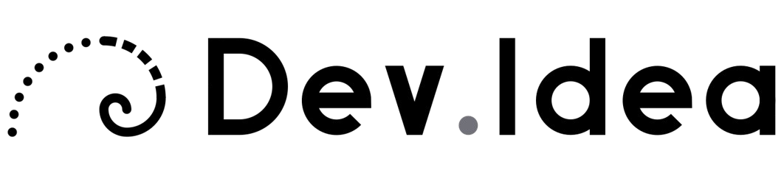

<div align="center">



# Dev.Idea

**Lienzo interactivo para planificar software paso a paso, pensado para quien empieza.**
Convierte una idea difusa en un _blueprint_ técnico: requisitos, stack, base de datos, arquitectura, diagramas, diseño y despliegue, eligiendo entre cartas.

<br />

[](https://nextjs.org)
[](https://tailwindcss.com)
[](https://ai.google.dev)
[](https://supabase.com)
[](https://github.com/pmndrs/zustand)
[](https://pnpm.io)

<br />

[¿Qué es?](#-qué-es-devidea) ·
[Funcionalidades](#-funcionalidades) ·
[Estaciones](#-mapa-de-estaciones) ·
[Stack](#-stack-tecnológico) ·
[Inicio rápido](#-inicio-rápido) ·
[Estructura](#-estructura-del-proyecto)

</div>

---

## 🎯 ¿Qué es Dev.Idea?

Mucha gente que empieza a programar, o que construye con IA ("vibe coding"), se lanza a escribir código sin saber qué requisitos tiene su proyecto, qué arquitectura le conviene o qué diagramas necesita. **Dev.Idea** propone un **mapa de 14 estaciones encadenadas**: en cada una, **Google Gemini** genera **6 cartas** adaptadas a tu idea y a todo lo que elegiste antes, y tú decides.

- Cada carta explica la opción **"en simple"**, con ventajas, desventajas y las tecnologías involucradas (con su logo).
- Cada estación tiene un botón **"¿Qué es?"**: **Strobi**, el copiloto, se mueve al lado y explica el concepto (qué es un stack, qué es la arquitectura, qué son los requisitos...), dónde se ve en la universidad y cómo se usa en la industria.
- Combina **temario universitario** (ERS / IEEE 830, UML, modelo entidad-relación, Scrum, RUP) con **práctica de la industria** (C4, BaaS, CI/CD, copilots de IA).
- Recomienda en proporción al proyecto: una landing no recibe diagramas de componentes ni de despliegue, y si eliges no usar base de datos no se propone un diagrama entidad-relación.

---

## ⚡ Funcionalidades

- **Mazo de cartas barajable:** las 6 opciones de cada estación viven en un mazo de altura fija. Se navega con flechas, con los indicadores numerados, con el teclado (← →) o deslizando en móvil, y el botón de confirmar no se mueve nunca. Solo se montan las 3 cartas visibles, así que el rendimiento no depende del número de opciones.
- **Selección única o múltiple:** requisitos, historias de usuario y diagramas permiten elegir varias cartas. Ninguna carta viene preseleccionada.
- **Backlog de historias de usuario:** en lugar de cartas, una tabla con checks, criterios de aceptación y puntos; se pueden generar más historias por categoría y copiar la selección como tareas (GitHub Projects) o como tabla Markdown.
- **Encadenamiento contextual (*Chain-of-Context*):** cada estación se calcula sobre las anteriores con salidas estructuradas (**JSON Schema**) y un saneamiento de respaldo.
- **Strobi explica cada estación:** panel "¿Qué es?" con concepto, analogía, ideas clave, universidad vs. industria y un consejo. Se cierra con la X, con Escape o al confirmar.
- **Logos de tecnologías:** catálogo curado de [Simple Icons](https://simpleicons.org) en stacks, bases de datos, deploy y herramientas.
- **Diagramas dibujados:** cada diagrama recomendado incluye un ejemplo en **Mermaid** que se dibuja en un modal (la librería se carga solo al abrirlo).
- **Lenguaje visual real:** en la estación de estilo, cada carta adopta su propio material (glassmorphism, neobrutalismo, aurora, terminal...).
- **Login con Google + autoguardado:** con sesión iniciada (Supabase Auth), cada cambio se guarda solo en la nube, incluidas todas las cartas generadas, para retomar el mapa completo en otro dispositivo. Sin sesión, todo queda en `localStorage`.
- **Modo consulta y reescritura:** las estaciones ya superadas se pueden revisar; "Reescribir desde aquí" descarta lo calculado después.
- **Mapa de ruta:** panel lateral con el recorrido en zigzag para saltar entre estaciones completadas.
- **Cancelación en tiempo real:** `AbortController` para pausar una generación en curso.

---

## 🧭 Mapa de Estaciones

```mermaid
flowchart LR
    A["0 · Idea"] --> B["1 · Naming<br/><i>opcional</i>"]
    B --> C["2 · Requisitos"]
    C --> D["3 · Historias<br/><i>opcional</i>"]
    D --> E["4 · Stack"]
    E --> F["5 · Base de datos"]
    F --> G["6 · Arquitectura"]
    G --> H["7 · Metodología<br/><i>opcional</i>"]
    H --> I["8 · Diagramas"]
    I --> J["9 · Estilo visual"]
    J --> K["10 · Layout"]
    K --> L["11 · Deploy"]
    L --> M["12 · Ecosistema IA"]
    M --> N["⭐ 13 · ¡A Trabajar!"]

    style N fill:#8E75B2,stroke:#5b4a7a,color:#fff
```



| # | Estación | Qué decides | Selección |
|:-:|----------|-------------|-----------|
| 0 | **Idea** | Descripción y contexto (Académico, Startup / Trabajo, Personal / MVP). | Entrada |
| 1 | **Naming** | 6 nombres por estilo, o el tuyo propio. | Única · ⏭️ omitible |
| 2 | **Requisitos** | Módulos con requisitos funcionales (RF) y no funcionales (RNF), priorizados para el MVP. | Múltiple |
| 3 | **Historias de usuario** | Backlog en **tabla** (10 iniciales): "Como… quiero… para…", criterios de aceptación, prioridad y puntos. Botón para generar 5 más por categoría y copiar como tareas para GitHub Projects. | Checks · ⏭️ omitible |
| 4 | **Stack** | Combinaciones de tecnologías por dificultad, con el lenguaje a elegir. | Única |
| 5 | **Base de datos** | Sin base de datos, relacional, documental, BaaS o embebida. Condiciona los diagramas. | Única |
| 6 | **Arquitectura** | Patrones reales del stack elegido (MVC, MVT, capas, monolito modular, hexagonal...). | Única |
| 7 | **Metodología** | Kanban, Scrum, Shape Up, XP, RUP... según equipo y contexto. | Única · ⏭️ omitible |
| 8 | **Diagramas** | UML, C4, ERD, DFD, BPMN, wireflow, user journey... proporcionales al proyecto. | Múltiple |
| 9 | **Estilo visual** | 6 lenguajes visuales; cada carta se ve con su propio estilo. | Única |
| 10 | **Layout** | Distribución de pantallas coherente con el estilo y los requisitos. | Única |
| 11 | **Deploy** | Planes con costo inicial $0 y el código en GitHub. | Única |
| 12 | **Ecosistema IA** | Modelos para el producto y copilots para programar. | Única |
| ⭐ | **¡A Trabajar!** | Blueprint final (en desarrollo). | — |

---

## 🧰 Stack Tecnológico

| Capa | Tecnología | Rol |
|------|------------|-----|
| **Framework** | Next.js 16 (App Router) | Full-stack en JavaScript (`.jsx` / `.js`), rutas API para Gemini y proyectos. |
| **Estilos** | Tailwind CSS 4 | Diseño responsivo y tarjetas por estilo visual. |
| **Animaciones** | Framer Motion | Mazo de cartas, transiciones y paneles. |
| **IA** | Google Gemini (Vertex AI REST) | Pool de modelos con fallback, `responseSchema` y validación. |
| **Auth y datos** | Supabase | Login con Google, tablas `projects` / `blueprints` con RLS. |
| **Estado** | Zustand + `persist` | Estado global, caché local y migraciones de versión. |
| **Iconos** | Lucide + Simple Icons | Interfaz y logos oficiales de tecnologías. |
| **Diagramas** | Mermaid | Ejemplos dibujados de cada diagrama recomendado. |
| **Copiloto** | `@bible-strong/avatar-web` | Avatar procedural de Strobi. |

---

## 🚀 Inicio Rápido

### Requisitos previos

- [Node.js](https://nodejs.org) 20 o superior
- [pnpm](https://pnpm.io)
- Una API key de Google Cloud con acceso a Gemini en Vertex AI
- (Opcional) Un proyecto de [Supabase](https://supabase.com) para login y guardado en la nube

### 1️⃣ Instalar dependencias

```bash
pnpm install
```

### 2️⃣ Variables de entorno

Crea un archivo `.env.local` en la raíz:

```env
GEMINI_API_KEY=tu_api_key
GOOGLE_CLOUD_PROJECT=tu_proyecto_de_google_cloud

# Opcional: login con Google y autoguardado
NEXT_PUBLIC_SUPABASE_URL=https://tu-proyecto.supabase.co
NEXT_PUBLIC_SUPABASE_ANON_KEY=tu_anon_key
```

### 3️⃣ Base de datos (Supabase)

- **Proyecto nuevo:** ejecuta [`supabase/schema.sql`](supabase/schema.sql) en el SQL Editor.
- **Proyecto existente:** ejecuta una vez [`supabase/migrations/20261116_estaciones_v3.sql`](supabase/migrations/20261116_estaciones_v3.sql), que añade las columnas de las nuevas estaciones y las cartas generadas.
- Activa el proveedor **Google** en *Authentication → Providers*.

### 4️⃣ Iniciar en local

```bash
pnpm dev
```

Abre [http://localhost:3000](http://localhost:3000) y escribe tu idea. 🎉

### 🐳 Docker

```bash
docker compose up --build
```

---

## 🗂️ Estructura del Proyecto

```text
src/
├── app/
│   ├── api/generate-step/     # Genera las cartas de una estación con Gemini
│   ├── api/projects/          # CRUD de proyectos en Supabase (con el JWT del usuario)
│   └── page.jsx               # Layout principal: cabecera, Strobi, mapa y lienzo
├── components/
│   ├── companion/             # Strobi: avatar, burbuja y panel "¿Qué es?"
│   ├── map/deck/CardDeck.jsx  # Mazo de cartas común a todas las estaciones
│   ├── map/stations/          # OptionStation (genérica) + estaciones con contenido propio
│   ├── navigation/            # Barra de controles, mapa de ruta, estado del autoguardado
│   └── ui/                    # TechChip (logos), esqueletos
├── config/stations.config.js  # Registro único de estaciones (orden, claves, columnas)
├── data/stationGuides.js      # Explicaciones de Strobi por estación
├── hooks/                     # Store de Zustand, navegación y autoguardado
├── lib/
│   ├── prompts.js             # Prompts por estación
│   ├── stepSchemas.js         # responseSchema de Gemini por estación
│   ├── stepContracts.js       # Saneamiento de las respuestas
│   ├── gemini.js              # Pool de modelos con presupuesto de tiempo y fallback
│   └── techIcons.js           # Catálogo curado de logos (Simple Icons)
└── services/projectService.js # Auth con Google y llamadas a /api/projects
supabase/
├── schema.sql                 # Esquema completo
└── migrations/                # Cambios para bases existentes
```

**Añadir una estación:** regístrala en `stations.config.js`, añade su prompt en `prompts.js`, su esquema en `stepSchemas.js`, su guía en `stationGuides.js` y, si necesita columna propia, una migración en `supabase/migrations/`. Si sus cartas no necesitan contenido especial, `OptionStation` la dibuja sola.

---

## 📄 Licencia

Distribuido bajo la licencia **MIT**.

<div align="center">

**MIT © 2026 Dev.Idea**

<sub>Hecho para quienes prefieren entender antes de construir.</sub>

</div>
