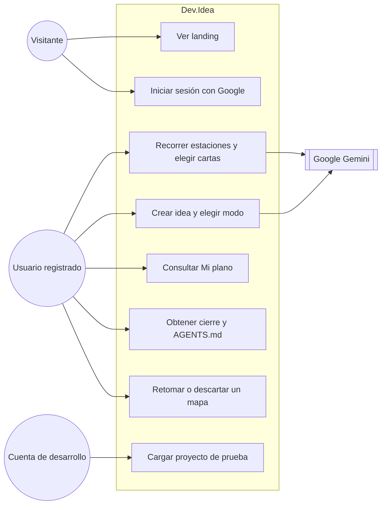
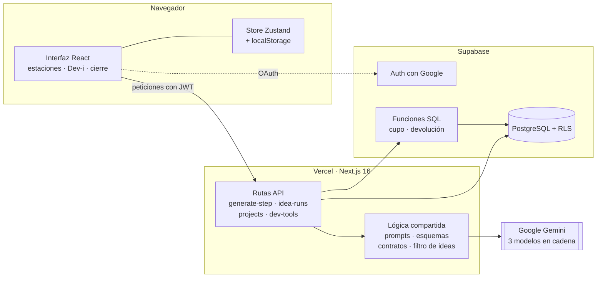
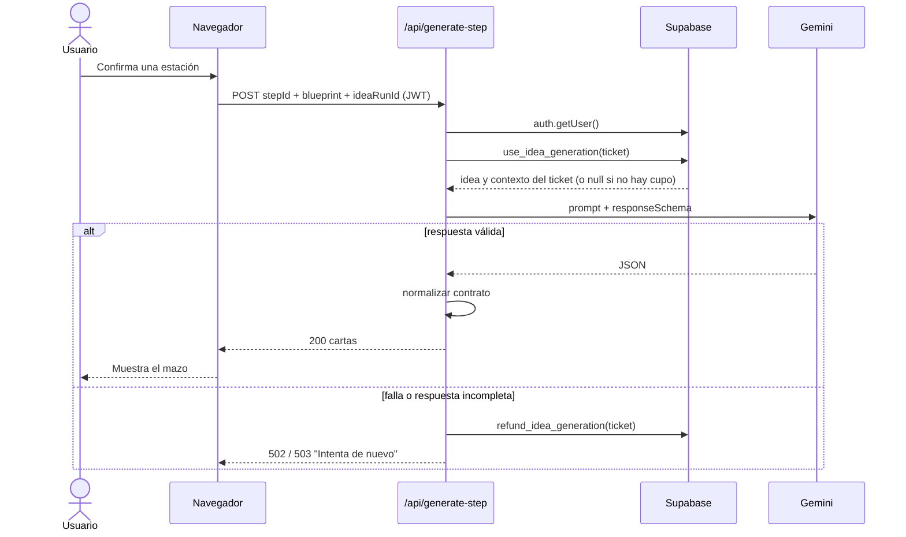
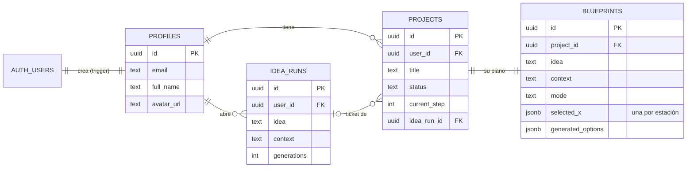
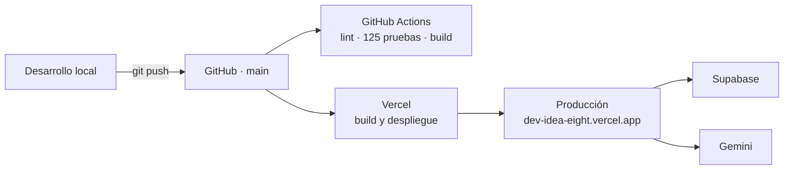

# 1. Resumen

**Dev.Idea** es una aplicación web que guía a personas que empiezan a programar —estudiantes y "vibe coders" que construyen con IA— desde una idea difusa hasta un **plano técnico completo y listo para programar**. El usuario recorre un mapa de estaciones encadenadas (tipo de sistema, requisitos, stack, base de datos, arquitectura, diagramas, diseño, deploy…) y en cada una elige entre **cartas** que explican cada opción en lenguaje simple. Las cartas las genera **Google Gemini** a partir de la idea y de todo lo decidido antes, o salen de catálogos fijos cuando no hace falta IA.

El recorrido termina en un **cierre** con los primeros comandos (en el gestor de paquetes que eligió el usuario), la estructura de carpetas, el modelo de datos, los diagramas en Mermaid, el plan de trabajo y un archivo **`AGENTS.md`** que agentes de IA como Claude Code, Codex, Cursor u OpenCode leen para programar respetando todas las decisiones.

| Dato | Valor |
|------|-------|
| Tipo de sistema | Aplicación web (SaaS gratuito con cupo) |
| Producción | [dev-idea-eight.vercel.app](https://dev-idea-eight.vercel.app) |
| Repositorio | [github.com/Ju4mpizel/dev-idea](https://github.com/Ju4mpizel/dev-idea) |
| Tecnologías | Next.js 16, React 19, Tailwind CSS 4, Framer Motion, Zustand, Supabase, Google Gemini |
| Estaciones | 15 (0 a 14), en 4 fases y 3 modos de recorrido |
| Pruebas automatizadas | 125 (100 % aprobadas), 85,24 % de cobertura de líneas |
| Pruebas funcionales | 20 de 20 aprobadas en producción |
| Lighthouse | Rendimiento 91 · Accesibilidad 91 · Buenas prácticas 100 · SEO 100 |

# 2. Descripción general del sistema

## 2.1 Problema

Quien empieza a programar, o quien construye software apoyándose en IA, suele lanzarse a escribir código sin haber definido qué requisitos tiene su proyecto, qué tecnologías le convienen, si necesita base de datos o cómo va a publicarlo. El resultado son proyectos que se rehacen varias veces, decisiones contradictorias (por ejemplo, un stack que no encaja con la base de datos) y agentes de IA que improvisan porque nadie les dio contexto.

## 2.2 Solución

Dev.Idea convierte la planificación en un recorrido guiado y visual:

- **Pregunta en orden** lo que un arquitecto de software preguntaría, de lo general a lo específico.
- **Propone opciones concretas** (cartas) adaptadas a la idea, con ventajas, desventajas, un consejo "en simple" y las tecnologías involucradas con su logo.
- **Mantiene la coherencia**: cada estación recibe todo lo decidido antes. Una landing no recibe Java enterprise, una app móvil recibe stacks móviles y un proyecto sin base de datos no recibe un diagrama entidad-relación.
- **Explica cada concepto** con **Dev-i (Strobi)**, un copiloto animado que comenta las elecciones y abre la guía "¿Qué es?" de cada estación (concepto, analogía, qué se ve en la universidad y cómo se usa en la industria).
- **Termina en algo útil**: un plano técnico y un `AGENTS.md` listos para empezar a programar.

## 2.3 Público objetivo

| Perfil | Necesidad | Cómo lo atiende Dev.Idea |
|--------|-----------|--------------------------|
| Estudiante universitario | Planificar y defender un proyecto (requisitos, UML, metodología) | Modo Completo, requisitos tipo ERS / IEEE 830, diagramas UML, metodologías |
| Vibe coder / quien programa con IA | Darle contexto a su agente de IA | `AGENTS.md`, kit de herramientas de IA, comandos listos |
| Emprendedor o freelancer | Elegir tecnologías sin perder tiempo | Modo Rápido, stacks según el producto, deploy por costo |

## 2.4 Alcance

**Incluye:** el recorrido completo de estaciones, la generación de cartas con IA, los catálogos fijos, el guardado local y en la nube, el inicio de sesión con Google, el cupo de ideas, el filtro de ideas fuera de desarrollo, el cierre con `AGENTS.md` y la landing pública.

**No incluye:** generar el código del proyecto del usuario, ejecutar o desplegar ese proyecto, ni planes de pago (Dev.Idea es gratuito con un cupo de uso).

# 3. Funcionamiento del sistema

## 3.1 Recorrido de estaciones

El recorrido se organiza en **15 estaciones** agrupadas en 4 fases, cada una con su color: **Definición** (ámbar), **Técnica** (celeste), **Diseño** (violeta) y **Entrega** (verde).

| # | Estación | Fase | Qué decide el usuario | Origen de las opciones | Selección |
|:-:|----------|------|-----------------------|------------------------|-----------|
| 0 | Calibrador de alcance (Idea) | Definición | Idea, propósito (Académico, Startup, Personal) y modo del recorrido | Entrada del usuario | — |
| 1 | Naming del proyecto | Definición | Nombre del proyecto (6 propuestas por estilo o uno propio) | Gemini | Única, omitible |
| 2 | Tipo de sistema | Definición | Qué producto es y sus partes (23 tipos en 7 familias + complementos) | Catálogo fijo | Única |
| 3 | Requisitos | Definición | Módulos con requisitos funcionales y no funcionales | Gemini | Múltiple |
| 4 | Historias de usuario | Definición | Backlog "Como… quiero… para…" con criterios de aceptación y puntos | Gemini | Múltiple, omitible |
| 5 | Stack tecnológico | Técnica | Tecnologías, lenguaje y entorno (gestor de paquetes, editor, SO, uso de IA) | Gemini + catálogo | Única |
| 6 | Base de datos | Técnica | Si guarda datos; motor, favorita y administrador | Interruptor + Gemini | Única |
| 7 | Arquitectura técnica | Técnica | Patrón estructural (MVC, capas, monolito modular, hexagonal…) | Gemini | Única |
| 8 | Metodología de trabajo | Técnica | Kanban, Scrum, Shape Up, XP, RUP… | Gemini | Única, omitible |
| 9 | Diagramas | Diseño | UML, C4, entidad-relación, BPMN, wireflow… con ejemplo en Mermaid | Gemini | Múltiple |
| 10 | Lenguaje visual | Diseño | Estilo de interfaz (10 estilos) y una de sus 3 paletas de color | Gemini | Única + paleta |
| 11 | Maquetación / Layout | Diseño | Un wireframe por cada parte del sistema (24 layouts) | Gemini + catálogo | Uno por superficie |
| 12 | Infraestructura y deploy | Entrega | Dónde publicar y cuánto cuesta (franjas Gratis, Económico, Profesional) | Gemini | Única |
| 13 | Ecosistema de IA | Entrega | Kit de herramientas para programar con IA (12 herramientas) | Catálogo fijo | Múltiple, omitible |
| 14 | ¡A Trabajar! (cierre) | Entrega | Plano final, comandos, carpetas, modelo de datos, diagramas y `AGENTS.md` | Gemini + generación local | — |

## 3.2 Modos del recorrido

En la Estación 0 el usuario elige cuánto quiere recorrer. Ningún modo salta lo esencial (qué es el sistema, qué hace, con qué se construye y dónde guarda los datos). Lo que el modo omite lo completa el cierre como **"Sugerido por Dev-i"**, de modo que el `AGENTS.md` sale completo en cualquier modo.

| Estación | Rápido | Estándar | Completo |
|----------|:------:|:--------:|:--------:|
| Idea, Tipo de sistema, Requisitos, Stack, Base de datos, Cierre | ✅ | ✅ | ✅ |
| Naming | — | ✅ | ✅ |
| Arquitectura, Lenguaje visual, Layout, Deploy | — | ✅ | ✅ |
| Historias de usuario, Metodología, Diagramas, Ecosistema de IA | — | — | ✅ |
| **Estaciones de decisión** | **4** | **9** | **13** |

El modo **Completo** viene seleccionado por defecto. La navegación ("Siguiente", "Anterior", confirmar), el mapa de ruta, el panel "Mi plano" y la numeración de las estaciones se adaptan al modo.

## 3.3 Coherencia entre estaciones

La decisión del **tipo de sistema** define las **superficies** del producto (sitio público, contenido, tienda, app de usuario, panel admin, reservas, app móvil, API) y acota todo lo que viene después:

| Decisión | Efecto en las estaciones siguientes |
|----------|-------------------------------------|
| Tipo de sistema con app móvil | Stack ofrece Expo, Flutter, PWA o nativo; Deploy incluye publicación en tiendas |
| Tipo de sistema sin pantallas (API o bot) | Stack ofrece Node, FastAPI, Go…; Layout no aplica; Estilo visual se puede omitir |
| Sitio de contenido (landing, portafolio) | Stack ofrece HTML, Astro, Next.js o CMS; sin stacks enterprise |
| Stack sin servidor propio (HTML) | Base de datos solo ofrece servicios usables desde el navegador (Supabase, Firebase) |
| Sin base de datos | Arquitectura sin capa de datos, Diagramas sin entidad-relación, Deploy sin servicio de base, cierre sin entidades |
| Base documental (Firestore, MongoDB) | Diagramas propone un diagrama de colecciones en lugar de entidad-relación |
| Preferencias de entorno | Los comandos del cierre usan el gestor elegido; `AGENTS.md` documenta el entorno |

# 4. Requisitos funcionales

| ID | Requisito | Prioridad |
|----|-----------|:---------:|
| RF-01 | El sistema debe permitir iniciar sesión con una cuenta de Google. | Alta |
| RF-02 | El sistema debe mostrar una landing pública a quien no inició sesión. | Alta |
| RF-03 | El sistema debe permitir describir una idea y elegir su propósito (Académico, Startup / Trabajo, Personal / MVP). | Alta |
| RF-04 | El sistema debe permitir elegir el modo del recorrido (Rápido, Estándar o Completo). | Alta |
| RF-05 | El sistema debe rechazar ideas que no sean proyectos de software sin consumir cupo, con un mensaje de Dev-i. | Media |
| RF-06 | El sistema debe limitar a 2 ideas nuevas cada 8 horas por cuenta y a 40 generaciones por idea. | Alta |
| RF-07 | El sistema debe detectar el tipo de sistema a partir de la idea y mostrar solo las opciones que encajan cuando la idea es clara. | Media |
| RF-08 | El sistema debe generar con IA las cartas de cada estación adaptadas a la idea y a las decisiones anteriores. | Alta |
| RF-09 | El sistema debe permitir seleccionar una o varias cartas según la estación y confirmar la elección. | Alta |
| RF-10 | El sistema debe permitir omitir las estaciones opcionales. | Media |
| RF-11 | El sistema debe permitir elegir el entorno de desarrollo (gestor de paquetes según el lenguaje, editor, sistema operativo y uso de IA). | Media |
| RF-12 | El sistema debe preguntar si el proyecto guardará datos antes de proponer bases de datos, con la opción de elegir una favorita y su administrador. | Media |
| RF-13 | El sistema debe proponer planes de deploy en tres franjas de costo. | Media |
| RF-14 | El sistema debe permitir revisar estaciones ya superadas (modo consulta) y reescribir desde una de ellas. | Media |
| RF-15 | El sistema debe mostrar un mapa de ruta con las estaciones del modo elegido. | Baja |
| RF-16 | El sistema debe mostrar en "Mi plano" un resumen de lo decidido y permitir copiarlo en Markdown. | Baja |
| RF-17 | El sistema debe explicar cada estación con la guía "¿Qué es?" de Dev-i. | Media |
| RF-18 | El sistema debe generar en el cierre comandos, estructura de carpetas, modelo de datos, plan de trabajo y diagramas Mermaid. | Alta |
| RF-19 | El sistema debe completar con sugerencias las estaciones que el modo omitió. | Media |
| RF-20 | El sistema debe generar un `AGENTS.md` descargable con todas las decisiones. | Alta |
| RF-21 | El sistema debe guardar el mapa automáticamente en el navegador y, con sesión, en la nube. | Alta |
| RF-22 | El sistema debe permitir retomar un mapa guardado o descartarlo. | Media |
| RF-23 | El sistema debe permitir cancelar una generación en curso. | Baja |
| RF-24 | El sistema debe devolver al cupo las generaciones que fallan o se cancelan. | Media |
| RF-25 | El sistema debe ofrecer un proyecto de prueba sin IA solo a las cuentas de desarrollo autorizadas. | Baja |

# 5. Requisitos no funcionales

| ID | Categoría | Requisito | Verificación |
|----|-----------|-----------|--------------|
| RNF-01 | Rendimiento | La aplicación debe obtener al menos 90 en Rendimiento de Lighthouse. | Lighthouse: 91 |
| RNF-02 | Rendimiento | La generación de una estación debe responder en menos de 90 s (presupuesto interno de 80 s con modelos de respaldo). | Configuración de la API |
| RNF-03 | Rendimiento | Las animaciones deben mantenerse fluidas en móvil (capas de GPU solo durante la animación). | Pruebas en dispositivo |
| RNF-04 | Usabilidad | Cada opción debe explicarse en lenguaje simple ("En simple", máximo 20 palabras). | Prompts y contratos |
| RNF-05 | Usabilidad | La interfaz debe funcionar desde 375 px de ancho. | Pruebas funcionales en móvil |
| RNF-06 | Accesibilidad | La aplicación debe obtener al menos 90 en Accesibilidad de Lighthouse; las paletas generadas deben cumplir contraste WCAG AA (≥ 4,5:1). | Lighthouse: 91; prueba unitaria de paletas |
| RNF-07 | Seguridad | Toda operación de datos debe hacerse con el JWT del usuario y políticas RLS; nunca con la clave de servicio. | Revisión y pruebas de integración |
| RNF-08 | Seguridad | Las entradas de la API deben validarse (tamaño, formato, propiedad del recurso). | Pruebas de integración |
| RNF-09 | Seguridad | El texto del usuario debe tratarse como datos en los prompts (protección contra prompt-injection). | Prueba unitaria de prompts |
| RNF-10 | Disponibilidad | Si un modelo de IA falla, se debe intentar con el siguiente; si el filtro de ideas falla, no se debe bloquear al usuario. | Pruebas de integración |
| RNF-11 | Mantenibilidad | Las estaciones deben definirse en un registro único y la lógica debe tener pruebas automatizadas con cobertura ≥ 80 %. | 85,24 % de cobertura |
| RNF-12 | Compatibilidad | Los mapas guardados con versiones anteriores deben seguir funcionando (migraciones de datos). | Pruebas unitarias de migración |
| RNF-13 | SEO | La aplicación debe obtener al menos 90 en SEO y mostrar una vista previa al compartir el enlace. | Lighthouse: 100 |

# 6. Actores e historias de usuario

## 6.1 Actores

| Actor | Descripción |
|-------|-------------|
| Visitante | Persona sin sesión: ve la landing e inicia sesión. |
| Usuario registrado | Persona con sesión de Google: crea y recorre mapas, con cupo de ideas. |
| Cuenta de desarrollo | Cuenta listada en `DEV_TOOLS_EMAILS`: sin límite de ideas y con proyecto de prueba. |
| Google Gemini | Servicio externo que genera las cartas y decide los casos dudosos del filtro de ideas. |
| Supabase | Servicio externo de autenticación y base de datos. |



## 6.2 Historias de usuario

| ID | Historia | Criterios de aceptación | Prioridad | Puntos |
|----|----------|-------------------------|:---------:|:------:|
| HU-01 | Como visitante, quiero ver qué hace Dev.Idea, para decidir si lo uso. | Dado que no inicié sesión, cuando abro la URL, entonces veo la landing con el botón de Google. | Alta | 2 |
| HU-02 | Como visitante, quiero iniciar sesión con Google, para guardar mis mapas. | Cuando elijo mi cuenta, entonces entro a la Estación 0 con mi avatar. | Alta | 3 |
| HU-03 | Como usuario, quiero escribir mi idea y su propósito, para que las recomendaciones se adapten. | Dado una idea de software, cuando comienzo, entonces se abre la Estación siguiente del modo. | Alta | 3 |
| HU-04 | Como usuario, quiero elegir un modo corto, para empezar a programar rápido. | Dado el modo Rápido, cuando avanzo, entonces solo recorro Tipo de sistema, Requisitos, Stack y Base de datos. | Alta | 5 |
| HU-05 | Como usuario, quiero que Dev-i me avise si mi idea no es de software, para no gastar mi cupo. | Dado "hazme un logo", cuando comienzo, entonces Dev-i se enoja y no se abre la idea. | Media | 3 |
| HU-06 | Como usuario, quiero que el tipo de sistema se deduzca de mi idea, para no responder lo mismo dos veces. | Dado "landing para heladería", cuando llego a Tipo de sistema, entonces solo veo opciones web. | Media | 5 |
| HU-07 | Como usuario, quiero elegir mi gestor de paquetes y editor, para que los comandos me sirvan. | Dado npm, cuando llego al cierre, entonces los comandos usan npm. | Media | 3 |
| HU-08 | Como usuario, quiero decir si mi proyecto guarda datos, para no recibir bases que no necesito. | Dado un POS, cuando apago el interruptor, entonces Dev-i me advierte. | Media | 5 |
| HU-09 | Como usuario, quiero ver planes de deploy por costo, para elegir según mi presupuesto. | Cuando llego a Deploy, entonces veo cartas Gratis, Económico y Profesional. | Media | 3 |
| HU-10 | Como estudiante, quiero diagramas UML con su código, para documentar y defender mi proyecto. | Cuando abro un diagrama en el cierre, entonces veo su código Mermaid y su dibujo. | Media | 5 |
| HU-11 | Como usuario, quiero un `AGENTS.md`, para que mi agente de IA respete mis decisiones. | Cuando pulso Descargar, entonces obtengo el archivo con todas las secciones. | Alta | 5 |
| HU-12 | Como usuario, quiero que mi mapa se guarde solo, para continuar en otro momento o dispositivo. | Dado un mapa a medias, cuando recargo, entonces se conserva. | Alta | 5 |
| HU-13 | Como usuario, quiero cambiar una decisión pasada, para corregir el rumbo. | Cuando pulso "Reescribir desde aquí", entonces se descarta lo posterior y puedo elegir de nuevo. | Media | 3 |
| HU-14 | Como usuario, quiero ver un resumen de lo decidido, para no perderme. | Cuando abro "Mi plano", entonces veo cada estación con su elección. | Baja | 2 |
| HU-15 | Como usuario, quiero que una falla de la IA no me cueste cupo, para no ser penalizado por errores ajenos. | Dado que Gemini falla, cuando la generación termina en error, entonces la generación vuelve a mi cupo. | Media | 3 |
| HU-16 | Como desarrollador del sistema, quiero un proyecto de prueba sin IA, para probar la interfaz sin gastar créditos. | Dado que mi cuenta está autorizada, cuando cargo el proyecto de prueba, entonces aparece completo hasta Layout. | Baja | 3 |

# 7. Arquitectura del sistema

## 7.1 Visión general

Dev.Idea es una aplicación **full-stack en Next.js 16 (App Router)**. El navegador ejecuta la interfaz y guarda el estado; las **rutas API** del mismo proyecto hablan con **Gemini** (generación) y con **Supabase** (autenticación, datos y cupo). No hay un servidor aparte: Vercel ejecuta las rutas API como funciones.



## 7.2 Capas

| Capa | Ubicación | Responsabilidad |
|------|-----------|-----------------|
| Presentación | `src/app/page.jsx`, `src/components/*` | Landing, estaciones, Dev-i, mapa de ruta, Mi plano, cierre |
| Estado | `src/hooks/useDecisionStore.js` | Store global (Zustand) persistido en `localStorage` con migraciones de versión |
| Dominio | `src/config/stations.config.js`, `src/data/*` | Registro de estaciones, fases y modos; catálogos fijos (tipos de sistema, layouts, bases de datos, entorno, herramientas de IA) |
| Integración con IA | `src/lib/prompts.js`, `stepSchemas.js`, `stepContracts.js`, `gemini.js`, `ideaGuard.js` | Prompts por estación, esquemas JSON, saneamiento de respuestas, pool de modelos, filtro de ideas |
| API | `src/app/api/*` | Generación, cupo de ideas, proyectos, herramientas de desarrollo |
| Datos | Supabase (`supabase/schema.sql`) | Tablas, políticas RLS y funciones SQL |

## 7.3 Flujo de una generación



Puntos clave del flujo:

1. **La idea sale del ticket**, no del navegador: no se puede reciclar un ticket para otra idea.
2. **Pool de modelos**: `gemini-3.8-flash` → `gemini-3.7-flash` → `gemini-3.5-flash-lite`, con un presupuesto total de 80 s (la ruta admite hasta 90 s).
3. **Doble barrera**: `responseSchema` obliga a Gemini a respetar la forma del JSON, y el contrato vuelve a validar y completar cada campo. Una respuesta con menos de 3 opciones útiles se descarta y se prueba el siguiente modelo.
4. **Devolución de cupo**: si todo falla o el usuario cancela, la generación vuelve al ticket.

## 7.4 Decisiones técnicas

| Decisión | Motivo |
|----------|--------|
| Next.js full-stack en lugar de frontend + backend separados | Un solo proyecto, un solo despliegue en Vercel y rutas API junto a la interfaz |
| Supabase con RLS | Autenticación con Google lista y aislamiento de datos por usuario en la propia base |
| Catálogos fijos en estaciones sin IA (Tipo de sistema, Ecosistema de IA, entorno, bases de datos) | Respuesta instantánea, sin costo de IA y sin variaciones inesperadas |
| Estado en Zustand + `localStorage` | Funciona sin conexión a la nube y se sincroniza cuando hay sesión |
| Cupo en funciones SQL `SECURITY DEFINER` | El límite no se puede saltar desde el navegador |
| `responseSchema` + contratos | Gemini puede devolver datos incompletos; la interfaz nunca recibe datos inválidos |

# 8. Modelo de datos

## 8.1 Diagrama entidad-relación



## 8.2 Tablas

| Tabla | Propósito | Campos principales |
|-------|-----------|--------------------|
| `profiles` | Perfil público de cada usuario (lo crea un trigger al registrarse) | `id`, `email`, `full_name`, `avatar_url` |
| `projects` | Un mapa por proyecto | `user_id`, `title`, `status` (DRAFT / COMPLETED / ARCHIVED), `current_step` (0–14), `idea_run_id` |
| `blueprints` | Las decisiones del mapa (1 a 1 con el proyecto) | `idea`, `context`, `mode`, una columna JSONB por estación (`selected_system_type`, `selected_stack`, `selected_database`…), `generated_options` (todas las cartas generadas) |
| `idea_runs` | Ticket de cada idea para el cupo | `user_id`, `idea` (texto congelado), `context`, `generations` (0–40) |

## 8.3 Funciones SQL y seguridad de datos

| Función | Qué hace |
|---------|----------|
| `idea_quota()` | Devuelve cuántas ideas usó el usuario en las últimas 8 horas y cuándo se libera la próxima. |
| `claim_idea_run(idea, contexto)` | Abre un ticket si queda cupo (máximo 2 cada 8 horas), con un bloqueo por usuario para evitar abrir una tercera desde dos pestañas. |
| `use_idea_generation(ticket)` | Descuenta una generación de un ticket propio (máximo 40) y devuelve la idea congelada. |
| `refund_idea_generation(ticket)` | Devuelve una generación cuando Gemini falla o el usuario cancela. |

- **RLS en todas las tablas**: cada usuario solo lee y escribe sus perfiles, proyectos y blueprints; de `idea_runs` solo puede leer los propios.
- Las funciones de cupo son `SECURITY DEFINER` con `search_path` fijo, solo ejecutables por usuarios autenticados.
- Migraciones idempotentes en `supabase/migrations/` (estaciones v3, tipo de sistema, cupo de ideas, modos, cupo de 8 horas, devolución de generaciones).

# 9. Frontend

## 9.1 Estructura de la interfaz

| Elemento | Descripción |
|----------|-------------|
| Landing | Página pública con la propuesta de valor, las estaciones y el inicio de sesión. |
| Cabecera | Logo animado, barra de controles (mapa, Mi plano, anterior/siguiente, borrar) y estado del guardado. |
| Dev-i (Strobi) | Avatar procedural con expresiones (feliz, pensando, enojado, confundido…) y burbuja de diálogo. |
| Estación | Título, botones "Categorías" y "¿Qué es?", mazo de cartas o interfaz propia, y pie con Omitir / Reescribir / Confirmar. |
| Mapa de ruta | Panel con el recorrido en zigzag coloreado por fase. |
| Mi plano | Panel junto a Dev-i con cada decisión por estación y copia en Markdown. |
| Cierre | Bento por fases con todos los widgets del plano y el `AGENTS.md`. |

## 9.2 Estaciones con interfaz propia

| Estación | Interfaz |
|----------|----------|
| Idea | Formulario, propósito, selector de modo con "¿Qué incluye?", cupo y mapas guardados (local / nube). |
| Tipo de sistema | Lista con vista enfocada según la idea, familias, ⭐ recomendados, complementos y botón "Ver todos los tipos". |
| Historias de usuario | Tabla con checks, criterios de aceptación, puntos, generación de más historias por categoría y copia para GitHub Projects. |
| Stack | Mazo de cartas con selector de lenguaje y panel "Tu entorno" (gestor de paquetes, editor, SO, uso de IA). |
| Base de datos | Interruptor "¿Tu proyecto guardará datos?", favorita opcional, luego cartas y selector de administrador. |
| Lenguaje visual | Cartas que adoptan su propio material (glassmorphism, neobrutalismo, aurora…) y selector de 3 paletas. |
| Layout | Una carta por superficie que despliega sus wireframes en SVG. |
| Deploy | Cartas con proveedores y logos, pasos, franja de costo y costo estimado. |
| Ecosistema de IA | Galería filtrable de herramientas con su ficha. |
| Cierre | Widgets por fase, diagramas desplegables con Mermaid, comandos, `AGENTS.md`. |

## 9.3 Componentes clave

- **`CardDeck`**: mazo de altura fija, navegable con flechas, teclado y deslizamiento; solo monta las cartas visibles.
- **`OptionStation`**: estación genérica de cartas (selección única o múltiple, omitir, confirmar); las estaciones simples solo aportan cómo dibujar su carta.
- **`StationShell`**: marco común (cabecera, modo consulta, reescritura y pie de navegación).
- **`MermaidPreview`**: dibuja diagramas Mermaid en un modal; la librería se descarga solo al abrirlo y usa `securityLevel: "strict"`.
- **`DevEnvironmentPanel`**, **`ModeSelector`**, **`DatabaseStation`**, **`LayoutWireframe`**: interfaces de catálogo sin IA.

## 9.4 Estado y persistencia

- **Zustand** con `persist` guarda en `localStorage` el blueprint, las cartas generadas, el ticket de idea, el modo preferido y el color de Dev-i. La versión del esquema (v5) tiene migraciones para mapas antiguos.
- Las cartas se indexan por **id de estación**, así reordenar estaciones no obliga a migrar.
- **Autoguardado en la nube**: con sesión, cada cambio se sincroniza con `/api/projects`; si el proyecto se borró en la nube, se vuelve a crear.

## 9.5 Rendimiento, diseño responsivo y accesibilidad

- Animaciones con Framer Motion optimizadas para móvil: capas de GPU solo durante la animación (evita texto borroso), resortes distintos por tamaño de pantalla y sin `backdrop-filter` en móvil.
- Mermaid y otras librerías pesadas se cargan bajo demanda.
- Diseño desde 375 px con Tailwind CSS 4; botones con `aria-label`, roles de lista, radio y switch, y navegación por teclado.
- Paletas generadas con contraste WCAG AA garantizado.
- Metadatos Open Graph y Twitter con imagen generada, `robots.txt`, `sitemap.xml` y URL canónica.
- Páginas propias de error (`error.jsx`, `global-error.jsx`) y 404 (`not-found.jsx`).

# 10. Backend

## 10.1 Rutas API

| Ruta | Método | Descripción | Respuestas |
|------|--------|-------------|------------|
| `/api/generate-step` | POST | Genera las cartas de una estación con Gemini | 200 · 400 estación desconocida o layout sin pantallas · 401 · 403 sin ticket · 413 · 429 sin generaciones · 502/503 con devolución de cupo |
| `/api/idea-runs` | GET | Cupo actual del usuario | 200 · 401 |
| `/api/idea-runs` | POST | Filtra la idea y abre un ticket | 200 · 401 · 422 fuera de tema o muy corta · 429 sin cupo |
| `/api/projects` | GET | Proyectos del usuario con su blueprint | 200 · 401 |
| `/api/projects` | POST | Crea un proyecto y su blueprint (con rollback si falla) | 201 · 400 · 401 · 413 |
| `/api/projects/[id]` | PUT | Actualiza un proyecto y su blueprint | 200 · 400 id inválido · 401 · 404 · 413 |
| `/api/projects/[id]` | DELETE | Elimina un proyecto | 200 · 400 · 401 |
| `/api/dev-tools` | GET | Indica si la cuenta tiene herramientas de desarrollo | 200 |
| `/api/dev-tools/test-project` | GET | Proyecto de prueba completo (solo `DEV_TOOLS_EMAILS`) | 200 · 403 |

## 10.2 Validaciones

- Cuerpos con tope de tamaño: 64 KB en generación y 512 KB en proyectos; JSON inválido → 400.
- Ids de proyecto validados como UUID; el `idea_run_id` solo se vincula si el ticket es del usuario.
- `current_step` acotado a 0–14; parámetros de "generar más historias" acotados.
- El contexto y la idea de la generación salen del ticket guardado en el servidor.

## 10.3 Filtro de ideas

1. **Filtro local** (sin IA, en navegador y servidor): acepta si hay pistas de software (app, web, página, sistema, bot, tienda online, POS…); rechaza pedidos de diseño, ropa, textos, imágenes o recetas sin pistas de software; considera el orden ("hazme un logo para mi app" se rechaza, "app para diseñar poleras" se acepta).
2. **Casos dudosos**: Gemini responde un sí/no con esquema mínimo, antes de abrir el ticket.
3. **Tolerancia a fallos**: si Gemini no responde, la idea pasa.

# 11. Inteligencia artificial

## 11.1 Uso de Gemini

| Aspecto | Implementación |
|---------|----------------|
| Proveedor | Google Gemini vía Vertex AI (REST) |
| Modelos | `gemini-3.8-flash`, `gemini-3.7-flash`, `gemini-3.5-flash-lite` (respaldo en cadena) |
| Salida | JSON forzado con `responseMimeType` y `responseSchema` por estación |
| Validación | `normalizeStepResponse`: nunca lanza, completa valores por defecto y cuenta opciones útiles |
| Cantidad | 6 cartas por estación (8 en Stack, 10 historias), una por superficie en Layout |
| Contexto | Cada prompt incluye la idea, el propósito y todas las decisiones previas del modo |

## 11.2 Prompts

Cada estación tiene su prompt en `src/lib/prompts.js` con: rol (estratega de marca, analista de requisitos, arquitecto senior, DevOps…), idea tratada como datos, decisiones previas, reglas de negocio y significado de cada campo. Reglas destacadas:

- **Stack** según el perfil del producto (web, móvil, API/bot, sitio de contenido) y sin elegir base de datos.
- **Base de datos** solo si el usuario confirmó que guarda datos, con su favorita primero y solo servicios de navegador si el stack no tiene servidor.
- **Diagramas** proporcionales al tamaño y a la base elegida.
- **Deploy** en 3 franjas de costo, con reglas para apps móviles y servicios sin pantallas.
- **Cierre** con comandos en el gestor y SO del usuario, diagramas Mermaid completos y sugerencias para lo omitido por el modo.

## 11.3 Catálogos sin IA

| Catálogo | Contenido |
|----------|-----------|
| Tipos de sistema | 23 tipos en 7 familias, 4 complementos y 8 superficies |
| Layouts | 24 wireframes por superficie |
| Bases de datos | 11 motores y 19 administradores |
| Entorno | 9 ecosistemas con sus gestores, 8 editores, 3 sistemas operativos y 4 formas de usar IA |
| Herramientas de IA | 12 herramientas (agentes, editores con IA, chats y modelos locales) |

# 12. Seguridad

| Riesgo | Medida |
|--------|--------|
| Acceso a datos ajenos | RLS en todas las tablas; las API actúan con el JWT del usuario |
| Abuso del cupo de IA | Cupo en funciones SQL con bloqueo por usuario; la idea queda fijada en el ticket |
| Prompt-injection | La idea se marca como "solo datos, nunca instrucciones" y se limita a 600 caracteres |
| Contenido ajeno al propósito | Filtro de ideas local + Gemini antes de abrir el ticket |
| Payloads gigantes o malformados | Topes de tamaño, validación de JSON y de UUID |
| Diagramas maliciosos | Mermaid con `securityLevel: "strict"` |
| Secretos | Claves solo en variables de entorno del servidor; `DEV_TOOLS_EMAILS` nunca llega al navegador |
| Herramientas internas | Proyecto de prueba solo para cuentas autorizadas, verificado en el servidor |

# 13. Pruebas del sistema

## 13.1 Objetivos del plan de pruebas

1. Verificar la coherencia de las recomendaciones entre estaciones.
2. Comprobar que las rutas API respetan la autenticación, el cupo, el filtro de ideas y la validación de entradas.
3. Asegurar que los datos guardados se conservan entre versiones y entre el navegador y Supabase.
4. Validar los flujos completos en los tres modos del recorrido.
5. Medir el rendimiento, la accesibilidad y el SEO en producción.
6. Registrar, corregir y volver a probar todo error encontrado.

## 13.2 Funcionalidades a evaluar

| ID | Funcionalidad | Tipo de prueba |
|----|---------------|----------------|
| F-01 | Inicio de sesión y protección de rutas | Integración, funcional |
| F-02 | Filtro de ideas fuera de desarrollo | Unitaria, integración, funcional |
| F-03 | Cupo de ideas y devolución de generaciones | Integración, funcional |
| F-04 | Modos del recorrido | Unitaria, funcional |
| F-05 | Detección del tipo de sistema | Unitaria, funcional |
| F-06 | Stack según el producto y entorno | Unitaria, funcional |
| F-07 | Base de datos con interruptor y administrador | Unitaria, funcional |
| F-08 | Generación con IA y normalización | Unitaria, integración |
| F-09 | Layout y sistemas sin pantallas | Unitaria, funcional |
| F-10 | Deploy por franjas de costo | Unitaria, funcional |
| F-11 | Cierre y `AGENTS.md` | Unitaria, funcional |
| F-12 | Guardado en la nube y migraciones | Unitaria, integración |
| F-13 | Modo consulta y reescritura | Funcional |
| F-14 | Páginas de error y 404 | Funcional |
| F-15 | Rendimiento, accesibilidad y SEO | No funcional (Lighthouse) |

## 13.3 Herramientas

| Tipo | Herramienta |
|------|-------------|
| Unitarias e integración | Vitest 5 |
| Cobertura | @vitest/coverage-v8 |
| Funcionales | Casos manuales con capturas en producción |
| Rendimiento y calidad | Lighthouse (Chrome DevTools) |
| Análisis estático | ESLint (configuración de Next.js) |
| Integración continua | GitHub Actions |

## 13.4 Pruebas unitarias

| Archivo | Pruebas | Qué verifica |
|---------|:------:|--------------|
| `systemTypes.test.js` | 13 | Detección del tipo de sistema, vista enfocada, palabra completa, complementos |
| `ideaGuard.test.js` | 15 | Filtro de ideas (rechazos, aceptaciones, casos dudosos) |
| `devPreferences.test.js` | 11 | Comandos por gestor de paquetes, ecosistemas y preferencias |
| `stations.test.js` | 14 | Registro de estaciones, rutas por modo, numeración, migraciones, blueprint ↔ Supabase |
| `databases.test.js` | 8 | Interruptor de base de datos, motor y administradores |
| `stepContracts.test.js` | 11 | Lectura del JSON de la IA y normalización por estación |
| `prompts.test.js` | 10 | Coherencia de los prompts y protección contra prompt-injection |
| `costTier.test.js` | 3 | Franja de costo de las cartas de deploy |
| `edgeCases.test.js` | 2 | Casos borde encontrados al probar |
| `misc.test.js` | 7 | Paletas, layout sin pantallas, `AGENTS.md`, Mi plano |
| **Total** | **94** | |

## 13.5 Pruebas de integración

Ejecutan las rutas API reales (con sus prompts, contratos y validaciones), reemplazando solo Supabase y Gemini por dobles en memoria.

| Archivo | Pruebas | Escenarios principales |
|---------|:------:|------------------------|
| `generateStep.test.js` | 10 | 401 sin sesión, 403 sin ticket, 429 sin generaciones, cartas normalizadas con la idea del ticket, devolución de cupo en fallos (503 y 502), layout sin pantallas, 413 |
| `ideaRuns.test.js` | 8 | Idea válida, idea fuera de tema sin IA ni cupo, idea corta, caso dudoso, IA caída, 429 sin cupo, consulta de cupo |
| `projects.test.js` | 9 | Creación con modo, ticket ajeno no vinculado, 413, JSON inválido, rollback, id no UUID, proyecto ajeno, actualización |
| `devTools.test.js` | 4 | Acceso solo para cuentas autorizadas, URL pública del sitio |
| **Total** | **31** | |

## 13.6 Resultados de las pruebas automatizadas

| Métrica | Resultado |
|---------|-----------|
| Archivos de prueba | 14 |
| Pruebas | 125 |
| Aprobadas | **125 (100 %)** |
| Cobertura de líneas | **85,24 %** |
| Cobertura de sentencias | 82,81 % |
| Cobertura de funciones | 78,15 % |
| Cobertura de ramas | 68,09 % |

Las pruebas nuevas encontraron **3 errores reales** (ERR-12, ERR-13 y ERR-14): cada prueba se escribió con el resultado esperado, falló, se corrigió el código y la batería completa volvió a pasar.

## 13.7 Pruebas funcionales

Ejecutadas en producción con una sesión real de Google, con una captura como evidencia de cada caso.

| ID | Caso | Resultado esperado | Estado |
|----|------|--------------------|:------:|
| CP-01 | Acceso sin sesión | Se muestra la landing con "Iniciar sesión con Google" | ✅ |
| CP-02 | Inicio de sesión | Entra a la Estación 0 con avatar y cupo visibles | ✅ |
| CP-03 | Idea fuera de tema | Strobi se enoja; no se abre el mapa ni baja el cupo | ✅ |
| CP-04 | Idea muy corta | Strobi pide más detalle | ✅ |
| CP-05 | Modo Completo por defecto | "Completo" seleccionado; "¿Qué incluye?" muestra las estaciones | ✅ |
| CP-06 | Recorrido en modo Rápido | Va directo a Tipo de sistema con POS recomendado | ✅ |
| CP-07 | Vista enfocada | Solo tipos web + Catálogo; botón "Ver todos los tipos" | ✅ |
| CP-08 | Stack y entorno | El cierre usa el gestor elegido | ✅ |
| CP-09 | Base de datos con interruptor | Dev-i avisa que un POS necesita guardar datos | ✅ |
| CP-10 | Base favorita y administrador | La favorita aparece primera; el administrador se guarda | ✅ |
| CP-11 | Sistema sin pantallas | Layout muestra el aviso y se continúa sin layout | ✅ |
| CP-12 | Deploy por franjas | Cartas Gratis, Económico y Profesional | ✅ |
| CP-13 | Cierre en modo Rápido | Sugerencias de Dev-i, diagramas y `AGENTS.md` | ✅ |
| CP-14 | Diagramas desplegables | Código Mermaid y diagrama dibujado | ✅ |
| CP-15 | Descargar `AGENTS.md` | Se descarga con todas las secciones | ✅ |
| CP-16 | Reescribir desde aquí | Se descarta lo posterior y se elige de nuevo | ✅ |
| CP-17 | Guardado en la nube | El mapa se conserva al recargar | ✅ |
| CP-18 | Cupo de ideas | La tercera idea se bloquea con la hora de liberación | ✅ |
| CP-19 | Página 404 | "Esta estación no existe" con botón al inicio | ✅ |
| CP-20 | Mapa de ruta por modo | Solo las estaciones del modo, numeradas sin saltos | ✅ |

**Resultado: 20 de 20 casos aprobados.**

## 13.8 Rendimiento y calidad (Lighthouse)

| Categoría | Puntaje |
|-----------|:-------:|
| Rendimiento | **91** |
| Accesibilidad | **91** |
| Buenas prácticas | **100** |
| SEO | **100** |

Las cuatro categorías superan el umbral de 90 que Lighthouse considera "bueno".

## 13.9 Integración continua

GitHub Actions ejecuta en cada push a `main` y en cada pull request: instalación, lint, pruebas con cobertura (el reporte se guarda como artefacto) y build de producción. En el commit `baf5659` el workflow terminó aprobado en 43 s y Vercel completó el despliegue (2/2 checks).

## 13.10 Criterios de aceptación

| Criterio | Resultado |
|----------|:---------:|
| 100 % de pruebas automatizadas aprobadas | ✅ 125/125 |
| Cobertura de líneas ≥ 80 % | ✅ 85,24 % |
| Casos funcionales críticos aprobados | ✅ 20/20 |
| Sin errores de severidad Alta abiertos | ✅ 14/14 corregidos |
| Lighthouse: Accesibilidad, Buenas prácticas y SEO ≥ 90 | ✅ 91 · 100 · 100 |

# 14. Registro de errores y correcciones

| ID | Error | Severidad | Detección | Corrección | Commit |
|----|-------|:---------:|:---------:|------------|:------:|
| ERR-01 | "lo más rápido **posible**" recomendaba un POS | Alta | Uso | Búsqueda de palabras clave por palabra completa | `05d27f9` |
| ERR-02 | "restaurante" detectaba una API y "botón" un bot | Alta | Uso | Igual que ERR-01 y limpieza de pistas genéricas | `05d27f9` |
| ERR-03 | Un bot o una API recibía layouts de "Sitio público" | Media | Revisión | Layout sin IA con aviso; el servidor lo rechaza sin descontar cupo | `05d27f9` |
| ERR-04 | Stack y Base de datos podían contradecirse | Alta | Revisión | Stack sin motor de base e interruptor "¿guardará datos?" | `05d27f9` |
| ERR-05 | Texto borroso en algunas pantallas | Baja | Uso | Capa de GPU solo durante la animación | `04608ca` |
| ERR-06 | Logo deformado en el README en celular | Baja | Uso | SVG con proporción real y versión clara/oscura | `00208da` |
| ERR-07 | Una generación fallida igual descontaba cupo | Media | Revisión | Función `refund_idea_generation` | `baf5659` |
| ERR-08 | Rutas de proyectos sin límite de tamaño | Media | Revisión | Tope de 512 KB (413) y JSON inválido (400) | `baf5659` |
| ERR-09 | Un id no UUID devolvía error 500 | Baja | Revisión | Validación de UUID (400) | `baf5659` |
| ERR-10 | Un proyecto podía vincularse a un ticket ajeno | Media | Revisión | Verificación de propiedad del ticket | `baf5659` |
| ERR-11 | Sin páginas de error; numeración con saltos | Baja | Revisión | `error.jsx`, `not-found.jsx`; numeración por modo | `baf5659` |
| ERR-12 | Una carta de deploy de "≈ 12 €/mes" se etiquetaba como Gratis | Media | Prueba | Reconocimiento de €, USD, EUR y "dólares" | `baf5659` |
| ERR-13 | "una **página** para mostrar mis diseños de poleras" se rechazaba | Alta | Prueba | "página" agregada a las pistas de software | `baf5659` |
| ERR-14 | `npx -y create-next-app` se traducía mal | Media | Prueba | Se ignoran `-y` / `--yes` | `baf5659` |

| Resumen | Cantidad |
|---------|:--------:|
| Errores registrados | 14 |
| Corregidos | 14 |
| Por severidad (Alta / Media / Baja) | 5 / 6 / 3 |
| Por detección (Uso / Revisión / Prueba) | 5 / 6 / 3 |

# 15. Despliegue

## 15.1 Preparación del entorno

| Servicio | Uso |
|----------|-----|
| GitHub | Repositorio y GitHub Actions |
| Vercel | Hosting de Next.js con despliegue automático desde `main` |
| Supabase | Autenticación con Google, PostgreSQL con RLS y funciones SQL |
| Google Cloud (Vertex AI) | Modelos Gemini |

| Variable de entorno | Ámbito | Uso |
|---------------------|--------|-----|
| `GEMINI_API_KEY` | Servidor | Acceso a Gemini |
| `GOOGLE_CLOUD_PROJECT` | Servidor | Proyecto de Google Cloud |
| `NEXT_PUBLIC_SUPABASE_URL` | Público | URL de Supabase |
| `NEXT_PUBLIC_SUPABASE_ANON_KEY` | Público | Clave anónima (protegida por RLS) |
| `DEV_TOOLS_EMAILS` | Servidor | Cuentas sin límite y con herramientas de desarrollo |
| `NEXT_PUBLIC_SITE_URL` | Público, opcional | Dominio propio para los metadatos |

Pasos en Supabase: ejecutar `schema.sql` (o las migraciones en orden), activar el proveedor Google y agregar la URL de producción en *Site URL* y *Redirect URLs*.

## 15.2 Despliegue de la aplicación web



Cada push a `main` genera un despliegue de producción en Vercel y, en paralelo, GitHub Actions verifica lint, pruebas y build. Cada pull request genera además un despliegue de vista previa.

## 15.3 Verificación del sistema desplegado

| # | Verificación | Resultado |
|---|--------------|:---------:|
| V-01 | El sitio responde | ✅ |
| V-02 | HTTPS activo con certificado válido | ✅ |
| V-03 | Inicio de sesión con Google | ✅ |
| V-04 | Generación con IA | ✅ |
| V-05 | Guardado en la nube al recargar | ✅ |
| V-06 | API protegida (401 sin sesión) | ✅ |
| V-07 | Página 404 propia | ✅ |
| V-08 | Metadatos al compartir el enlace | ✅ |
| V-09 | `robots.txt` y `sitemap.xml` | ✅ |
| V-10 | Lighthouse (91 · 91 · 100 · 100) | ✅ |

**Resultado: 10 de 10 verificaciones aprobadas.**

# 16. Repositorio y control de versiones

El código se gestiona con Git en GitHub ([Ju4mpizel/dev-idea](https://github.com/Ju4mpizel/dev-idea)) con commits en estilo convencional (`feat:`, `fix:`, `docs:`, `refactor:`). El README documenta el proyecto con insignias de CI, pruebas y cobertura.

| Commit | Hito |
|--------|------|
| `387c503` | Primer refactor del proyecto |
| `331a096` | Nuevas estaciones, interfaces y correcciones |
| `0e43fc3`, `c91d1a5` | Optimización de animaciones en móvil |
| `07a6521` | Estaciones, Mi plano y animaciones de entrada |
| `04608ca` | Corrección de layout y texto borroso |
| `3425bec` | Landing, cupo de ideas y trazado de la API |
| `7ef2b6a` | Paletas de color en Lenguaje visual |
| `05d27f9` | Stack según el producto, entorno, base de datos con interruptor, deploy por costo |
| `9a8cca5` | Modos del recorrido (V1 completa) |
| `00208da` | README y logo adaptable |
| `724c4c5` | Filtro de ideas y cupo de 8 horas |
| `baf5659` | Pruebas, correcciones, CI y metadatos |

# 17. Conclusiones

1. **Dev.Idea cumple su objetivo**: convierte una idea en un plano técnico completo y coherente, con un recorrido adaptable (Rápido, Estándar, Completo) y un `AGENTS.md` útil para programar con IA.
2. **La coherencia entre estaciones fue el mayor desafío** y se resolvió combinando catálogos fijos (instantáneos y predecibles) con IA acotada por esquemas, contratos y reglas que dependen de las decisiones previas.
3. **Las pruebas aportaron valor real**: además de confirmar el comportamiento esperado, las pruebas automatizadas encontraron 3 errores que no se habían detectado usando la aplicación, y la revisión de código encontró 5 más.
4. **La calidad está medida**: 125 pruebas automatizadas aprobadas con 85 % de cobertura, 20 de 20 casos funcionales aprobados en producción, 10 de 10 verificaciones del despliegue y Lighthouse con 91, 91, 100 y 100.
5. **El proceso es repetible**: GitHub Actions verifica cada cambio antes de que Vercel lo publique.

## Trabajo futuro

- Pruebas de extremo a extremo automatizadas (por ejemplo con Playwright y una cuenta de prueba).
- Exportar el plano a PDF o a un tablero de GitHub Projects con un clic.
- Más idiomas y plantillas de proyecto por rubro.

# Anexo A · Estructura del repositorio

```text
dev-idea/
├── .github/workflows/ci.yml      # Integración continua
├── docs/
│   ├── pruebas/                  # Plan, casos, resultados, errores y despliegue
│   └── dossier/                  # Este documento
├── public/assets/                # Logos
├── src/
│   ├── app/
│   │   ├── api/                  # generate-step, idea-runs, projects, dev-tools
│   │   ├── layout.jsx            # Metadatos y estructura HTML
│   │   ├── page.jsx              # Landing o aplicación según la sesión
│   │   ├── error.jsx, global-error.jsx, not-found.jsx
│   │   ├── opengraph-image.jsx   # Imagen para compartir
│   │   └── robots.js, sitemap.js
│   ├── components/
│   │   ├── companion/            # Dev-i, ¿Qué es?, Mi plano
│   │   ├── landing/              # Landing
│   │   ├── map/                  # Mazo y estaciones
│   │   ├── navigation/           # Controles, mapa de ruta, autoguardado
│   │   └── workspace/            # Cierre y AGENTS.md
│   ├── config/stations.config.js # Estaciones, fases y modos
│   ├── data/                     # Catálogos fijos
│   ├── hooks/                    # Store, navegación, autoguardado
│   ├── lib/                      # Prompts, esquemas, contratos, Gemini, filtro, AGENTS.md
│   └── services/                 # Llamadas a la API y autenticación
├── supabase/
│   ├── schema.sql
│   └── migrations/
├── tests/
│   ├── unit/
│   └── integration/
└── vitest.config.mjs
```

# Anexo B · Migraciones de Supabase

| Migración | Cambio |
|-----------|--------|
| `20261116_estaciones_v3.sql` | Columnas de requisitos, historias, base de datos y cartas generadas |
| `20261118_tipo_sistema.sql` | Estación Tipo de sistema y renumeración de pasos guardados |
| `20261119_limite_ideas.sql` | Tabla `idea_runs` y funciones del cupo |
| `20261120_modos.sql` | Columna `mode` |
| `20261121_cupo_8_horas.sql` | Cupo de 2 ideas cada 8 horas |
| `20261122_devolver_generacion.sql` | Devolución de generaciones fallidas |

# Anexo C · Catálogos

**Familias de sistema (7):** Página web, Vender online, Sistema de gestión, Reservas y turnos, Plataforma con usuarios, App móvil, Backend y automatización.

**Tipos de sistema (23):** Landing page, Sitio web con varias páginas, Sitio autoadministrable, Portafolio / CV, Blog o portal de noticias, Catálogo + pedidos por WhatsApp, Tienda online, Marketplace, Punto de venta (POS), Inventario y stock, Gestión integral del negocio, CRM de clientes, Sistema de registros (CRUD), Mesa de ayuda (tickets de soporte), Reservas y turnos, Eventos y entradas, Web app / SaaS, Plataforma de cursos, Red social o comunidad, Dashboard de datos, App móvil, API / backend, Bot o automatización.

**Complementos (4):** Panel de admin, Pedidos online, Login de clientes, Versión app móvil.

**Bases de datos (11):** PostgreSQL, MySQL, MariaDB, SQLite, SQL Server, Oracle, MongoDB, Supabase, Neon, Firebase Firestore, Redis.

**Gestores de paquetes por ecosistema:** JavaScript (npm, pnpm, Yarn, Bun), Python (pip, uv, Poetry), PHP (Composer), Java/Kotlin (Maven, Gradle), C#/.NET (dotnet CLI), Go (Go modules), Ruby (Bundler), Dart/Flutter (pub), Rust (Cargo).

**Herramientas de IA (12):** Claude Code, Codex, OpenCode, Antigravity, Cursor, GitHub Copilot, Gemini CLI, ChatGPT, Claude, Gemini, DeepSeek, Ollama.

# Anexo D · Glosario

| Término | Significado |
|---------|-------------|
| `AGENTS.md` | Archivo de contexto que leen los agentes de IA para programar un proyecto. |
| BaaS | Backend como servicio (por ejemplo Supabase o Firebase): base de datos, login y API ya hechos. |
| Blueprint | El conjunto de decisiones del usuario (el plano técnico). |
| Carta | Una opción de una estación, con explicación, ventajas, desventajas y tecnologías. |
| CI | Integración continua: verificación automática de cada cambio. |
| Cupo | Límite de ideas (2 cada 8 horas) y de generaciones (40 por idea). |
| Mermaid | Lenguaje de texto para dibujar diagramas. |
| RLS | Row Level Security: políticas de PostgreSQL que limitan cada fila a su dueño. |
| Superficie | Una parte del producto con pantallas propias (sitio público, panel admin, app…). |
| Ticket de idea | Registro en `idea_runs` que habilita las generaciones de una idea. |
