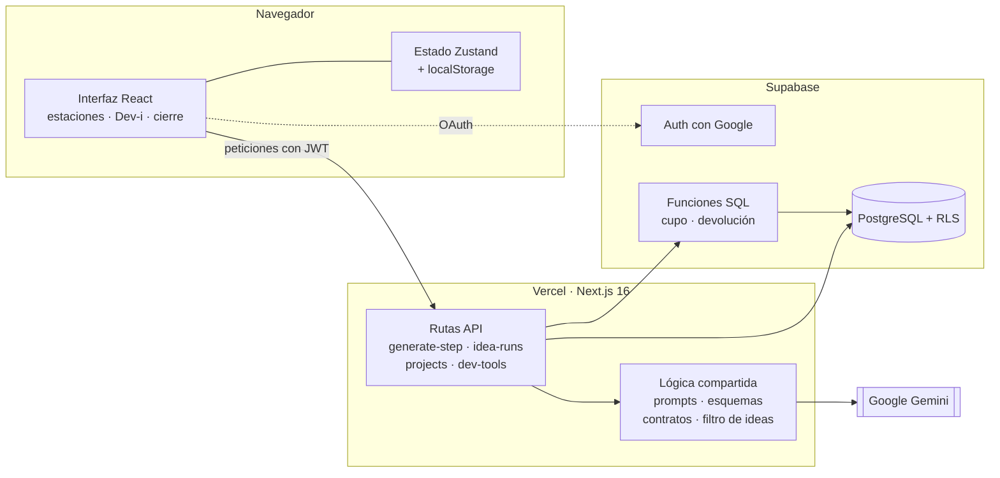
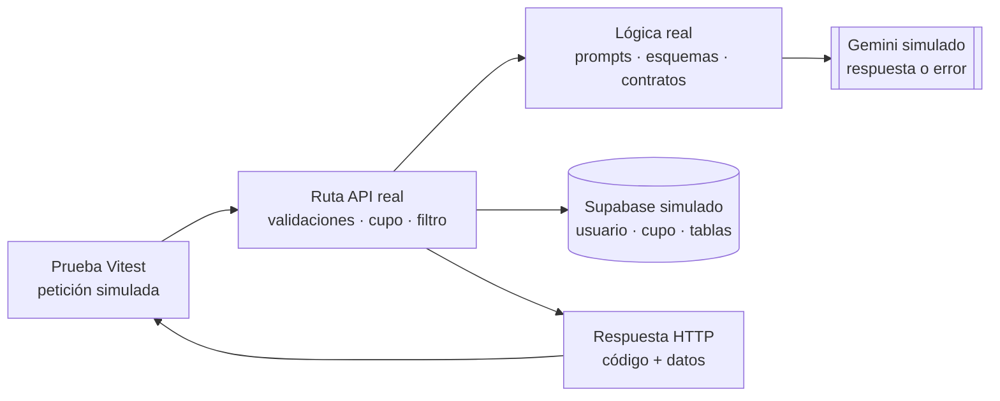
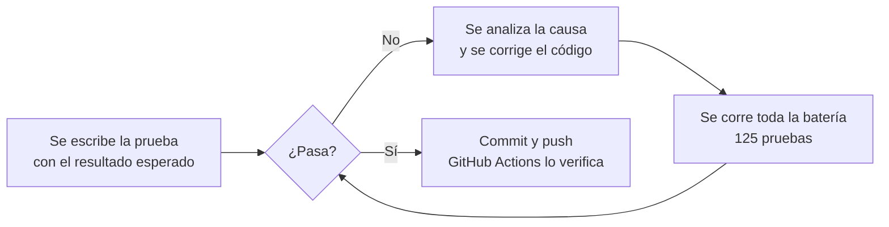
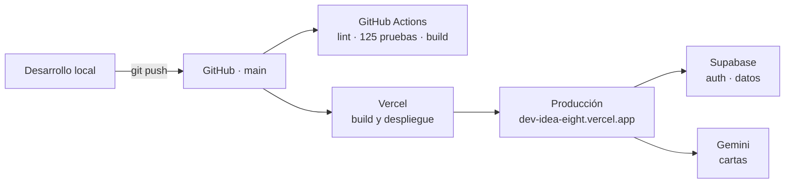

# Informe de pruebas · Dev.Idea

> **Cómo usar este documento.** Cada sección trae el texto listo para pegar en el informe. Las marcas indican qué va en cada lugar:
>
> - 📸 **Captura:** una imagen que tienes que poner tú (qué mostrar y cómo sacarla).
> - 🧩 **Diagrama:** código Mermaid. Pégalo en [mermaid.live](https://mermaid.live), exporta en PNG y pon la imagen. En la versión HTML ya aparece dibujado.
> - Las **tablas** van tal cual, en el lugar donde aparecen (siempre antes de las capturas que las respaldan).
>
> Las marcas (📸, 🧩 y estos recuadros grises) no se copian al informe.

---

# 1. Portada

> Ya la tienes: logo de la Universidad Privada Domingo Savio, título, nombre, docente, Bolivia-Cochabamba 2026.
>
> Solo cambia el título a algo como: **"Actividad 4 Desarrollo de Sistemas II – Plan de pruebas y despliegue de Dev.Idea"** (ahora dice "Desarrollo Frontend").
>
> Después de la portada conviene poner un **índice automático** (en Word: Referencias → Tabla de contenido), usando Título 1 para las 16 secciones.

---

# 2. Descripción general del sistema

**Dev.Idea** es una aplicación web que ayuda a quienes están empezando a programar (estudiantes y personas que construyen software apoyándose en IA) a pasar de una idea suelta a un **plano técnico completo** antes de escribir una sola línea de código.

La idea surge de un problema bastante común: uno se lanza a programar sin tener claro qué requisitos tiene el proyecto, qué tecnologías le convienen, si necesita base de datos o dónde lo va a publicar. Eso termina en proyectos que se rehacen varias veces, en decisiones que se contradicen entre sí y en agentes de IA que improvisan porque nadie les dio contexto.

Dev.Idea resuelve esto con un **recorrido guiado por estaciones**. En cada estación el usuario toma una decisión (tipo de sistema, requisitos, stack, base de datos, arquitectura, diagramas, diseño visual, deploy, etc.) eligiendo entre **cartas** que explican cada opción en lenguaje simple, con ventajas, desventajas y un consejo. Las cartas las genera **Google Gemini** tomando en cuenta la idea y todo lo que se decidió antes, o salen de catálogos fijos cuando no hace falta IA. Al final se obtiene un **cierre** con los comandos para empezar, la estructura de carpetas, el modelo de datos, los diagramas y un archivo `AGENTS.md` que los agentes de IA (Claude Code, Codex, Cursor) leen para programar respetando esas decisiones.

Características principales:

- **15 estaciones** (de la 0 a la 14) organizadas en 4 fases.
- **3 modos de recorrido:** Rápido (6 estaciones), Estándar (11) y Completo (todas).
- **Dev-i (Strobi):** un copiloto animado que comenta las decisiones y explica cada concepto en la guía "¿Qué es?".
- **Inicio de sesión con Google** y guardado del progreso en la nube.
- **Cupo de uso:** 2 ideas cada 8 horas por cuenta, y un filtro que rechaza ideas que no son de desarrollo de software.

| Dato | Valor |
|------|-------|
| Tipo de sistema | Aplicación web full-stack |
| URL de producción | dev-idea-eight.vercel.app |
| Repositorio | github.com/Ju4mpizel/dev-idea |
| Frontend | Next.js 16, React 19, Tailwind CSS 4, Framer Motion, Zustand |
| Backend | Rutas API de Next.js ejecutadas como funciones en Vercel |
| Base de datos y autenticación | Supabase (PostgreSQL con RLS, login con Google) |
| Inteligencia artificial | Google Gemini |
| Hosting | Vercel |

**Arquitectura.** Todo vive en un solo proyecto de Next.js. El navegador muestra la interfaz y guarda el estado; las rutas API del mismo proyecto se comunican con Gemini para generar las cartas y con Supabase para la autenticación, los datos y el cupo. No hay un servidor aparte: Vercel ejecuta esas rutas como funciones.

🧩 **Diagrama: arquitectura del sistema**



📸 **Captura (opcional):** la landing de Dev.Idea en producción, para que el lector vea el sistema antes de entrar en detalle. Puede ser la misma de CP-01.

---

# 3. Objetivos del plan de pruebas

El objetivo general del plan es **comprobar que Dev.Idea funciona como se espera antes y después de publicarlo**, y que lo que recomienda tiene sentido. Al ser un sistema que combina decisiones del usuario con respuestas de una IA, no basta con ver que "no se cae": también hay que verificar que una estación no contradiga a la anterior (por ejemplo, que no se recomiende un diagrama de base de datos a un proyecto que no tiene base de datos).

Objetivos específicos:

1. **Verificar la coherencia de las recomendaciones:** que el tipo de sistema, el stack, la base de datos, los diagramas y el deploy no se contradigan.
2. **Comprobar la seguridad de la API:** que las rutas respeten el inicio de sesión, el cupo de ideas, el filtro de ideas y la validación de los datos que reciben.
3. **Asegurar la persistencia:** que el progreso (decisiones, cartas y modo) se conserve al recargar y al guardarse en Supabase.
4. **Validar los flujos de usuario completos** en los tres modos del recorrido.
5. **Medir la calidad de la aplicación desplegada:** rendimiento, accesibilidad, buenas prácticas y SEO con Lighthouse.
6. **Registrar, corregir y volver a probar** cada error encontrado.

**Alcance.** Se prueba la lógica del sistema, los contratos con la IA, las rutas API, el guardado, la navegación por modos, la interfaz y la aplicación ya publicada en Vercel. Queda **fuera del alcance** la calidad del texto que redacta Gemini (es un servicio externo, así que se valida que la respuesta tenga la **forma** correcta, no cómo está escrita), el servicio de login de Google y la infraestructura interna de Vercel y Supabase.

**Criterios de aceptación.** Para dar el sistema por aprobado se definieron estas metas:

| Criterio | Meta | Resultado |
|----------|------|-----------|
| Pruebas automatizadas | 100 % aprobadas en local y en GitHub Actions | 125 de 125 ✅ |
| Cobertura de líneas | ≥ 80 % en la lógica probada | 85,24 % ✅ |
| Casos funcionales de prioridad Alta | Todos aprobados | 9 de 9 ✅ |
| Errores de severidad Alta | Ninguno abierto | 0 abiertos ✅ |
| Lighthouse | Accesibilidad, Buenas prácticas y SEO ≥ 90 | 91 · 100 · 100 ✅ |

---

# 4. Identificación de funcionalidades a evaluar

Antes de diseñar los casos se identificaron las funcionalidades del sistema que había que cubrir. Se agruparon en **15 funcionalidades** (F-01 a F-15) y a cada una se le asignó el tipo de prueba más adecuado: las reglas de negocio se prueban con **pruebas unitarias**, las rutas API con **pruebas de integración**, lo que ve el usuario con **pruebas funcionales** y la calidad general con **Lighthouse**.

| ID | Funcionalidad | Tipo de prueba |
|----|---------------|----------------|
| F-01 | Inicio de sesión con Google y protección de rutas | Integración, funcional |
| F-02 | Filtro de ideas que no son de desarrollo (Strobi enojado) | Unitaria, integración, funcional |
| F-03 | Cupo de ideas (2 cada 8 horas, 40 generaciones por idea) y devolución de generaciones fallidas | Integración, funcional |
| F-04 | Modos del recorrido (Rápido, Estándar, Completo) | Unitaria, funcional |
| F-05 | Detección del tipo de sistema y vista enfocada | Unitaria, funcional |
| F-06 | Stack según el tipo de sistema y preferencias de entorno | Unitaria, funcional |
| F-07 | Base de datos con interruptor, base favorita y administrador | Unitaria, funcional |
| F-08 | Generación de cartas con IA y normalización de respuestas | Unitaria, integración |
| F-09 | Layout por tipo de pantalla y sistemas sin pantallas | Unitaria, funcional |
| F-10 | Deploy en 3 franjas de costo | Unitaria, funcional |
| F-11 | Cierre: comandos adaptados, diagramas Mermaid, sugerencias y `AGENTS.md` | Unitaria, funcional |
| F-12 | Guardado en la nube y migración de datos antiguos | Unitaria, integración |
| F-13 | Modo consulta y "Reescribir desde aquí" | Funcional |
| F-14 | Páginas de error y 404 | Funcional |
| F-15 | Rendimiento, accesibilidad, buenas prácticas y SEO | No funcional (Lighthouse) |

**Herramientas utilizadas:**

| Tipo | Herramienta | Para qué |
|------|-------------|----------|
| Unitarias e integración | Vitest 5 | Ejecutar las pruebas automatizadas |
| Cobertura | @vitest/coverage-v8 | Medir qué porcentaje del código ejecutan las pruebas |
| Funcionales | Casos manuales con capturas | Probar los flujos reales en producción |
| Calidad | Lighthouse (Chrome DevTools) | Rendimiento, accesibilidad, buenas prácticas y SEO |
| Análisis estático | ESLint | Detectar errores de código |
| Integración continua | GitHub Actions | Correr lint, pruebas y build en cada push |

**Entorno de pruebas:** Windows 11 con Node.js 24 y pnpm en local; Ubuntu con Node.js 24 en GitHub Actions; y la aplicación en producción (Vercel + Supabase + Gemini) probada en Chrome de escritorio y en vista móvil.

---

# 5. Diseño de casos de prueba

Con las funcionalidades identificadas se diseñaron los casos en dos niveles:

- **Pruebas automatizadas (125):** se escribieron con Vitest. Las **unitarias** prueban funciones sueltas (por ejemplo, que "landing lo más rápido posible" no se confunda con un sistema POS), y las **de integración** prueban las rutas API completas.
- **Casos funcionales (20):** se diseñaron pensando en lo que haría un usuario real, con pasos concretos y un resultado esperado claro. A cada uno se le asignó una **prioridad** (Alta, Media o Baja) según qué tan grave sería que fallara.

**Pruebas automatizadas diseñadas:**

| Archivo | Tipo | Pruebas | Qué verifica | Func. |
|---------|------|:------:|--------------|:-----:|
| `systemTypes.test.js` | Unitaria | 13 | Detección del tipo de sistema y vista enfocada | F-05 |
| `ideaGuard.test.js` | Unitaria | 15 | Filtro de ideas: rechaza poleras, logos, poemas; acepta software | F-02 |
| `devPreferences.test.js` | Unitaria | 11 | Comandos según npm, pnpm, yarn o bun | F-06, F-11 |
| `stations.test.js` | Unitaria | 14 | Estaciones por modo, numeración y guardado | F-04, F-12 |
| `databases.test.js` | Unitaria | 8 | Interruptor de base de datos y administradores | F-07 |
| `stepContracts.test.js` | Unitaria | 11 | Lectura y limpieza de las respuestas de la IA | F-08, F-11 |
| `prompts.test.js` | Unitaria | 10 | Coherencia entre estaciones y protección contra prompt injection | F-06, F-07, F-10 |
| `costTier.test.js` | Unitaria | 3 | Franja de costo según el precio del texto | F-10 |
| `edgeCases.test.js` | Unitaria | 2 | Casos borde encontrados al probar | F-02, F-11 |
| `misc.test.js` | Unitaria | 7 | Paletas con contraste, layout sin pantallas, `AGENTS.md` | F-09, F-11 |
| `generateStep.test.js` | Integración | 10 | Ruta de generación de cartas | F-01, F-03, F-08 |
| `ideaRuns.test.js` | Integración | 8 | Ruta del cupo y filtro de ideas | F-02, F-03 |
| `projects.test.js` | Integración | 9 | Rutas de proyectos guardados | F-12 |
| `devTools.test.js` | Integración | 4 | Herramientas solo para cuentas autorizadas | F-01 |
| **Total** | | **125** | | |

**Casos funcionales diseñados:**

| ID | Func. | Prioridad | Caso | Pasos | Resultado esperado |
|----|:-----:|:---------:|------|-------|--------------------|
| CP-01 | F-01 | Alta | Acceso sin sesión | Abrir la URL sin iniciar sesión | Se muestra la landing con "Iniciar sesión con Google" |
| CP-02 | F-01 | Alta | Inicio de sesión | Pulsar "Iniciar sesión con Google" y elegir la cuenta | Entra a la Estación 0 con avatar y cupo visibles |
| CP-03 | F-02 | Alta | Idea fuera de tema | Escribir "hazme un diseño de una polera" y comenzar | Strobi se enoja; no se abre el mapa ni baja el cupo |
| CP-04 | F-02 | Media | Idea muy corta | Escribir "hola" y comenzar | Strobi pide más detalle |
| CP-05 | F-04 | Alta | Modo Completo por defecto | Abrir la Estación 0 | "Completo" seleccionado; "¿Qué incluye?" muestra las 13 estaciones |
| CP-06 | F-04, F-05 | Alta | Recorrido en modo Rápido | Elegir Rápido, escribir "pos para minimarket" y comenzar | Va directo a Tipo de sistema, con POS recomendado |
| CP-07 | F-05 | Media | Vista enfocada | Idea "landing page para heladeria" → Tipo de sistema | Solo tipos web + Catálogo; botón "Ver todos los tipos" |
| CP-08 | F-06 | Media | Stack y entorno | En Stack elegir una carta y cambiar el gestor a npm y el editor | Se guardan; el cierre usa npm en los comandos |
| CP-09 | F-07 | Alta | Base de datos con interruptor | En un POS, apagar el interruptor | Dev-i avisa que un POS necesita guardar datos |
| CP-10 | F-07 | Media | Base favorita y administrador | Encender, elegir PostgreSQL; elegir una carta y su administrador | PostgreSQL aparece primera; el administrador queda guardado |
| CP-11 | F-09 | Media | Sistema sin pantallas | Idea "bot de telegram para recordatorios", tipo Bot, llegar a Layout | "Tu sistema no tiene pantallas propias"; se continúa sin layout |
| CP-12 | F-10 | Media | Deploy por franjas | Llegar a Deploy (Estándar o Completo) | Cartas Gratis, Económico y Profesional, ordenadas |
| CP-13 | F-11 | Alta | Cierre en modo Rápido | Terminar el recorrido Rápido | Celdas "Sugerido por Dev-i", 2 diagramas y `AGENTS.md` con sugerencias |
| CP-14 | F-11 | Media | Diagramas desplegables | En el cierre abrir un diagrama y "Ver dibujado" | Se ve el código Mermaid y el diagrama dibujado |
| CP-15 | F-11 | Media | Descargar `AGENTS.md` | Pulsar "Descargar" en el cierre | Se descarga `AGENTS.md` con todas las secciones |
| CP-16 | F-13 | Media | Reescribir desde aquí | Volver a una estación superada y reescribir | Se descarta lo posterior y se puede elegir de nuevo |
| CP-17 | F-12 | Alta | Guardado en la nube | Recargar la página a mitad del recorrido | El mapa, las cartas y el modo se conservan |
| CP-18 | F-03 | Alta | Cupo de ideas | Abrir 2 ideas y luego una tercera | La tercera se bloquea mostrando la hora en que se libera |
| CP-19 | F-14 | Baja | Página 404 | Abrir `/ruta-que-no-existe` | Página "Esta estación no existe" con botón al inicio |
| CP-20 | F-04 | Media | Mapa de ruta por modo | En modo Rápido abrir "Mapa" | Solo 6 estaciones, numeradas 0 a 5 |

---

# 6. Ejecución de pruebas funcionales

Los 20 casos se ejecutaron **sobre la aplicación ya publicada** (dev-idea-eight.vercel.app), con una cuenta real de Google y en Chrome, siguiendo los pasos tal como se diseñaron. De cada caso se tomó una captura como evidencia del resultado obtenido.

En resumen:

- **20 casos ejecutados, 20 aprobados (100 %).**
- Todos los casos de prioridad Alta pasaron.
- No apareció ningún error nuevo durante esta ejecución, porque los errores detectados antes ya se habían corregido (ver secciones 8 y 9).

| ID | Caso | Resultado esperado | Resultado obtenido | Estado |
|----|------|--------------------|--------------------|:------:|
| CP-01 | Acceso sin sesión | Se muestra la landing con "Iniciar sesión con Google" | Correcto, como se esperaba (captura CP-01) | ✅ Aprobado |
| CP-02 | Inicio de sesión | Entra a la Estación 0 con avatar y cupo visibles | Correcto, como se esperaba (captura CP-02) | ✅ Aprobado |
| CP-03 | Idea fuera de tema | Strobi se enoja; no se abre el mapa ni baja el cupo | Correcto, como se esperaba (captura CP-03) | ✅ Aprobado |
| CP-04 | Idea muy corta | Strobi pide más detalle | Correcto, como se esperaba (captura CP-04) | ✅ Aprobado |
| CP-05 | Modo Completo por defecto | "Completo" seleccionado; "¿Qué incluye?" muestra las 13 estaciones | Correcto, como se esperaba (captura CP-05) | ✅ Aprobado |
| CP-06 | Recorrido en modo Rápido | Va directo a Tipo de sistema, con POS recomendado | Correcto, como se esperaba (captura CP-06) | ✅ Aprobado |
| CP-07 | Vista enfocada | Solo tipos web + Catálogo; botón "Ver todos los tipos" | Correcto, como se esperaba (captura CP-07) | ✅ Aprobado |
| CP-08 | Stack y entorno | Se guardan; el cierre usa npm en los comandos | Correcto, como se esperaba (captura CP-08) | ✅ Aprobado |
| CP-09 | Base de datos con interruptor | Dev-i avisa que un POS necesita guardar datos | Correcto, como se esperaba (captura CP-09) | ✅ Aprobado |
| CP-10 | Base favorita y administrador | PostgreSQL aparece primera; el administrador queda guardado | Correcto, como se esperaba (captura CP-10) | ✅ Aprobado |
| CP-11 | Sistema sin pantallas | "Tu sistema no tiene pantallas propias"; se continúa sin layout | Correcto, como se esperaba (captura CP-11) | ✅ Aprobado |
| CP-12 | Deploy por franjas | Cartas Gratis, Económico y Profesional, ordenadas | Correcto, como se esperaba (captura CP-12) | ✅ Aprobado |
| CP-13 | Cierre en modo Rápido | Celdas "Sugerido por Dev-i", 2 diagramas y `AGENTS.md` con sugerencias | Correcto, como se esperaba (captura CP-13) | ✅ Aprobado |
| CP-14 | Diagramas desplegables | Se ve el código Mermaid y el diagrama dibujado | Correcto, como se esperaba (captura CP-14) | ✅ Aprobado |
| CP-15 | Descargar `AGENTS.md` | Se descarga `AGENTS.md` con todas las secciones | Correcto, como se esperaba (captura CP-15) | ✅ Aprobado |
| CP-16 | Reescribir desde aquí | Se descarta lo posterior y se puede elegir de nuevo | Correcto, como se esperaba (captura CP-16) | ✅ Aprobado |
| CP-17 | Guardado en la nube | El mapa, las cartas y el modo se conservan | Correcto, como se esperaba (captura CP-17) | ✅ Aprobado |
| CP-18 | Cupo de ideas | La tercera se bloquea mostrando la hora en que se libera | Correcto, como se esperaba (captura CP-18) | ✅ Aprobado |
| CP-19 | Página 404 | Página "Esta estación no existe" con botón al inicio | Correcto, como se esperaba (captura CP-19) | ✅ Aprobado |
| CP-20 | Mapa de ruta por modo | Solo 6 estaciones, numeradas 0 a 5 | Correcto, como se esperaba (captura CP-20) | ✅ Aprobado |

**Resultado: 20 de 20 casos aprobados.**

📸 **Capturas:** aquí van tus capturas CP-01 a CP-20, en el mismo orden de la tabla y con su título ("CP-01 Acceso sin sesión", etc.), tal como ya las tienes armadas. La de **Lighthouse** no va aquí: muévela a la sección 12.

> Sugerencia: debajo de cada captura, una línea corta tipo "Figura 6.1 – CP-01: la landing muestra el botón de inicio de sesión". Ayuda a que el docente entienda qué mirar sin leer la tabla.

---

# 7. Pruebas de integración

Las pruebas de integración verifican que **las piezas del sistema funcionen juntas**. En Dev.Idea lo más importante son las rutas API, porque en ellas se juntan la autenticación, el cupo, el filtro de ideas, los prompts, la IA y la base de datos.

Estas pruebas ejecutan las **rutas API reales** del proyecto (con sus validaciones, prompts y contratos), y solo reemplazan dos servicios externos por **dobles en memoria**: Supabase y Gemini. Así se puede probar, por ejemplo, qué pasa cuando Gemini falla o cuando un usuario no tiene cupo, sin gastar créditos de la IA ni depender de internet, y con resultados que siempre se repiten igual.

🧩 **Diagrama: cómo se arma una prueba de integración**



| Archivo | Pruebas | Escenarios principales | Resultado |
|---------|:------:|------------------------|:---------:|
| `generateStep.test.js` | 10 | Sin sesión → 401 · sin ticket → 403 · cupo agotado → 429 · cartas generadas y normalizadas · Gemini falla → 503 y se devuelve el cupo · respuesta incompleta → 502 y se devuelve el cupo · layout sin pantallas → 400 sin gastar cupo · cuerpo muy grande → 413 | ✅ 10/10 |
| `ideaRuns.test.js` | 8 | Sin sesión → 401 · idea válida abre un ticket · idea fuera de tema → 422 sin usar la IA ni el cupo · idea corta → 422 · caso dudoso lo decide la IA · si la IA está caída se deja pasar · sin cupo → 429 con la hora de liberación | ✅ 8/8 |
| `projects.test.js` | 9 | Sin sesión → 401 · crea el proyecto con su modo · no se vincula al ticket de otra cuenta · cuerpo grande → 413 · JSON inválido → 400 · se deshace si falla el guardado · id inválido → 400 · proyecto ajeno → 404 · actualización | ✅ 9/9 |
| `devTools.test.js` | 4 | Herramientas solo para cuentas autorizadas · sin sesión no hay acceso · URL pública del sitio | ✅ 4/4 |
| **Total** | **31** | | **✅ 31/31** |

Lo que más vale destacar de estas pruebas:

- **Seguridad:** ninguna ruta responde datos sin sesión, y un usuario no puede tocar los proyectos ni los tickets de otro.
- **El cupo es justo:** si la generación falla por culpa de la IA, el intento se devuelve al usuario.
- **Robustez:** datos mal formados o demasiado grandes se rechazan con un mensaje claro en lugar de romper el servidor.

📸 **Captura:** la terminal después de ejecutar solo las pruebas de integración, donde se ven los 4 archivos en verde.

```powershell
pnpm vitest run tests/integration
```

---

# 8. Registro de errores encontrados

Durante el desarrollo y las pruebas se fue llevando un registro de cada error encontrado: qué pasaba, qué tan grave era, cómo se detectó y por qué ocurría. Se usaron dos clasificaciones:

- **Severidad:** **Alta** (bloquea o da un resultado incorrecto al usuario), **Media** (resultado confuso o riesgo controlado) y **Baja** (detalle visual o de experiencia).
- **Detección:** **Uso** (al usar la app), **Revisión** (al revisar el código) y **Prueba** (una prueba automatizada que falló).

En total se registraron **14 errores**. Lo interesante es que no todos se veían usando la aplicación: **6 aparecieron revisando el código** (sobre todo temas de seguridad) y **3 los encontraron las pruebas automatizadas**.

| ID | Error | Severidad | Detección | Causa |
|----|-------|:---------:|:---------:|-------|
| ERR-01 | "Landing… lo más rápido **posible**" recomendaba un sistema POS | Alta | Uso | Las palabras se buscaban por prefijo: "pos" coincidía con "posible" |
| ERR-02 | "restaurante" detectaba una API y "botón"/"botica" un bot | Alta | Uso | El mismo problema de prefijos ("rest", "bot") |
| ERR-03 | Un bot o una API recibía diseños de "Sitio público" | Media | Revisión | No se contemplaban sistemas sin pantallas |
| ERR-04 | Se podía elegir "Laravel + MySQL" y después MongoDB, o "sin base de datos" en un POS | Alta | Revisión | Stack y Base de datos decidían la base por separado |
| ERR-05 | Texto borroso en algunas pantallas | Baja | Uso | Efecto de animación (`will-change`) activo todo el tiempo |
| ERR-06 | Logo deformado en el README de GitHub en celular | Baja | Uso | Imagen horizontal forzada a un tamaño cuadrado |
| ERR-07 | Una generación que fallaba igual descontaba del cupo | Media | Revisión | El cupo se descontaba antes de llamar a Gemini y no se devolvía |
| ERR-08 | Las rutas de proyectos aceptaban datos de cualquier tamaño | Media | Revisión | Sin límite de tamaño en las peticiones |
| ERR-09 | Un id de proyecto inválido devolvía error 500 | Baja | Revisión | El id llegaba sin validar a la base de datos |
| ERR-10 | Un proyecto podía vincularse al ticket de idea de otra cuenta | Media | Revisión | Solo se validaba el formato, no el dueño |
| ERR-11 | No había páginas propias de error y la numeración saltaba en modos cortos | Baja | Revisión | Faltaban las páginas y se mostraba el número interno |
| ERR-12 | Una carta de Deploy que costaba "≈ 12 €/mes" se etiquetaba como **Gratis** | Media | Prueba | Solo se reconocían precios con "$" |
| ERR-13 | "Quiero una **página** para mostrar mis diseños de poleras" se rechazaba como fuera de tema | Alta | Prueba | Solo "página web" contaba como software |
| ERR-14 | `npx -y create-next-app` se traducía mal a otros gestores | Media | Prueba | La opción `-y` se tomaba como nombre del paquete |

| Severidad | Cantidad | | Detección | Cantidad |
|-----------|:--------:|-|-----------|:--------:|
| Alta | 5 | | Uso de la aplicación | 5 |
| Media | 6 | | Revisión de código | 6 |
| Baja | 3 | | Pruebas automatizadas | 3 |
| **Total** | **14** | | **Total** | **14** |

---

# 9. Corrección de errores y evidencias

Los 14 errores registrados se **corrigieron todos**, y cada corrección quedó **respaldada por una prueba automatizada o una verificación visual**, para asegurarse de que el error no vuelva a aparecer más adelante (prueba de regresión).

Para los errores que encontraron las pruebas se siguió siempre el mismo ciclo:

🧩 **Diagrama: ciclo de detección y corrección**



Por ejemplo, en el **ERR-12** la prueba esperaba que una carta de "≈ 12 €/mes" fuera de la franja *Económico*, pero el resultado fue `expected 'free' to be 'low'`. Se corrigió el código para que reconozca euros, dólares y otras formas de escribir precios, y la batería completa volvió a pasar.

| ID | Corrección aplicada | Commit | Verificado por |
|----|---------------------|:------:|----------------|
| ERR-01 | Búsqueda por palabra completa (con plural opcional) | `05d27f9` | `systemTypes.test.js` |
| ERR-02 | Igual que ERR-01 y limpieza de palabras genéricas | `05d27f9` | `systemTypes.test.js` |
| ERR-03 | Layout se resuelve sin IA con un aviso; el servidor lo rechaza sin descontar cupo | `05d27f9` | `misc.test.js`, `generateStep.test.js`, CP-11 |
| ERR-04 | Stack sin motor de base; interruptor "¿guardará datos?" según el tipo de sistema | `05d27f9` | `databases.test.js`, `prompts.test.js`, CP-09 |
| ERR-05 | La capa de animación solo se activa mientras se anima | `04608ca` | Verificación visual |
| ERR-06 | Logo SVG con su proporción real y versión clara/oscura | `00208da` | Verificación visual a 375 px |
| ERR-07 | Función SQL `refund_idea_generation` que devuelve el intento si Gemini falla | `baf5659` | `generateStep.test.js` |
| ERR-08 | Tope de 512 KB por petición (413) y JSON inválido (400) | `baf5659` | `projects.test.js` |
| ERR-09 | Validación del id (400 `INVALID_ID`) | `baf5659` | `projects.test.js` |
| ERR-10 | Se comprueba que el ticket pertenezca al usuario | `baf5659` | `projects.test.js` |
| ERR-11 | Páginas de error y 404 propias; numeración según el modo | `baf5659` | `stations.test.js`, CP-19, CP-20 |
| ERR-12 | Reconoce precios con $, US$, €, USD, EUR o "dólares" | `baf5659` | `costTier.test.js`, CP-12 |
| ERR-13 | "página" se agregó a las palabras de software | `baf5659` | `edgeCases.test.js` |
| ERR-14 | Se ignoran `-y` / `--yes` al traducir comandos | `baf5659` | `edgeCases.test.js` |

📸 **Capturas de evidencia** (con 2 o 3 alcanza, no hace falta una por error):

1. **Commit de las correcciones en GitHub:** abre `github.com/Ju4mpizel/dev-idea/commit/baf5659` y captura el cambio de un archivo, por ejemplo `src/lib/stepContracts.js` (ERR-12) o `src/lib/ideaGuard.js` (ERR-13), donde se ve en rojo lo anterior y en verde la corrección.
2. **La prueba que lo cubre pasando:** en la terminal, por ejemplo:

```powershell
pnpm vitest run tests/unit/costTier.test.js tests/unit/edgeCases.test.js
```

3. **Antes y después en la app (opcional):** la captura CP-11 sirve como evidencia de ERR-03 y la CP-12 de ERR-12.

---

# 10. Preparación del entorno de despliegue

Antes de publicar hubo que dejar listos los servicios de los que depende Dev.Idea y configurar sus credenciales. La idea es que el código **no tenga ninguna clave escrita adentro**: todas se cargan como variables de entorno en Vercel.

**Servicios utilizados:**

| Servicio | Para qué se usa |
|----------|-----------------|
| GitHub | Repositorio del código e integración continua (GitHub Actions) |
| Vercel | Hosting de la aplicación Next.js, con despliegue automático desde `main` |
| Supabase | Login con Google, base de datos PostgreSQL con RLS y funciones SQL del cupo |
| Google Cloud (Vertex AI) | Modelos Gemini que generan las cartas |

**Variables de entorno configuradas en Vercel:**

| Variable | Ámbito | Para qué sirve |
|----------|--------|----------------|
| `GEMINI_API_KEY` | Servidor | Clave de acceso a Gemini |
| `GOOGLE_CLOUD_PROJECT` | Servidor | Proyecto de Google Cloud |
| `NEXT_PUBLIC_SUPABASE_URL` | Público | Dirección del proyecto de Supabase |
| `NEXT_PUBLIC_SUPABASE_ANON_KEY` | Público | Clave pública de Supabase (protegida por RLS) |
| `DEV_TOOLS_EMAILS` | Servidor | Cuentas con herramientas de desarrollo y sin límite |
| `NEXT_PUBLIC_SITE_URL` | Público, opcional | Dominio propio para los metadatos |

**Pasos de preparación:**

1. **Base de datos:** se ejecutó `supabase/schema.sql` en Supabase (en un proyecto existente se corren las migraciones de `supabase/migrations/` en orden).
2. **Login:** se activó el proveedor **Google** en *Authentication → Providers*.
3. **URLs permitidas:** se agregó la URL de Vercel en *Site URL* y *Redirect URLs*, para que el login vuelva al sitio publicado.
4. **Vercel:** se importó el repositorio de GitHub y se cargaron las variables de entorno.
5. **Integración continua:** se agregó `.github/workflows/ci.yml` para que GitHub Actions revise cada cambio.

📸 **Capturas:**

1. **Vercel → Settings → Environment Variables**, con los nombres de las variables visibles y **los valores ocultos** (Vercel los muestra ocultos por defecto; no los reveles en la captura).
2. **Supabase → Authentication → Providers**, con Google activado.
3. (Opcional) **Supabase → Authentication → URL Configuration** con la URL de Vercel.

---

# 11. Despliegue de la aplicación web

El despliegue está **automatizado**: el repositorio de GitHub está conectado a Vercel, así que cada vez que se hace push a la rama `main` Vercel compila el proyecto con `next build` y lo publica en producción. Al mismo tiempo, GitHub Actions corre el lint, las 125 pruebas y el build; si algo falla, el commit queda marcado en rojo en GitHub. Además, cada pull request genera una versión de vista previa para probar antes de publicar.

🧩 **Diagrama: flujo de despliegue (CI/CD)**



Pasos del despliegue:

1. Se hizo commit de los últimos cambios (`baf5659`, "feat: Pruebas") y push a `main`.
2. GitHub Actions ejecutó el workflow **CI**: instalación, lint, pruebas con cobertura y build. **Aprobado en 43 segundos.**
3. Vercel detectó el push, compiló el proyecto y lo publicó en **dev-idea-eight.vercel.app**.
4. El commit quedó con **2 de 2 verificaciones aprobadas** en GitHub (CI y Vercel).

📸 **Capturas:**

1. **Vercel → Deployments**, con el despliegue de producción del commit `baf5659` en estado *Ready*.
2. **GitHub → Actions**, con la ejecución del workflow CI en verde (43 s).
3. (Opcional) El commit en GitHub con el ✓ verde y "2/2 checks passed".

---

# 12. Verificación del sistema desplegado

Una vez publicado, se revisó que el sistema funcionara **en producción y no solo en local**, porque hay cosas que solo se pueden comprobar ahí: el certificado HTTPS, el login con la URL real, las variables de entorno, la conexión con Supabase y Gemini, y los metadatos para compartir el enlace.

| # | Verificación | Cómo se comprobó | Resultado esperado | Estado |
|---|--------------|------------------|--------------------|:------:|
| V-01 | El sitio responde | Abrir la URL de producción | Landing en menos de 3 s | ✅ Aprobado |
| V-02 | HTTPS activo | Revisar el candado del navegador | Certificado válido de Vercel | ✅ Aprobado |
| V-03 | Login con Google | Iniciar sesión | Vuelve al sitio con la sesión iniciada | ✅ Aprobado |
| V-04 | Generación con IA | Comenzar una idea y llegar a Requisitos | Cartas generadas sin error | ✅ Aprobado |
| V-05 | Guardado en la nube | Recargar a mitad del recorrido | El mapa se conserva | ✅ Aprobado |
| V-06 | API protegida | Abrir `/api/projects` sin sesión | 401 No autorizado | ✅ Aprobado |
| V-07 | Página 404 propia | Abrir una ruta inexistente | Página "Esta estación no existe" | ✅ Aprobado |
| V-08 | Metadatos para compartir | Pegar la URL en WhatsApp u opengraph.xyz | Título, descripción e imagen de Dev.Idea | ✅ Aprobado |
| V-09 | `robots.txt` y `sitemap.xml` | Abrir `/robots.txt` y `/sitemap.xml` | Responden con el dominio de producción | ✅ Aprobado |
| V-10 | Lighthouse | DevTools → Lighthouse | Puntajes ≥ 90 | ✅ Aprobado |

**Resultado: 10 de 10 verificaciones aprobadas.**

**Rendimiento y calidad (Lighthouse).** Como parte de la verificación se midió la aplicación publicada con Lighthouse:

| Categoría | Puntaje | Valoración |
|-----------|:-------:|------------|
| Rendimiento (Performance) | **91** | Excelente (≥ 90) |
| Accesibilidad (Accessibility) | **91** | Excelente (≥ 90) |
| Buenas prácticas (Best Practices) | **100** | Excelente |
| SEO | **100** | Excelente |

Las cuatro categorías superan el umbral de 90 que Lighthouse considera "bueno". El 100 en SEO se debe a los metadatos, `robots.txt`, `sitemap.xml` y la URL canónica que se agregaron justo antes del despliegue.

📸 **Capturas:**

1. **Lighthouse** (la que ya tienes al final del documento de capturas): muévela aquí.
2. **V-08:** el enlace pegado en WhatsApp o en opengraph.xyz, con la imagen de Dev.Idea.
3. **V-06:** el navegador abriendo `dev-idea-eight.vercel.app/api/projects` sin sesión, mostrando el error 401.
4. (Opcional) **V-09:** `/robots.txt` o `/sitemap.xml` abiertos en el navegador.

> Las verificaciones V-03, V-04, V-05 y V-07 ya están respaldadas por las capturas CP-02, CP-06, CP-17 y CP-19; puedes mencionarlo en lugar de repetir las imágenes.

---

# 13. Informe de resultados de las pruebas

Esta sección junta todos los resultados en un solo lugar. En general, **Dev.Idea cumplió todos los criterios de aceptación** definidos en el plan.

| Tipo de prueba | Ejecutadas | Aprobadas | Resultado |
|----------------|:----------:|:---------:|:---------:|
| Unitarias (Vitest) | 94 | 94 | ✅ 100 % |
| Integración (Vitest) | 31 | 31 | ✅ 100 % |
| Funcionales (manuales en producción) | 20 | 20 | ✅ 100 % |
| Verificaciones del despliegue | 10 | 10 | ✅ 100 % |
| Integración continua (GitHub Actions) | 1 ejecución | Aprobada en 43 s | ✅ |

**Cobertura de código.** Se midió qué parte de la lógica y de las rutas API ejecutan las pruebas automatizadas (`src/lib`, `src/data`, `src/config` y `src/app/api`):

| Métrica | Cobertura |
|---------|:---------:|
| Líneas | **85,24 %** (942 de 1105) |
| Sentencias | **82,81 %** |
| Funciones | **78,15 %** |
| Ramas | **68,09 %** |

Los módulos más importantes quedaron por encima del 95 % (filtro de ideas, tipos de sistema, bases de datos, modos, contratos de la IA) y el módulo de autenticación y validación llegó al 100 %. La cobertura de ramas es la más baja porque muchas ramas corresponden a respuestas incompletas de la IA que se manejan con valores por defecto.

**Errores:** 14 registrados, **14 corregidos**, 0 abiertos (5 de severidad Alta, 6 Media y 3 Baja).

**Calidad (Lighthouse):** 91 en rendimiento, 91 en accesibilidad, 100 en buenas prácticas y 100 en SEO.

| Criterio de aceptación | Meta | Resultado | ¿Cumple? |
|------------------------|------|-----------|:--------:|
| Pruebas automatizadas | 100 % aprobadas | 125 / 125 | ✅ |
| Cobertura de líneas | ≥ 80 % | 85,24 % | ✅ |
| Casos funcionales de prioridad Alta | Todos aprobados | 9 / 9 | ✅ |
| Errores de severidad Alta abiertos | 0 | 0 | ✅ |
| Lighthouse (Accesibilidad, Buenas prácticas, SEO) | ≥ 90 | 91 · 100 · 100 | ✅ |

📸 **Capturas:**

1. **La terminal con todas las pruebas y la cobertura**, donde se ve "125 passed" y la tabla de porcentajes:

```powershell
pnpm test:coverage
```

2. (Opcional) **El reporte HTML de cobertura**: después del comando anterior, abre `coverage/index.html` en el navegador y captura la tabla de archivos.

---

# 14. Repositorio GitHub actualizado

Todo el código, las pruebas y la documentación están en GitHub, en **github.com/Ju4mpizel/dev-idea**. El repositorio se fue actualizando con commits que siguen un estilo convencional (`feat:`, `fix:`, `docs:`), lo que permite ver qué se hizo en cada etapa. El README presenta el proyecto con insignias de CI, pruebas y cobertura, y explica cómo instalarlo, configurarlo y correr las pruebas.

Lo que se agregó al repositorio en esta etapa:

- **Pruebas automatizadas:** carpeta `tests/` con las 10 suites unitarias y las 4 de integración.
- **Configuración de pruebas:** `vitest.config.mjs` y los scripts `test`, `test:watch` y `test:coverage` en `package.json`.
- **Integración continua:** `.github/workflows/ci.yml`.
- **Documentación de pruebas:** carpeta `docs/pruebas/` con el plan, los casos, los resultados, el registro de errores y el despliegue.
- **Correcciones:** los errores ERR-07 a ERR-14, más las migraciones SQL del cupo de 8 horas y la devolución de generaciones.

| Commit | Hito |
|--------|------|
| `05d27f9` | Stack según el producto, entorno, base de datos con interruptor, deploy por costo (corrige ERR-01 a ERR-04) |
| `9a8cca5` | Modos del recorrido: V1 completa |
| `00208da` | README actualizado y logo adaptable (corrige ERR-06) |
| `724c4c5` | Filtro de ideas y cupo de 8 horas por cuenta |
| `baf5659` | Pruebas, correcciones ERR-07 a ERR-14, CI y metadatos |

📸 **Capturas:**

1. **La página principal del repositorio**, con el README y las insignias de CI, pruebas y cobertura.
2. **El historial de commits** (`github.com/Ju4mpizel/dev-idea/commits/main`).
3. (Opcional) **La carpeta `tests/`** abierta en GitHub.

> Si después de este informe haces commit de la carpeta `docs/` (dossier e informe), toma la captura del historial **después**, para que aparezca como el último commit.

---

# 15. Conclusiones

1. **Dev.Idea cumple su objetivo y pasó todas las pruebas.** Las 125 pruebas automatizadas, los 20 casos funcionales y las 10 verificaciones del despliegue se aprobaron, y se cumplieron todos los criterios de aceptación del plan.
2. **Probar en distintos niveles valió la pena.** Cada tipo de prueba encontró cosas distintas: usar la app reveló errores de detección y visuales, la revisión de código encontró problemas de seguridad (como vincular el ticket de otra cuenta) y las pruebas automatizadas encontraron 3 errores que no se habían notado usando el sistema.
3. **Lo más difícil de probar fue la coherencia con la IA.** Como no se puede predecir el texto exacto que devuelve Gemini, se probó que la respuesta tenga la forma correcta y que el sistema sepa qué hacer cuando falla. Simular Gemini y Supabase hizo que las pruebas fueran rápidas (menos de un segundo) y repetibles.
4. **El despliegue quedó automatizado y protegido.** Con GitHub Actions y Vercel, cada cambio se revisa con lint, pruebas y build antes de llegar a producción, así que es difícil que un error ya corregido vuelva a aparecer.
5. **La calidad está medida, no solo supuesta.** El 85 % de cobertura y los puntajes de Lighthouse (91, 91, 100, 100) dan una idea objetiva del estado del sistema.

**Como trabajo futuro** se podrían agregar pruebas de extremo a extremo automatizadas (por ejemplo con Playwright y una cuenta de prueba), para que los casos funcionales también se ejecuten solos en cada push, y subir la cobertura de ramas.

---

# 16. Anexos

> Aquí van las cosas que respaldan el informe pero que no hace falta leer para entenderlo. Elige las que quieras:

- **Anexo A · Documentación técnica completa de Dev.Idea:** el PDF `docs/dossier/Dev.Idea-Documentacion.pdf` (requisitos, historias de usuario, arquitectura, modelo de datos, API). Puedes adjuntarlo o poner el enlace al repositorio.
- **Anexo B · Enlaces del proyecto:**
  - Aplicación: https://dev-idea-eight.vercel.app
  - Repositorio: https://github.com/Ju4mpizel/dev-idea
  - Documentación de pruebas: https://github.com/Ju4mpizel/dev-idea/tree/main/docs/pruebas
- **Anexo C · Ejemplo de prueba automatizada:** un fragmento corto de código de una prueba, para que se vea cómo está escrita. Por ejemplo, la del ERR-12 en `tests/unit/costTier.test.js` (puedes poner una captura del archivo en VS Code).
- **Anexo D · Workflow de integración continua:** captura o contenido de `.github/workflows/ci.yml`.
- **Anexo E · Glosario:**

| Término | Significado |
|---------|-------------|
| Prueba unitaria | Prueba de una función aislada del resto del sistema |
| Prueba de integración | Prueba de varias piezas trabajando juntas (aquí, las rutas API) |
| Doble de prueba (mock) | Versión simulada de un servicio externo para poder probar sin depender de él |
| Cobertura | Porcentaje del código que se ejecuta al correr las pruebas |
| CI/CD | Integración y despliegue continuos: revisar y publicar automáticamente cada cambio |
| RLS | Row Level Security: reglas de Supabase para que cada usuario solo vea sus propios datos |
| Lighthouse | Herramienta de Google que mide rendimiento, accesibilidad, buenas prácticas y SEO |
| Regresión | Error que vuelve a aparecer después de haber sido corregido |
