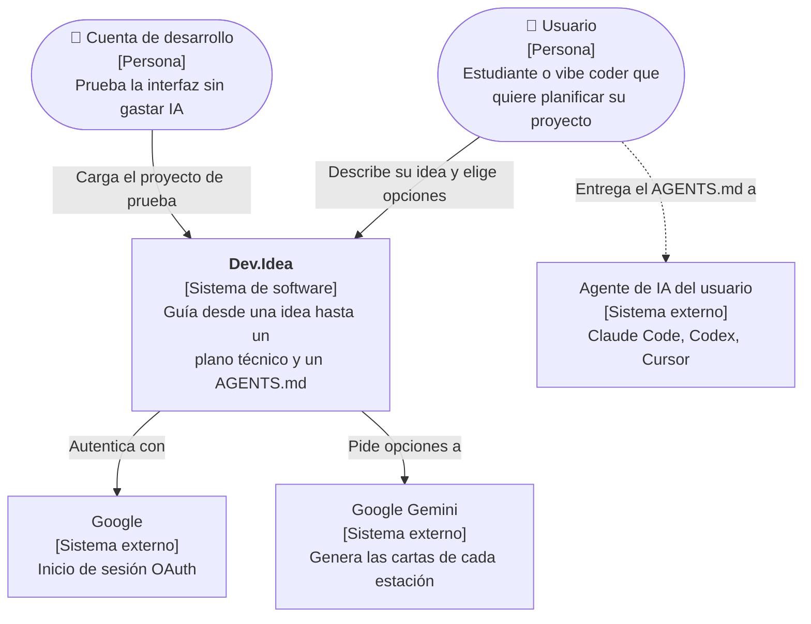
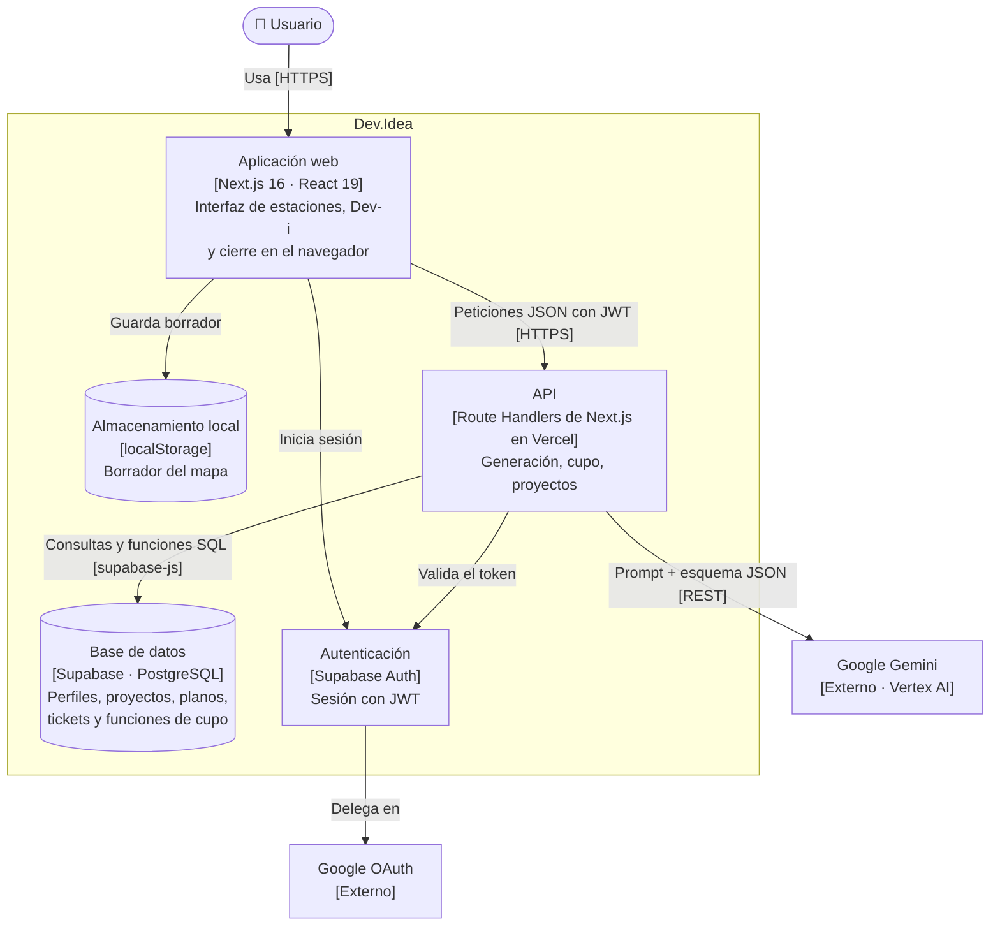
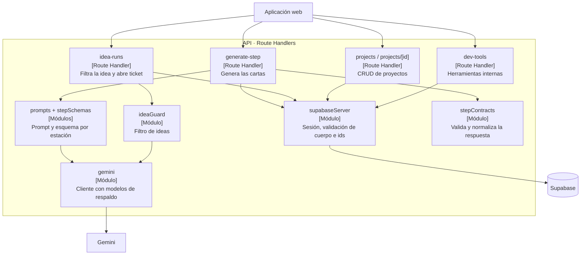
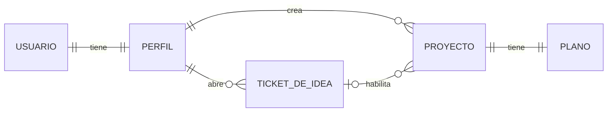
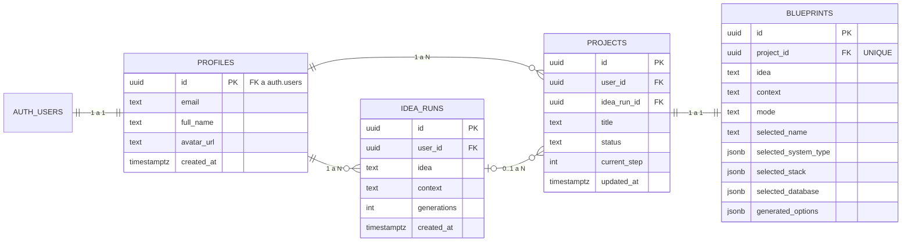
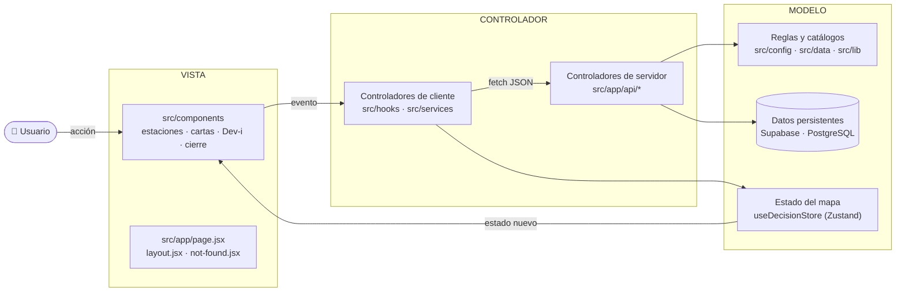
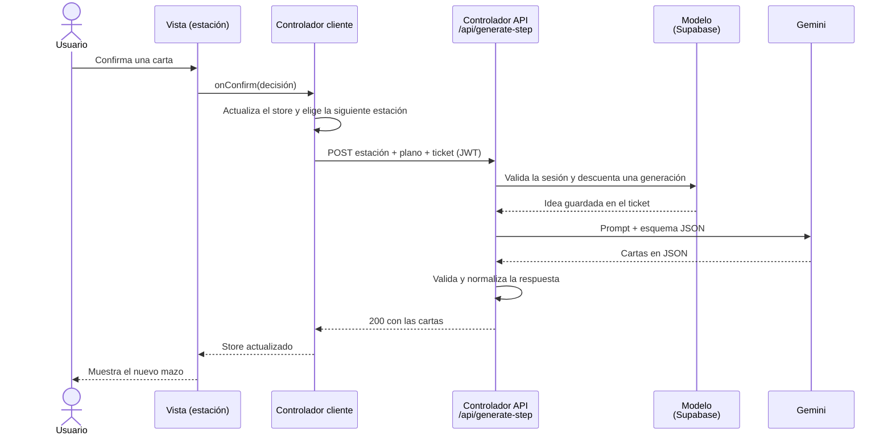

# Informe final · Dev.Idea

> **Cómo usar este documento.** Igual que el informe de pruebas: cada sección trae el texto listo para pegar.
>
> - 📸 **Captura:** imagen que pones tú (qué mostrar y cómo sacarla).
> - 🧩 **Diagrama:** en la versión HTML aparece dibujado; con "Copiar código" lo pegas en [mermaid.live](https://mermaid.live) y lo exportas en PNG.
> - Las tablas van tal cual, donde aparecen.
>
> Los recuadros grises y amarillos son instrucciones para ti: no se copian al informe.

---

# 1. Portada

> Usa la misma portada de la universidad (logo de la Universidad Privada Domingo Savio, nombre, docente, Bolivia-Cochabamba 2026) con este título:
>
> **Proyecto Final Desarrollo de Sistemas II – Dev.Idea: Aplicación web para planificar proyectos de software**
>
> Después de la portada va el índice automático (Word: Referencias → Tabla de contenido), usando Título 1 para las 19 secciones y Título 2 para los subtítulos.

---

# 2. Introducción y descripción general del proyecto

Hoy en día cualquiera puede empezar a programar un proyecto: hay tutoriales para todo, frameworks que arman un proyecto en un comando y asistentes de inteligencia artificial que escriben código en segundos. Sin embargo, lo que casi nadie enseña de forma práctica es **qué hay que decidir antes de programar**: qué tipo de sistema es, qué requisitos tiene, con qué tecnologías conviene construirlo, si necesita base de datos, qué arquitectura seguir y dónde se va a publicar. Esas decisiones son justamente las que vemos a lo largo de la carrera en materias como Ingeniería de Software, Base de Datos o Desarrollo de Sistemas, pero en la práctica muchas veces se saltan.

**Dev.Idea** nace para cubrir ese hueco. Es una aplicación web que guía al usuario, paso a paso, desde una idea escrita en una frase (por ejemplo, *"un sistema POS para un minimarket"*) hasta un **plano técnico completo** del proyecto. El recorrido está organizado como un mapa de **estaciones**: en cada una el usuario toma una decisión eligiendo entre varias **cartas**, y cada carta explica su opción en lenguaje simple, con ventajas, desventajas y un consejo. Las cartas las genera la inteligencia artificial **Google Gemini** tomando en cuenta la idea y todo lo que el usuario ya decidió, de modo que las recomendaciones no se contradicen entre sí.

Al final del recorrido el usuario obtiene un **cierre** con:

- los primeros comandos para crear el proyecto, en el gestor de paquetes que eligió;
- la estructura de carpetas y el modelo de datos;
- diagramas en Mermaid (casos de uso, entidad-relación, secuencia, etc.);
- un plan de trabajo;
- un archivo **`AGENTS.md`** que los agentes de IA como Claude Code, Codex o Cursor leen para programar respetando todas esas decisiones.

Para que el recorrido no sea aburrido ni intimidante, la aplicación tiene a **Dev-i (Strobi)**, un copiloto animado que comenta lo que el usuario elige, se enoja si le piden algo que no es de software, y explica cada estación con una guía "¿Qué es?" (concepto, analogía, qué se ve en la universidad y cómo se usa en la industria).

**Datos generales del proyecto:**

| Dato | Valor |
|------|-------|
| Nombre | Dev.Idea |
| Tipo | Aplicación web full-stack |
| URL de producción | https://dev-idea-eight.vercel.app |
| Repositorio | https://github.com/Ju4mpizel/dev-idea |
| Frontend | Next.js 16, React 19, Tailwind CSS 4, Framer Motion, Zustand |
| Backend | Rutas API de Next.js (Route Handlers) ejecutadas en Vercel |
| Base de datos y autenticación | Supabase (PostgreSQL con RLS y login con Google) |
| Inteligencia artificial | Google Gemini (Vertex AI) |
| Pruebas | Vitest (125 pruebas, 85 % de cobertura), Lighthouse, GitHub Actions |
| Despliegue | Vercel, con despliegue automático desde GitHub |

📸 **Captura:** la landing de Dev.Idea en producción (puede ser la misma de CP-01 del informe de pruebas), para que el lector conozca el sistema desde la primera página.

---

# 3. Planteamiento del problema y justificación

## 3.1 Planteamiento del problema

Quien empieza a programar, o quien construye software apoyándose en IA (lo que hoy se conoce como *vibe coding*), suele lanzarse directo a escribir código sin haber definido lo más básico del proyecto. Esto trae varios problemas que se repiten mucho, incluso en proyectos universitarios:

- **Proyectos que se rehacen varias veces**, porque a mitad del camino uno se da cuenta de que la tecnología elegida no servía para lo que se quería hacer.
- **Decisiones que se contradicen**, por ejemplo elegir un stack pensado para MySQL y después intentar usar MongoDB, o diseñar un diagrama entidad-relación para un sistema que ni siquiera guarda datos.
- **Agentes de IA que improvisan**, porque nadie les dio el contexto del proyecto. Cada vez que se les pide algo, proponen una estructura o una librería distinta.
- **Documentación que se hace al final y "de relleno"**, en lugar de usarse para pensar el sistema antes de construirlo.

Las herramientas que existen no resuelven bien esto: los generadores de proyectos (como `create-next-app`) arman código pero no ayudan a decidir, y los chats de IA responden lo que se les pregunta, pero no guían un proceso ordenado ni recuerdan las decisiones anteriores.

Por eso el problema se puede plantear así: **¿cómo ayudar a una persona que está empezando a planificar un proyecto de software de forma ordenada, coherente y entendible, antes de escribir código?**

## 3.2 Justificación

Dev.Idea se justifica desde varios puntos de vista:

- **Académico:** aplica de forma práctica lo que se enseña en la carrera (requisitos, historias de usuario, arquitectura, modelado, metodologías, despliegue). Un estudiante puede usarlo para planificar y defender su propio proyecto, porque cada decisión viene explicada.
- **Práctico:** reduce el tiempo que se pierde rehaciendo proyectos. En unos minutos se obtiene un plano coherente y los comandos para empezar.
- **Tecnológico:** aprovecha la inteligencia artificial, pero **acotada**: la IA no decide sola, sino que propone opciones dentro de reglas y esquemas, y el usuario elige. Además, el `AGENTS.md` final hace que los asistentes de IA trabajen mejor.
- **Social y económico:** es gratuito (con un cupo de uso para controlar el costo de la IA) y está pensado para personas que recién empiezan, sin necesidad de conocimientos avanzados.

---

# 4. Objetivo general y objetivos específicos

## 4.1 Objetivo general

Desarrollar e implementar una aplicación web que guíe a personas que empiezan a programar desde una idea hasta un plano técnico completo y coherente de su proyecto de software, apoyándose en inteligencia artificial para proponer opciones adaptadas a cada caso.

## 4.2 Objetivos específicos

1. **Analizar** las decisiones que se toman al planificar un proyecto de software y organizarlas en un recorrido ordenado de estaciones, de lo general a lo específico.
2. **Diseñar** la arquitectura de la aplicación, el modelo de datos y la interfaz, separando la presentación, la lógica y los datos.
3. **Integrar** Google Gemini para generar opciones adaptadas a la idea y a las decisiones previas, validando siempre la forma de sus respuestas.
4. **Implementar** la autenticación con Google, el guardado del progreso en la nube y un cupo de uso que controle el costo de la IA.
5. **Generar** un cierre con comandos, estructura de carpetas, modelo de datos, diagramas y un archivo `AGENTS.md` descargable.
6. **Verificar** el funcionamiento del sistema mediante pruebas unitarias, de integración, funcionales y de calidad (Lighthouse).
7. **Desplegar** la aplicación en la nube con integración y despliegue continuos.

---

# 5. Alcance del sistema

Definir el alcance sirve para dejar claro qué hace Dev.Idea y, sobre todo, qué **no** hace, para no generar expectativas falsas.

**El sistema incluye:**

- Una **landing pública** que explica qué es Dev.Idea.
- **Inicio de sesión con Google.**
- El **recorrido completo de 15 estaciones** (0 a 14) en 4 fases (Definición, Técnica, Diseño y Entrega), con **3 modos**: Rápido (6 estaciones), Estándar (11) y Completo (todas).
- **Generación de opciones con IA** en las estaciones que lo necesitan y **catálogos fijos** en las que no (tipo de sistema, entorno de desarrollo, bases de datos, herramientas de IA).
- **Filtro de ideas** que rechaza pedidos que no son de software (por ejemplo, "diséñame una polera").
- **Cupo de uso:** 2 ideas nuevas cada 8 horas por cuenta y hasta 40 generaciones por idea.
- **Guardado automático** en el navegador y, con sesión, en la nube; posibilidad de retomar o eliminar proyectos.
- **Mapa de ruta**, panel **"Mi plano"** con el resumen de lo decidido y modo consulta para revisar o reescribir decisiones.
- **Cierre** con comandos, carpetas, modelo de datos, diagramas, plan de trabajo y `AGENTS.md` descargable.
- Diseño **responsivo** desde 375 px (celular) hasta escritorio.

**El sistema no incluye:**

- **Generar el código del proyecto del usuario.** Dev.Idea planifica; programar lo hace el usuario o su agente de IA usando el `AGENTS.md`.
- **Ejecutar ni desplegar** el proyecto del usuario.
- **Planes de pago.** Es gratuito con cupo, porque el objetivo es académico y de aprendizaje.
- **Registro con correo y contraseña.** Solo se usa Google (se justifica en la sección 9.4).
- **Trabajo colaborativo** en tiempo real sobre un mismo mapa.
- **Otros idiomas:** por ahora solo está en español.

**Usuarios del sistema:**

| Usuario | Qué puede hacer |
|---------|-----------------|
| Visitante | Ver la landing e iniciar sesión |
| Usuario registrado | Crear ideas, recorrer estaciones, guardar, retomar y eliminar proyectos, descargar el `AGENTS.md` |
| Cuenta de desarrollo | Lo mismo, sin límite de ideas y con un proyecto de prueba que no gasta IA (para probar la interfaz) |

---

# 6. Requerimientos funcionales y no funcionales

Los requerimientos se obtuvieron a partir del problema planteado y se fueron afinando mientras se probaba la aplicación. Se clasifican por prioridad: **Alta** (sin esto el sistema no cumple su objetivo), **Media** (mejora mucho la experiencia) y **Baja** (complemento).

## 6.1 Requerimientos funcionales

| ID | Requerimiento | Prioridad |
|----|---------------|:---------:|
| RF-01 | Iniciar sesión con una cuenta de Google. | Alta |
| RF-02 | Mostrar una landing pública a quien no inició sesión. | Alta |
| RF-03 | Describir una idea y elegir su propósito (Académico, Startup / Trabajo, Personal / MVP). | Alta |
| RF-04 | Elegir el modo del recorrido (Rápido, Estándar o Completo). | Alta |
| RF-05 | Rechazar ideas que no sean de software sin consumir cupo, con un mensaje de Dev-i. | Media |
| RF-06 | Limitar a 2 ideas nuevas cada 8 horas por cuenta y a 40 generaciones por idea. | Alta |
| RF-07 | Detectar el tipo de sistema a partir de la idea y mostrar solo las opciones que encajan. | Media |
| RF-08 | Generar con IA las cartas de cada estación según la idea y las decisiones anteriores. | Alta |
| RF-09 | Seleccionar una o varias cartas según la estación y confirmar la elección. | Alta |
| RF-10 | Omitir las estaciones opcionales. | Media |
| RF-11 | Elegir el entorno de desarrollo (gestor de paquetes, editor, sistema operativo y uso de IA). | Media |
| RF-12 | Preguntar si el proyecto guardará datos antes de proponer bases de datos, con base favorita y administrador. | Media |
| RF-13 | Proponer opciones de despliegue en tres franjas de costo (Gratis, Económico, Profesional). | Media |
| RF-14 | Revisar estaciones ya superadas (modo consulta) y reescribir desde una de ellas. | Media |
| RF-15 | Mostrar un mapa de ruta con las estaciones del modo elegido. | Baja |
| RF-16 | Mostrar en "Mi plano" un resumen de lo decidido y copiarlo en Markdown. | Baja |
| RF-17 | Explicar cada estación con la guía "¿Qué es?" de Dev-i. | Media |
| RF-18 | Generar en el cierre comandos, estructura de carpetas, modelo de datos, plan de trabajo y diagramas. | Alta |
| RF-19 | Completar con sugerencias las estaciones que el modo omitió. | Media |
| RF-20 | Generar un `AGENTS.md` descargable con todas las decisiones. | Alta |
| RF-21 | Guardar el mapa automáticamente en el navegador y, con sesión, en la nube. | Alta |
| RF-22 | Listar, retomar y eliminar los proyectos guardados. | Media |
| RF-23 | Cancelar una generación en curso. | Baja |
| RF-24 | Devolver al cupo las generaciones que fallan o se cancelan. | Media |
| RF-25 | Ofrecer un proyecto de prueba sin IA solo a las cuentas de desarrollo autorizadas. | Baja |

## 6.2 Requerimientos no funcionales

| ID | Categoría | Requerimiento | Cómo se verificó |
|----|-----------|---------------|------------------|
| RNF-01 | Rendimiento | Obtener al menos 90 en Rendimiento de Lighthouse. | Lighthouse: 91 |
| RNF-02 | Rendimiento | Cada generación debe responder en menos de 90 segundos, usando modelos de respaldo si uno falla. | Configuración de la API |
| RNF-03 | Rendimiento | Las animaciones deben ser fluidas en celular. | Pruebas en dispositivo |
| RNF-04 | Usabilidad | Cada opción debe explicarse en lenguaje simple ("En simple", máximo 20 palabras). | Prompts y contratos |
| RNF-05 | Usabilidad | La interfaz debe funcionar desde 375 px de ancho. | Pruebas funcionales en móvil |
| RNF-06 | Accesibilidad | Obtener al menos 90 en Accesibilidad y paletas con contraste WCAG AA (≥ 4,5:1). | Lighthouse: 91; prueba unitaria |
| RNF-07 | Seguridad | Toda operación de datos debe hacerse con el token del usuario y políticas RLS. | Revisión y pruebas de integración |
| RNF-08 | Seguridad | Validar las entradas de la API (tamaño, formato y dueño del recurso). | Pruebas de integración |
| RNF-09 | Seguridad | Tratar el texto del usuario como datos en los prompts (protección contra *prompt injection*). | Prueba unitaria |
| RNF-10 | Disponibilidad | Si un modelo de IA falla, intentar con el siguiente; si el filtro de ideas falla, no bloquear al usuario. | Pruebas de integración |
| RNF-11 | Mantenibilidad | Estaciones definidas en un registro único y cobertura de pruebas ≥ 80 %. | Cobertura: 85,24 % |
| RNF-12 | Compatibilidad | Los mapas guardados con versiones anteriores deben seguir funcionando. | Pruebas de migración |
| RNF-13 | SEO | Obtener al menos 90 en SEO y mostrar vista previa al compartir el enlace. | Lighthouse: 100 |

---

# 7. Modelado C4 de la aplicación web

El **modelo C4** (propuesto por Simon Brown) describe la arquitectura de un sistema con diagramas en cuatro niveles de detalle, como si se hiciera zoom en un mapa: **Contexto**, **Contenedores**, **Componentes** y **Código**. La ventaja frente a otros diagramas es que cada nivel responde una pregunta distinta y se entiende sin conocer la notación UML completa.

> **Nota sobre los diagramas:** Mermaid tiene una sintaxis C4 propia, pero todavía es experimental y se dibuja desordenada. Por eso los diagramas están hechos con *flowchart* siguiendo las convenciones de C4: personas, sistema, contenedores y sistemas externos, con su tecnología entre corchetes.

## 7.1 Nivel 1 · Diagrama de contexto

Muestra a Dev.Idea como una caja negra: quién lo usa y con qué sistemas externos se comunica.

🧩 **Diagrama: C4 nivel 1 – Contexto**



En este nivel se ve que Dev.Idea depende de dos servicios de Google (login y Gemini) y que su resultado final, el `AGENTS.md`, sale del sistema para usarse en el agente de IA del usuario.

## 7.2 Nivel 2 · Diagrama de contenedores

Hace zoom dentro de Dev.Idea y muestra las piezas que se ejecutan por separado (contenedores) y cómo se comunican.

🧩 **Diagrama: C4 nivel 2 – Contenedores**



| Contenedor | Tecnología | Responsabilidad |
|------------|------------|-----------------|
| Aplicación web | Next.js 16, React 19, Tailwind 4, Framer Motion, Zustand | Toda la interfaz y el estado del mapa |
| Almacenamiento local | localStorage | Que el mapa no se pierda al recargar, incluso sin sesión |
| API | Route Handlers de Next.js (funciones en Vercel) | Lógica de servidor: filtro, cupo, generación con IA y proyectos |
| Base de datos | Supabase (PostgreSQL) | Persistencia, políticas RLS y funciones SQL del cupo |
| Autenticación | Supabase Auth + Google | Identificar al usuario y emitir su token |

## 7.3 Nivel 3 · Diagrama de componentes (API)

Hace zoom en el contenedor de la API, que es donde está la lógica más importante.

🧩 **Diagrama: C4 nivel 3 – Componentes de la API**



## 7.4 Nivel 4 · Código

El cuarto nivel (diagramas de clases o de código) **no se elaboró**, y es una decisión consciente: el propio C4 lo considera opcional porque se desactualiza con cada cambio, y en este proyecto la mayor parte del código son componentes de React y funciones, no clases, así que un diagrama de clases no aportaría mucho. Para ese nivel de detalle, la referencia es el código en el repositorio, que está organizado por carpetas según su responsabilidad (sección 9) y documentado en el manual técnico (sección 16).

---

# 8. Diseño de la base de datos (conceptual, lógico y físico)

La base de datos de Dev.Idea es **PostgreSQL**, administrada con **Supabase**. Su diseño se hizo en los tres niveles clásicos: primero qué cosas hay que guardar y cómo se relacionan (conceptual), luego cómo se convierten en tablas (lógico) y finalmente cómo se implementan en PostgreSQL (físico).

## 8.1 Diseño conceptual

A nivel conceptual se identificaron cinco entidades:

- **Usuario:** la persona que inicia sesión con Google. Supabase la gestiona en su esquema interno `auth.users`.
- **Perfil:** los datos públicos del usuario (nombre, correo, foto), que usa la aplicación.
- **Proyecto:** cada mapa que el usuario crea, con su título, estado y en qué estación va.
- **Plano (blueprint):** todas las decisiones tomadas en ese proyecto (idea, modo, tipo de sistema, stack, base de datos, etc.) y las cartas que generó la IA.
- **Ticket de idea:** el registro de cada idea nueva que abre el usuario, usado para controlar el cupo.

Las relaciones son:

- Un usuario tiene **un** perfil (1:1).
- Un perfil tiene **muchos** proyectos y abre **muchos** tickets de idea (1:N).
- Un proyecto tiene **exactamente un** plano (1:1).
- Un ticket de idea puede estar vinculado a **varios** proyectos (por ejemplo, si el usuario descarta el mapa y lo vuelve a crear), y un proyecto puede no tener ticket (0..1:N).

🧩 **Diagrama: modelo conceptual**



## 8.2 Diseño lógico

En el modelo lógico cada entidad pasa a ser una tabla, con su clave primaria (PK) y sus claves foráneas (FK).

🧩 **Diagrama: modelo lógico (entidad-relación con atributos)**



**Normalización y uso de JSONB.** Las tablas `profiles`, `projects` e `idea_runs` están en **tercera forma normal**: cada campo depende solo de su clave primaria y no hay datos repetidos entre tablas. En `blueprints` se tomó una decisión distinta a propósito: cada decisión del usuario (el stack, la base de datos, la arquitectura…) se guarda en una columna **JSONB** en lugar de en tablas separadas. La razón es que cada decisión es una carta completa con su título, descripción, ventajas, desventajas y tecnologías, y su forma cambia de una estación a otra. Normalizarla obligaría a crear más de 15 tablas con muchas columnas que casi siempre se leen juntas. Con JSONB el plano se lee y se guarda en una sola consulta, y PostgreSQL igual permite consultar dentro del JSON si hace falta. A cambio, la validación de esos datos se hace en el código (contratos y esquemas), no en la base.

**Diccionario de datos resumido:**

| Tabla | Campo | Tipo | Restricción / descripción |
|-------|-------|------|---------------------------|
| profiles | id | UUID | PK, FK a `auth.users`, borrado en cascada |
| profiles | email, full_name, avatar_url | TEXT | Datos que vienen de Google |
| projects | id | UUID | PK, generado con `gen_random_uuid()` |
| projects | user_id | UUID | FK a `profiles`, obligatorio, borrado en cascada |
| projects | title | TEXT | Por defecto "Proyecto sin nombre" |
| projects | status | TEXT | `DRAFT`, `COMPLETED` o `ARCHIVED` |
| projects | current_step | INTEGER | Entre 0 y 14 (estación actual) |
| projects | idea_run_id | UUID | FK a `idea_runs`; si se borra el ticket queda en NULL |
| blueprints | project_id | UUID | FK a `projects`, **UNIQUE** (garantiza el 1 a 1) |
| blueprints | context | TEXT | `academic`, `startup` o `personal` |
| blueprints | mode | TEXT | `quick`, `standard` o `complete` |
| blueprints | selected_* | JSONB | Una columna por estación con la carta elegida |
| blueprints | generated_options | JSONB | Todas las cartas generadas, por estación |
| idea_runs | idea | TEXT | Texto de la idea congelado al abrir el ticket |
| idea_runs | generations | INTEGER | Generaciones usadas (máximo 40), ≥ 0 |

## 8.3 Diseño físico

El diseño físico es el script `supabase/schema.sql`, que crea todo en PostgreSQL. Lo más importante:

- **Tipos de datos:** `UUID` para todas las claves (no se pueden adivinar como un número correlativo), `TEXT` para textos, `JSONB` para las decisiones y `TIMESTAMP WITH TIME ZONE` en UTC para las fechas.
- **Restricciones `CHECK`** para los valores permitidos (estado, contexto, modo, rango de `current_step`).
- **Integridad referencial** con `ON DELETE CASCADE`: si se elimina un proyecto, se elimina su plano; si se elimina un usuario, se eliminan todos sus datos.
- **Índices** en `projects(user_id)`, `blueprints(project_id)` e `idea_runs(user_id, created_at DESC)`, porque son las columnas por las que más se consulta (los proyectos de un usuario y sus ideas recientes).
- **Triggers:** uno actualiza `updated_at` en cada modificación y otro crea el perfil automáticamente cuando alguien inicia sesión por primera vez con Google.
- **Seguridad a nivel de fila (RLS):** está activada en todas las tablas. Cada usuario solo puede leer y modificar sus propios perfiles, proyectos y planos, y de `idea_runs` solo puede leer los suyos.
- **Funciones SQL del cupo** (`SECURITY DEFINER`): `idea_quota`, `claim_idea_run`, `use_idea_generation` y `refund_idea_generation`. Así el límite de ideas no se puede saltar desde el navegador.
- **Migraciones:** los cambios posteriores están en `supabase/migrations/`, numeradas por fecha y escritas para poder ejecutarse más de una vez sin romper nada.

Fragmento del script (tabla `projects`):

```sql
CREATE TABLE IF NOT EXISTS public.projects (
  id UUID PRIMARY KEY DEFAULT gen_random_uuid(),
  user_id UUID REFERENCES public.profiles(id) ON DELETE CASCADE NOT NULL,
  title TEXT NOT NULL DEFAULT 'Proyecto sin nombre',
  status TEXT NOT NULL DEFAULT 'DRAFT'
    CHECK (status IN ('DRAFT', 'COMPLETED', 'ARCHIVED')),
  current_step INTEGER NOT NULL DEFAULT 0
    CHECK (current_step >= 0 AND current_step <= 14),
  created_at TIMESTAMP WITH TIME ZONE DEFAULT timezone('utc', now()) NOT NULL,
  updated_at TIMESTAMP WITH TIME ZONE DEFAULT timezone('utc', now()) NOT NULL
);

CREATE INDEX IF NOT EXISTS idx_projects_user_id ON public.projects(user_id);

ALTER TABLE public.projects ENABLE ROW LEVEL SECURITY;
CREATE POLICY "CRUD propio en projects" ON public.projects
  FOR ALL USING (auth.uid() = user_id) WITH CHECK (auth.uid() = user_id);
```

> Este bloque es para pegar como código (fuente Consolas, tamaño 9). Si prefieres, pon una captura del archivo en VS Code.

📸 **Capturas:**

1. **Supabase → Table Editor** con la lista de las 4 tablas (`profiles`, `projects`, `blueprints`, `idea_runs`).
2. **Supabase → Database → Schema Visualizer**, que dibuja las tablas con sus relaciones. Sirve como evidencia del modelo físico real.
3. (Opcional) **Supabase → Authentication → Policies**, con las políticas RLS de cada tabla.

---

# 9. Descripción de la arquitectura MVC implementada

## 9.1 El patrón MVC en Dev.Idea

El patrón **Modelo-Vista-Controlador (MVC)** separa una aplicación en tres responsabilidades: el **Modelo** maneja los datos y las reglas del negocio, la **Vista** muestra la información al usuario y el **Controlador** recibe las acciones del usuario, decide qué hacer y conecta los otros dos.

Hay que aclarar algo: **Next.js no es un framework MVC clásico** como Laravel o ASP.NET MVC, donde las carpetas `models`, `views` y `controllers` ya vienen creadas. Next.js organiza el proyecto por rutas y componentes. Aun así, el código de Dev.Idea **sí respeta la separación de MVC**, solo que repartida en carpetas propias de Next.js. Se eligió Next.js en lugar de un framework MVC tradicional porque permite tener la interfaz interactiva y la API en un solo proyecto, con un solo despliegue en Vercel, algo muy conveniente para una aplicación que depende tanto de la interactividad (animaciones, cartas, mapa) como de un servidor que proteja las claves de la IA.

🧩 **Diagrama: MVC aplicado a Dev.Idea**



## 9.2 Modelo

El modelo agrupa todo lo que representa los datos y las reglas del negocio:

- **Base de datos (Supabase):** las tablas `profiles`, `projects`, `blueprints` e `idea_runs`, sus políticas RLS y las funciones SQL del cupo (sección 8).
- **Estado del mapa en el cliente:** `src/hooks/useDecisionStore.js` es un *store* de Zustand que guarda el plano del proyecto (idea, modo, decisiones de cada estación y cartas generadas). Es el modelo con el que trabaja la interfaz, y se persiste en `localStorage`.
- **Reglas de negocio y catálogos:**
  - `src/config/stations.config.js`: el registro único de las 15 estaciones, las fases, los modos y la conversión entre el plano y las columnas de la base de datos.
  - `src/data/*`: catálogos fijos (23 tipos de sistema, 11 bases de datos con 19 administradores, entornos de desarrollo, 24 layouts, 12 herramientas de IA) y la lógica de detección del tipo de sistema.
  - `src/lib/stepSchemas.js` y `stepContracts.js`: la forma que debe tener cada respuesta de la IA y la limpieza de esa respuesta.

## 9.3 Vista

La vista son los componentes de React que dibujan la interfaz. No contienen reglas de negocio: reciben datos del modelo y avisan al controlador cuando el usuario hace algo.

- `src/app/page.jsx` y `layout.jsx`: la página principal y el esqueleto común (metadatos, fuentes).
- `src/components/landing`: la landing pública.
- `src/components/map/stations`: una vista por estación (Idea, Tipo de sistema, Stack, Base de datos, Deploy…).
- `src/components/map/deck`: el mazo de cartas reutilizable.
- `src/components/companion`: Dev-i, su burbuja de diálogo, "¿Qué es?" y "Mi plano".
- `src/components/workspace`: el cierre con sus widgets, diagramas y el `AGENTS.md`.
- `src/components/navigation` y `modals`: barra superior, mapa de ruta, estado del guardado y ventanas de confirmación.
- `src/app/error.jsx` y `not-found.jsx`: páginas de error y 404 propias.

Los estilos se manejan con **Tailwind CSS** directamente en los componentes y las animaciones con **Framer Motion**.

## 9.4 Controlador

El controlador está dividido en dos partes, porque la aplicación tiene lógica tanto en el navegador como en el servidor:

**Controladores de servidor (`src/app/api/*`).** Son los *Route Handlers* de Next.js. Cada uno recibe una petición HTTP, valida la sesión y los datos, usa el modelo y devuelve una respuesta JSON:

| Ruta | Métodos | Qué controla |
|------|---------|--------------|
| `/api/idea-runs` | GET, POST | Consultar el cupo; filtrar una idea y abrir su ticket |
| `/api/generate-step` | POST | Generar las cartas de una estación con Gemini |
| `/api/projects` | GET, POST | Listar y crear proyectos |
| `/api/projects/[id]` | PUT, DELETE | Actualizar y eliminar un proyecto |
| `/api/dev-tools` | GET | Herramientas para cuentas de desarrollo |

**Controladores de cliente.** Coordinan las acciones del usuario en el navegador:

- `src/hooks/useStationNavigation.js`: decide a qué estación ir al confirmar, avanzar o retroceder según el modo.
- `src/hooks/useCloudAutosave.js`: detecta cambios en el plano y los guarda en la nube.
- `src/services/projectService.js`: concentra todas las llamadas a la API (es la única parte del cliente que hace `fetch`).
- `src/components/map/DecisionCanvas.jsx`: orquesta qué estación se muestra y cuándo pedir una generación.

## 9.5 Flujo de una petición

Para entender cómo trabajan juntas las tres capas, este es el recorrido cuando el usuario confirma una estación y se generan las cartas de la siguiente:

🧩 **Diagrama: secuencia de una generación**



Si Gemini falla, el controlador de la API devuelve la generación al cupo y responde con un error amigable, y la vista muestra el mensaje de Dev-i para intentar de nuevo.

## 9.6 Tecnologías que no se usaron y por qué

| Tecnología | Por qué no se usó |
|------------|-------------------|
| Backend separado (Express, Laravel, Django) | Next.js ya trae la API en el mismo proyecto. Un backend aparte significaba otro servidor, otro despliegue y otro costo, sin ganar nada para este caso. |
| ORM (Prisma, Sequelize) | Supabase ya ofrece un cliente para consultar la base, y la seguridad está en las políticas RLS de la propia base. Un ORM habría obligado a conectarse con una clave de administrador, saltando esas políticas. |
| Redux | Zustand hace lo mismo con mucho menos código y ya incluye guardado en `localStorage`. |
| TypeScript | El proyecto empezó en JavaScript y se priorizó avanzar con las funcionalidades. La validación de datos importante (respuestas de la IA y entradas de la API) se hace igual con esquemas y contratos, y está cubierta por pruebas. |
| Registro con correo y contraseña | Guardar contraseñas implica más riesgos (filtraciones, recuperación de cuenta). Con Google el usuario entra con un clic y no se guarda ninguna contraseña. |
| Docker en producción | Vercel compila y publica directamente desde GitHub. El proyecto igual incluye `Dockerfile` y `docker-compose.yml` para quien quiera ejecutarlo en su propio servidor. |

---

# 10. Descripción de los módulos y funcionalidades desarrolladas

El sistema se organizó en módulos, cada uno con una responsabilidad clara. A continuación se describe cada uno.

## 10.1 Módulo de autenticación

Permite iniciar sesión con Google mediante **Supabase Auth**. Al entrar por primera vez, un trigger de la base crea automáticamente el perfil del usuario con su nombre, correo y foto. Todas las peticiones a la API van con el token (JWT) del usuario, y las rutas que manejan datos responden **401** si no hay sesión. Quien no inició sesión solo ve la landing.

## 10.2 Módulo de idea y filtro (Estación 0)

Es la puerta de entrada. El usuario escribe su idea, elige el **propósito** (Académico, Startup / Trabajo o Personal / MVP) y el **modo** del recorrido. El modo Completo viene por defecto, y cada modo tiene un botón "¿Qué incluye?" que muestra sus estaciones.

Antes de abrir la idea se pasa por un **filtro en dos etapas**:

1. **Filtro local** (sin IA): busca pistas de software ("app", "web", "página", "sistema", "bot"…) y pistas de cosas que no son software ("diseño de polera", "logo", "poema", "receta"). También considera el orden: *"hazme un logo para mi app"* se rechaza, pero *"app para diseñar poleras"* se acepta.
2. **Casos dudosos:** si el filtro local no está seguro, se le pregunta a Gemini con una respuesta de sí o no.

Si la idea no es de software, **Dev-i se enoja** y no se descuenta cupo. Si es muy corta (por ejemplo "hola"), pide más detalle.

## 10.3 Módulo de cupo de uso

Controla el costo de la IA. Cada cuenta puede abrir **2 ideas nuevas cada 8 horas**, y cada idea permite **40 generaciones**. Todo se controla con funciones SQL en Supabase, con un bloqueo por usuario para que no se pueda abrir una tercera idea desde dos pestañas al mismo tiempo. La idea queda "congelada" en el ticket, así que no se puede reutilizar un ticket para otra idea. Si una generación falla o el usuario la cancela, **se devuelve al cupo**. Cuando se agota, la aplicación muestra a qué hora se libera la próxima idea.

## 10.4 Módulo de recorrido de estaciones

Es el corazón de la aplicación. Las 15 estaciones están definidas en un **registro único** (`stations.config.js`), con su fase, su tipo de selección (única o múltiple), si se pueden omitir y en qué modos aparecen.

| # | Estación | Qué se decide | Origen |
|:-:|----------|---------------|--------|
| 0 | Idea | Idea, propósito y modo | Usuario |
| 1 | Naming | Nombre del proyecto | IA |
| 2 | Tipo de sistema | Qué producto es y sus partes | Catálogo |
| 3 | Requisitos | Módulos con requisitos funcionales y no funcionales | IA |
| 4 | Historias de usuario | Backlog con criterios de aceptación | IA |
| 5 | Stack | Tecnologías y entorno de desarrollo | IA + catálogo |
| 6 | Base de datos | Si guarda datos, motor y administrador | Catálogo + IA |
| 7 | Arquitectura | Patrón (MVC, capas, hexagonal…) | IA |
| 8 | Metodología | Scrum, Kanban, XP… | IA |
| 9 | Diagramas | UML, C4, entidad-relación… | IA |
| 10 | Lenguaje visual | Estilo de interfaz y paleta de colores | IA |
| 11 | Layout | Un wireframe por cada parte del sistema | IA + catálogo |
| 12 | Deploy | Dónde publicar, en 3 franjas de costo | IA |
| 13 | Ecosistema de IA | Herramientas para programar con IA | Catálogo |
| 14 | Cierre | Plano final y `AGENTS.md` | IA + local |

Funcionalidades destacadas del recorrido:

- **Coherencia entre estaciones:** cada estación recibe todo lo decidido antes. Una landing no recibe stacks empresariales, una app móvil recibe stacks móviles y un sistema sin pantallas (como un bot) no pasa por Layout.
- **Vista enfocada en Tipo de sistema:** si la idea es clara ("landing para heladería"), solo se muestran los tipos que encajan, con un botón para ver todos.
- **Entorno de desarrollo en Stack:** el usuario elige gestor de paquetes (npm, pnpm, yarn, bun, etc.), editor, sistema operativo y cómo usará la IA, y los comandos del cierre se adaptan a eso.
- **Interruptor de base de datos:** antes de proponer bases, se pregunta si el proyecto guardará datos. Si el usuario lo apaga en un sistema que claramente los necesita (como un POS), Dev-i le advierte.
- **Deploy por costo:** las opciones vienen etiquetadas como Gratis, Económico o Profesional.
- **Modo consulta y "Reescribir desde aquí":** se puede volver a una estación pasada para revisarla o cambiar la decisión, descartando lo que venía después.

## 10.5 Módulo de generación con IA

Se encarga de pedirle a Gemini las cartas de cada estación. Cada estación tiene su propio **prompt** (con un rol, como "arquitecto de software senior" o "analista de requisitos"), la idea tratada como dato (nunca como instrucción, para evitar *prompt injection*) y todas las decisiones previas. La respuesta tiene que cumplir un **esquema JSON**, y además pasa por un **contrato** que completa los campos que falten y descarta respuestas con menos de 3 opciones útiles. Se usan **tres modelos de Gemini en cadena**: si el primero falla o tarda, se prueba con el siguiente.

## 10.6 Módulo de persistencia (CRUD de proyectos)

El mapa se guarda **automáticamente** en el navegador (`localStorage`) y, si hay sesión, en la nube (Supabase). Este módulo implementa el CRUD completo de proyectos, que se detalla con evidencias en la sección 11. También incluye **migraciones de datos**: si un mapa se guardó con una versión anterior de la aplicación, se adapta solo a la versión actual.

## 10.7 Módulo de cierre y AGENTS.md

La última estación arma el **plano final** en un tablero por fases, con: los primeros comandos (en el gestor elegido), la estructura de carpetas, el modelo de datos, el plan de trabajo, los diagramas en Mermaid (desplegables, con su código y su dibujo) y el archivo **`AGENTS.md`**, que se puede copiar o descargar. Si el modo omitió estaciones, el cierre las completa como **"Sugerido por Dev-i"**, para que el `AGENTS.md` siempre salga completo.

## 10.8 Módulo de asistente (Dev-i) y navegación

- **Dev-i (Strobi):** avatar animado con expresiones (feliz, pensando, enojado, confundido…) que comenta cada decisión y abre la guía **"¿Qué es?"** de cada estación.
- **Mapa de ruta:** muestra el recorrido del modo elegido, coloreado por fase.
- **Mi plano:** resumen de lo decidido, que se puede copiar en Markdown.
- **Barra superior:** anterior y siguiente, mapa, borrar y estado del guardado ("Guardando…", "Guardado").

## 10.9 Módulo de herramientas de desarrollo

Solo para las cuentas listadas en la variable `DEV_TOOLS_EMAILS`: no tienen límite de ideas y pueden cargar un **proyecto de prueba completo** sin gastar IA, para revisar la interfaz rápidamente. La verificación se hace en el servidor, así que un usuario normal no puede activarlo desde el navegador.

---

# 11. Evidencias de las interfaces y operaciones CRUD

## 11.1 Interfaces principales

A continuación se presentan las pantallas principales de la aplicación en producción.

> Muchas de estas capturas ya las tienes del informe de pruebas (la CP correspondiente va entre paréntesis). Pon cada una con su título y una línea que explique qué se ve.

📸 **Capturas de interfaces** (en este orden):

1. **Landing pública** (CP-01): propuesta de valor y botón "Iniciar sesión con Google".
2. **Estación 0 – Idea** (CP-02 o CP-05): formulario de idea, propósito, selector de modo y cupo.
3. **Dev-i enojado** (CP-03): idea fuera de tema rechazada.
4. **Tipo de sistema con vista enfocada** (CP-07).
5. **Mazo de cartas** de una estación con IA, por ejemplo Requisitos o Arquitectura (captura nueva): se ven las cartas con ventajas, desventajas y "En simple".
6. **Guía "¿Qué es?" de Dev-i** (captura nueva): el panel que explica la estación.
7. **Stack con el panel "Tu entorno"** (CP-08).
8. **Base de datos con interruptor** (CP-09 y CP-10).
9. **Lenguaje visual** con sus paletas (captura nueva).
10. **Layout con wireframes** (captura nueva) o el aviso de sistema sin pantallas (CP-11).
11. **Deploy por franjas de costo** (CP-12).
12. **Mapa de ruta** (CP-20) y **Mi plano** (captura nueva).
13. **Cierre** con sus widgets (CP-13) y un **diagrama desplegado** (CP-14).
14. **Vista en celular** (captura nueva): en Chrome, F12 → ícono de dispositivo móvil → 375 px, mostrando la Estación 0 o una estación con cartas.

## 11.2 Operaciones CRUD

La entidad principal que el usuario administra es el **proyecto** (con su plano). Sus cuatro operaciones CRUD se hacen desde la interfaz, pasan por la API y terminan en Supabase. Una particularidad es que **crear y actualizar son automáticos**: el usuario no tiene que pulsar "Guardar", porque el autoguardado detecta cada cambio y lo envía a la nube.

| Operación | Acción en la interfaz | Petición a la API | Efecto en la base de datos |
|-----------|-----------------------|-------------------|----------------------------|
| **Create** | Escribir una idea, pulsar Comenzar y confirmar la primera estación | `POST /api/projects` → 201 | `INSERT` en `projects` y `blueprints` (si falla el plano, se deshace el proyecto) |
| **Read** | Abrir la pestaña **Nube** en la Estación 0 y elegir un proyecto para retomarlo | `GET /api/projects` → 200 | `SELECT` de los proyectos del usuario con su plano |
| **Update** | Avanzar o cambiar decisiones; la barra muestra "Guardando…" y luego "Guardado" | `PUT /api/projects/{id}` → 200 | `UPDATE` de `projects` (título, estación actual) y `blueprints` (decisiones) |
| **Delete** | En la pestaña **Nube**, ícono de papelera → "Sí, eliminar" | `DELETE /api/projects/{id}` → 200 | `DELETE` en `projects`; el plano se borra en cascada |

Además del CRUD de proyectos, el sistema hace un **Create** de tickets de idea (`POST /api/idea-runs`) cada vez que se abre una idea nueva, y un **Read** del cupo (`GET /api/idea-runs`).

Todas estas operaciones están protegidas: sin sesión responden 401, un usuario no puede leer ni modificar proyectos ajenos (404), los ids inválidos se rechazan (400) y los cuerpos de más de 512 KB también (413).

📸 **Capturas de evidencia del CRUD.** La mejor forma de mostrarlo es con la pestaña **Network** de las herramientas de desarrollo (F12 → Network → filtro "projects"), donde se ve el método, la ruta y el código de respuesta. Para cada operación:

1. **Create:** crea una idea nueva y avanza una estación. Captura la interfaz con el indicador "Guardado" y, en Network, la petición **POST /api/projects** con estado **201**.
2. **Read:** vuelve a la Estación 0, abre la pestaña **Nube** y captura la lista de proyectos. En Network se ve **GET /api/projects** con **200**.
3. **Update:** avanza o cambia una decisión y captura **PUT /api/projects/…** con **200**. Si quieres, agrega la fila del proyecto en **Supabase → Table Editor → projects**, donde cambian `current_step` y `updated_at`.
4. **Delete:** en la pestaña Nube, pulsa la papelera de un proyecto y captura la ventana **"Eliminar de la nube"**, la petición **DELETE /api/projects/…** con **200** y la lista sin ese proyecto.
5. (Opcional) **Supabase → Table Editor → projects** antes y después de eliminar, como evidencia en la base de datos.

---

# 12. Plan de pruebas y resultados obtenidos

> Esta sección resume el informe de pruebas anterior. Si el docente quiere el detalle completo, se puede adjuntar ese informe como anexo.

## 12.1 Plan de pruebas

El objetivo del plan fue comprobar que Dev.Idea funciona como se espera antes y después de publicarlo, y que sus recomendaciones son coherentes. Se probó en cuatro niveles:

| Nivel | Herramienta | Qué se probó |
|-------|-------------|--------------|
| Unitarias | Vitest | Funciones sueltas: detección del tipo de sistema, filtro de ideas, modos, comandos, contratos de la IA |
| Integración | Vitest con Supabase y Gemini simulados | Las rutas API completas: sesión, cupo, filtro, generación y proyectos |
| Funcionales | Casos manuales con capturas | Flujos reales en la aplicación publicada |
| Calidad | Lighthouse | Rendimiento, accesibilidad, buenas prácticas y SEO |

Además, **GitHub Actions** ejecuta el lint, todas las pruebas y el build en cada push, y **ESLint** revisa el código.

Se identificaron **15 funcionalidades a evaluar** (F-01 a F-15) y se diseñaron **125 pruebas automatizadas** y **20 casos funcionales** (CP-01 a CP-20), cada uno con su prioridad.

## 12.2 Resultados obtenidos

| Tipo de prueba | Ejecutadas | Aprobadas | Resultado |
|----------------|:----------:|:---------:|:---------:|
| Unitarias | 94 | 94 | ✅ 100 % |
| Integración | 31 | 31 | ✅ 100 % |
| Funcionales en producción | 20 | 20 | ✅ 100 % |
| Verificaciones del despliegue | 10 | 10 | ✅ 100 % |

- **Cobertura de código:** 85,24 % de líneas (meta: 80 %). Los módulos clave superan el 95 % y el de autenticación y validación llega al 100 %.
- **Lighthouse:** Rendimiento **91**, Accesibilidad **91**, Buenas prácticas **100** y SEO **100**.
- **Integración continua:** el workflow pasó en 43 segundos en el último commit.
- **Criterios de aceptación:** se cumplieron todos (100 % de pruebas aprobadas, cobertura ≥ 80 %, todos los casos de prioridad Alta aprobados, ningún error grave abierto y Lighthouse ≥ 90).

📸 **Capturas:**

1. **La terminal con `pnpm test:coverage`** mostrando "125 passed" y la tabla de cobertura (la misma del informe de pruebas).
2. **Lighthouse** con los cuatro puntajes.
3. (Opcional) **GitHub Actions** con el workflow en verde.

---

# 13. Corrección y mejoras realizadas

Durante el desarrollo, la revisión del código y las pruebas se encontraron y corrigieron **14 errores**, y además se hicieron varias **mejoras** a partir de probar el sistema como si fuéramos un usuario más.

## 13.1 Errores corregidos

Los errores se clasificaron por severidad (Alta, Media o Baja). Todos quedaron corregidos y cubiertos por una prueba o una verificación, para que no vuelvan a aparecer.

| ID | Error | Severidad | Corrección |
|----|-------|:---------:|------------|
| ERR-01 | "Landing… lo más rápido **posible**" recomendaba un sistema POS | Alta | Búsqueda por palabra completa en lugar de prefijo |
| ERR-02 | "restaurante" detectaba una API y "botón" un bot | Alta | Misma corrección y limpieza de palabras genéricas |
| ERR-03 | Un bot o una API recibía diseños de pantallas | Media | Layout se resuelve con un aviso y sin gastar cupo |
| ERR-04 | Se podía elegir un stack con MySQL y después MongoDB | Alta | Stack sin base de datos e interruptor "¿guardará datos?" |
| ERR-05 | Texto borroso en algunas pantallas | Baja | Capa de animación solo mientras se anima |
| ERR-06 | Logo deformado en el README en celular | Baja | Logo SVG con su proporción real |
| ERR-07 | Una generación fallida igual descontaba del cupo | Media | Función SQL que devuelve la generación |
| ERR-08 | Las rutas de proyectos aceptaban datos de cualquier tamaño | Media | Tope de 512 KB y validación del JSON |
| ERR-09 | Un id inválido devolvía error 500 | Baja | Validación del id (400) |
| ERR-10 | Un proyecto podía vincularse al ticket de otra cuenta | Media | Se comprueba el dueño del ticket |
| ERR-11 | Sin páginas de error propias y numeración con saltos | Baja | Páginas de error y 404; numeración según el modo |
| ERR-12 | Una opción de deploy de "≈ 12 €/mes" salía como Gratis | Media | Reconoce precios en euros, dólares y otras formas |
| ERR-13 | "Una **página** para mostrar mis poleras" se rechazaba | Alta | "página" se agregó a las palabras de software |
| ERR-14 | `npx -y` se traducía mal a otros gestores | Media | Se ignora la opción `-y` al traducir |

**Resumen:** 5 de severidad Alta, 6 Media y 3 Baja, **todos corregidos**. Se detectaron 5 usando la aplicación, 6 revisando el código y 3 con las pruebas automatizadas.

## 13.2 Mejoras realizadas

Además de corregir errores, se hicieron mejoras importantes durante el desarrollo:

- **Modos de recorrido (Rápido, Estándar y Completo).** Al principio había que recorrer las 15 estaciones siempre, lo que era demasiado para quien solo quería empezar rápido. Ahora el usuario elige cuánto recorrer y el cierre completa lo omitido.
- **Stack según el tipo de producto.** Antes se ofrecían stacks web para todo; ahora una app móvil recibe stacks móviles, un bot recibe stacks de servidor, etc.
- **Entorno de desarrollo.** Se agregó la elección de gestor de paquetes, editor, sistema operativo y uso de IA, y los comandos del cierre se adaptan solos.
- **Base de datos con interruptor, favorita y administrador**, en lugar de decidir la base dentro del stack.
- **Deploy en tres franjas de costo**, en vez de forzar siempre la opción gratuita.
- **Diagramas desplegables** en el cierre, con el código Mermaid y su dibujo.
- **Filtro de ideas y cupo de 8 horas**, para controlar el costo de la IA y evitar usos que no son de software.
- **Devolución de generaciones fallidas**, para no penalizar al usuario por errores de la IA.
- **Seguridad de la API:** límite de tamaño, validación de ids y verificación del dueño de cada recurso.
- **Metadatos para compartir**, `robots.txt`, `sitemap.xml` y páginas de error propias, que llevaron el SEO de Lighthouse a 100.
- **Pruebas automatizadas e integración continua** con GitHub Actions.

📸 **Capturas (2 o 3 alcanzan):**

1. **El diff de un commit de corrección en GitHub**, por ejemplo `github.com/Ju4mpizel/dev-idea/commit/baf5659`, mostrando el cambio en `src/lib/ideaGuard.js` (ERR-13) o en `src/lib/stepContracts.js` (ERR-12).
2. **Una mejora visible:** el selector de modos de la Estación 0 o el interruptor de base de datos (puedes reutilizar CP-05 o CP-09).

---

# 14. Enlace de acceso a la aplicación web desplegada

La aplicación está desplegada en **Vercel** y disponible públicamente en:

**https://dev-idea-eight.vercel.app**

- **Acceso:** cualquier persona puede ver la landing. Para usar el recorrido hay que iniciar sesión con una cuenta de Google.
- **Cupo:** cada cuenta puede abrir 2 ideas nuevas cada 8 horas.
- **Navegadores probados:** Google Chrome en escritorio y en celular.
- **Despliegue continuo:** cada cambio que se sube a la rama `main` de GitHub se publica automáticamente.

📸 **Captura:** la aplicación abierta en el navegador con la URL visible en la barra de direcciones (el candado de HTTPS incluido).

> Opcional: un código QR con el enlace (se puede generar en cualquier generador de QR gratuito) para que el docente lo abra desde el celular.

---

# 15. Enlace al repositorio GitHub

El código fuente completo, las pruebas y la documentación están en:

**https://github.com/Ju4mpizel/dev-idea**

Qué se encuentra en el repositorio:

- **`src/`:** todo el código de la aplicación (vistas, controladores, modelo y lógica).
- **`tests/`:** las 125 pruebas automatizadas (unitarias e integración).
- **`supabase/`:** el script de la base de datos (`schema.sql`) y sus migraciones.
- **`docs/`:** el plan de pruebas, los casos, los resultados, el registro de errores, el despliegue y la documentación técnica completa en PDF.
- **`.github/workflows/ci.yml`:** la integración continua.
- **`README.md`:** descripción del proyecto, insignias de CI, pruebas y cobertura, e instrucciones de instalación.

El historial de commits sigue un estilo convencional (`feat:`, `fix:`, `docs:`), así que se puede seguir la evolución del proyecto por etapas.

📸 **Capturas:**

1. **La página principal del repositorio** con el README y las insignias.
2. **El historial de commits** (`github.com/Ju4mpizel/dev-idea/commits/main`).

---

# 16. Manual técnico de la aplicación

Este manual está dirigido a un desarrollador que necesite instalar, ejecutar, mantener o ampliar Dev.Idea.

## 16.1 Requisitos previos

- **Node.js 20 o superior** (el proyecto se desarrolló con Node.js 24).
- **pnpm** como gestor de paquetes.
- **Git.**
- Una cuenta de **Supabase** (gratuita) para la base de datos y el login.
- Un proyecto de **Google Cloud** con acceso a Gemini en Vertex AI y su clave de API.
- (Opcional) **Docker**, para ejecutarlo en un contenedor.

## 16.2 Instalación

1. Clonar el repositorio e instalar las dependencias:

```powershell
git clone https://github.com/Ju4mpizel/dev-idea.git
```

```powershell
cd dev-idea
```

```powershell
pnpm install
```

2. Crear el archivo `.env.local` en la raíz del proyecto con estas variables:

| Variable | Dónde se usa | Descripción |
|----------|--------------|-------------|
| `GEMINI_API_KEY` | Servidor | Clave de Google Cloud con acceso a Gemini |
| `GOOGLE_CLOUD_PROJECT` | Servidor | Id del proyecto de Google Cloud |
| `NEXT_PUBLIC_SUPABASE_URL` | Público | URL del proyecto de Supabase |
| `NEXT_PUBLIC_SUPABASE_ANON_KEY` | Público | Clave anónima de Supabase (protegida por RLS) |
| `DEV_TOOLS_EMAILS` | Servidor | Correos con herramientas de desarrollo, separados por comas |
| `NEXT_PUBLIC_SITE_URL` | Público, opcional | Dominio propio; si no existe se usa el de Vercel |

> Las variables `NEXT_PUBLIC_` llegan al navegador; las demás solo existen en el servidor. Nunca pongas una clave secreta con el prefijo `NEXT_PUBLIC_`.

3. Preparar la base de datos en Supabase:
   - **Proyecto nuevo:** ejecutar `supabase/schema.sql` en el *SQL Editor*.
   - **Proyecto existente:** ejecutar en orden las migraciones de `supabase/migrations/` que falten.
   - Activar el proveedor **Google** en *Authentication → Providers*.
   - Agregar la URL de la aplicación en *Authentication → URL Configuration* (Site URL y Redirect URLs).

## 16.3 Ejecución y comandos

| Comando | Para qué sirve |
|---------|----------------|
| `pnpm dev` | Inicia el servidor de desarrollo en http://localhost:3000 |
| `pnpm build` | Compila la aplicación para producción |
| `pnpm start` | Ejecuta la versión compilada |
| `pnpm lint` | Revisa el código con ESLint |
| `pnpm test` | Ejecuta las 125 pruebas |
| `pnpm test:coverage` | Ejecuta las pruebas con reporte de cobertura (`coverage/index.html`) |
| `docker compose up --build` | Construye y ejecuta la aplicación en un contenedor Docker |

## 16.4 Estructura del proyecto

```text
dev-idea/
├── src/
│   ├── app/            # Páginas, layout, metadatos y rutas API (controladores de servidor)
│   │   └── api/        # generate-step, idea-runs, projects, dev-tools
│   ├── components/     # Vistas: landing, estaciones, cartas, Dev-i, cierre
│   ├── hooks/          # Store de Zustand, navegación y autoguardado
│   ├── services/       # Llamadas a la API desde el cliente
│   ├── config/         # Registro de estaciones, fases y modos
│   ├── data/           # Catálogos fijos y detección del tipo de sistema
│   └── lib/            # Prompts, esquemas, contratos, cliente de Gemini, filtro de ideas
├── supabase/           # schema.sql y migraciones
├── tests/              # Pruebas unitarias e integración (Vitest)
├── docs/               # Documentación de pruebas y técnica
├── public/             # Imágenes y logos
└── .github/workflows/  # Integración continua
```

## 16.5 Despliegue

1. Importar el repositorio en **Vercel** (New Project → Import Git Repository).
2. Cargar las variables de entorno en *Settings → Environment Variables*.
3. Desplegar. Desde ese momento, cada push a `main` publica una nueva versión y cada pull request genera una vista previa.
4. Agregar la URL de Vercel en Supabase (*URL Configuration*).

**Integración continua:** el archivo `.github/workflows/ci.yml` corre en GitHub Actions con cada push: instala las dependencias, ejecuta el lint, las pruebas con cobertura y el build.

## 16.6 Cómo ampliar el sistema

- **Agregar una estación nueva:** registrarla en `src/config/stations.config.js` (id, fase, tipo de selección y modos), crear su prompt en `src/lib/prompts.js`, su esquema en `stepSchemas.js` y su contrato en `stepContracts.js`. Si guarda una decisión nueva, agregar la columna en Supabase con una migración y actualizar la conversión plano ↔ base en `stations.config.js`.
- **Agregar un tipo de sistema, base de datos o herramienta:** editar el catálogo correspondiente en `src/data/`.
- **Cambiar los modelos de IA:** editar la lista de modelos en `src/lib/gemini.js`.
- **Cambiar el cupo:** modificar las funciones SQL con una migración nueva (no editar las anteriores).
- Después de cualquier cambio, ejecutar `pnpm test` y `pnpm lint` antes de hacer push.

## 16.7 Solución de problemas frecuentes

| Problema | Causa probable | Solución |
|----------|----------------|----------|
| El login con Google vuelve a la landing sin sesión | La URL no está en *Redirect URLs* de Supabase | Agregar la URL exacta de la aplicación |
| Error 503 al generar cartas | Clave de Gemini inválida o sin cuota | Revisar `GEMINI_API_KEY` y `GOOGLE_CLOUD_PROJECT` |
| Error al guardar en la nube | Falta una migración en Supabase | Ejecutar las migraciones pendientes en orden |
| "No pude abrir tu idea" | Funciones del cupo no creadas | Ejecutar `schema.sql` o la migración del cupo |
| El build falla en Vercel | Faltan variables de entorno | Cargar las variables en *Settings → Environment Variables* |

---

# 17. Manual de usuario

Este manual explica cómo usar Dev.Idea paso a paso, sin necesidad de conocimientos técnicos.

## 17.1 Ingresar a la aplicación

1. Abre **https://dev-idea-eight.vercel.app** en tu navegador.
2. Pulsa **"Iniciar sesión con Google"** y elige tu cuenta.
3. Entrarás a la **Estación 0**, donde verás a Dev-i, tu foto y cuántas ideas te quedan.

📸 **Captura:** la landing y la Estación 0 después de iniciar sesión (CP-01 y CP-02).

## 17.2 Escribir tu idea y elegir el modo

1. Describe tu idea en una o dos frases. Mientras más clara, mejores serán las recomendaciones. Ejemplo: *"Un sistema POS para un minimarket con control de inventario"*.
2. Elige el **propósito**: Académico (para la universidad), Startup / Trabajo o Personal / MVP.
3. Elige el **modo**:
   - **Rápido:** lo esencial (tipo de sistema, requisitos, stack y base de datos).
   - **Estándar:** agrega nombre, arquitectura, diseño visual, layout y deploy.
   - **Completo:** todas las estaciones, ideal para proyectos universitarios.
   
   Con el botón **"¿Qué incluye?"** ves las estaciones de cada modo.
4. Pulsa **Comenzar**.

> **Ojo:** la idea tiene que ser de software. Si escribes algo como "diséñame una polera", Dev-i se enojará y no se abrirá la idea (tampoco se gasta tu cupo).

📸 **Captura:** la Estación 0 con una idea escrita y el modo seleccionado (CP-05 o CP-06).

## 17.3 Recorrer las estaciones

En cada estación verás un **mazo de cartas**. Cada carta es una opción, con su descripción, ventajas, desventajas y un consejo "En simple".

1. Pasa las cartas con las **flechas**, el teclado o deslizando en el celular.
2. **Elige** una carta (o varias, en estaciones como Requisitos o Diagramas).
3. Pulsa **Confirmar** para pasar a la siguiente estación.
4. En las estaciones opcionales puedes pulsar **Omitir**.

Botones útiles en cada estación:

- **¿Qué es?:** Dev-i te explica el concepto de la estación con una analogía y cómo se usa en la universidad y en la industria.
- **Categorías:** filtra las cartas por tipo.
- **Mapa:** muestra todas las estaciones de tu recorrido y en cuál estás.
- **Mi plano:** resumen de todo lo que decidiste hasta ahora.

📸 **Captura:** una estación con el mazo de cartas y otra con el panel "¿Qué es?" abierto.

## 17.4 Estaciones especiales

- **Tipo de sistema:** Dev.Idea deduce el tipo de sistema de tu idea y te muestra los que encajan (con ⭐ los recomendados). Si quieres otro, pulsa **"Ver todos los tipos"**.
- **Stack:** además de elegir las tecnologías, en **"Tu entorno"** puedes indicar tu gestor de paquetes, tu editor, tu sistema operativo y si programarás con IA. Los comandos finales usarán lo que elijas.
- **Base de datos:** primero responde si tu proyecto **guardará datos** con el interruptor. Si lo enciendes, puedes elegir una base favorita y, después de elegir la carta, un administrador (por ejemplo pgAdmin o DBeaver).
- **Deploy:** las opciones vienen marcadas como **Gratis**, **Económico** o **Profesional** según su costo.

## 17.5 Cambiar una decisión

Si quieres revisar o cambiar algo que ya decidiste:

1. Abre el **Mapa** o usa **Anterior** para volver a esa estación. Entrarás en **modo consulta**, donde ves lo que elegiste.
2. Pulsa **"Reescribir desde aquí"** si quieres cambiarla. Las estaciones posteriores se descartan y se vuelven a generar con tu nueva decisión.

📸 **Captura:** una estación en modo consulta con el botón "Reescribir desde aquí" (CP-16).

## 17.6 El cierre y el AGENTS.md

Al terminar el recorrido llegas a **"¡A Trabajar!"**, donde está tu plano completo:

- **Primeros comandos** para crear tu proyecto (puedes copiarlos).
- **Estructura de carpetas** y **modelo de datos**.
- **Diagramas:** pulsa uno para desplegarlo y ver su código Mermaid, y **"Ver dibujado"** para verlo como imagen.
- **Plan de trabajo.**
- **`AGENTS.md`:** pulsa **Descargar** y guarda el archivo en la carpeta raíz de tu proyecto. Así tu agente de IA (Claude Code, Codex, Cursor) sabrá todo lo que decidiste.

Si usaste un modo corto, verás algunas celdas como **"Sugerido por Dev-i"**: son las estaciones que no recorriste, completadas automáticamente.

📸 **Captura:** el cierre (CP-13), un diagrama desplegado (CP-14) y el `AGENTS.md` descargado (CP-15).

## 17.7 Guardar, retomar y eliminar proyectos

- **Guardado automático:** no tienes que guardar nada. En la barra superior verás "Guardando…" y luego "Guardado".
- **Retomar:** en la Estación 0, en la pestaña **Local** verás el mapa de este navegador y en la pestaña **Nube** todos tus proyectos guardados. Pulsa uno para continuar donde lo dejaste, incluso desde otro dispositivo.
- **Eliminar:** en la pestaña **Nube**, pulsa la **papelera** de un proyecto y confirma con **"Sí, eliminar"**. Esta acción no se puede deshacer. **Descartar** en la pestaña Local solo borra la copia de ese navegador.

📸 **Captura:** la pestaña Nube con la lista de proyectos y la ventana de confirmación para eliminar.

## 17.8 Preguntas frecuentes

- **¿Por qué no puedo abrir más ideas?** Cada cuenta tiene 2 ideas nuevas cada 8 horas. La aplicación te muestra a qué hora se libera la siguiente. Los mapas que ya abriste los puedes seguir usando.
- **¿Qué pasa si falla la generación?** Dev-i te pedirá intentar de nuevo, y esa generación no se descuenta de tu cupo.
- **¿Dev.Idea programa mi proyecto?** No. Te da el plano y los comandos para empezar; el código lo escribes tú o tu agente de IA con el `AGENTS.md`.
- **¿Funciona en el celular?** Sí, la interfaz se adapta desde pantallas de 375 px.

---

# 18. Conclusiones y recomendaciones

## 18.1 Conclusiones

1. **Se cumplió el objetivo general.** Dev.Idea guía al usuario desde una idea hasta un plano técnico completo y coherente, y está desplegado y funcionando en producción. Los 25 requerimientos funcionales quedaron implementados.
2. **La parte más difícil fue la coherencia entre decisiones.** Usar inteligencia artificial sin control habría dado recomendaciones contradictorias. Se resolvió combinando **catálogos fijos** (rápidos, gratuitos y predecibles) con **IA acotada** por esquemas, contratos y reglas que dependen de lo que el usuario ya decidió.
3. **La arquitectura MVC funcionó aun sin un framework MVC clásico.** Separar el modelo (store, reglas, base de datos), la vista (componentes) y el controlador (rutas API, hooks y servicios) hizo que el sistema fuera más fácil de probar y de ampliar: agregar los modos o la estación de base de datos no obligó a reescribir lo demás.
4. **El diseño de la base de datos combina lo relacional con JSONB.** Las entidades principales están normalizadas y protegidas con RLS, mientras que las decisiones del plano usan JSONB por su forma variable, lo que simplificó mucho el guardado.
5. **Las pruebas aportaron valor real.** Además de confirmar que todo funcionaba, encontraron errores que no se veían usando la aplicación. Se aprobaron las 125 pruebas automatizadas, los 20 casos funcionales y las 10 verificaciones del despliegue, con 85 % de cobertura y Lighthouse por encima de 90 en todas sus categorías.
6. **El despliegue quedó automatizado.** Con GitHub Actions y Vercel, cada cambio se revisa y se publica solo, lo que reduce el riesgo de romper algo en producción.

## 18.2 Recomendaciones

- **Agregar pruebas de extremo a extremo automatizadas** (por ejemplo con Playwright) para que los casos funcionales también se ejecuten solos en cada cambio.
- **Migrar a TypeScript** de forma gradual, empezando por los módulos de datos y contratos, para detectar errores de tipos antes de ejecutar.
- **Exportar el plano** a PDF o a un tablero de GitHub Projects con un clic.
- **Permitir trabajo en equipo**, compartiendo un mapa con otras cuentas.
- **Agregar más idiomas**, empezando por inglés, para llegar a más usuarios.
- **Monitorear el uso y el costo de la IA** con un panel, para ajustar el cupo según la demanda real.
- A quien use Dev.Idea para un proyecto universitario, se le recomienda el **modo Completo**, porque incluye requisitos, historias de usuario, metodología y diagramas UML que sirven directamente para la documentación.

---

# 19. Anexos

> Elige los que quieras incluir:

- **Anexo A · Informe de pruebas completo:** el informe de la actividad anterior (plan, casos, capturas CP-01 a CP-20, errores y despliegue).
- **Anexo B · Documentación técnica de Dev.Idea:** el PDF `docs/dossier/Dev.Idea-Documentacion.pdf` (31 páginas), con historias de usuario, decisiones técnicas, prompts y catálogos.
- **Anexo C · Historias de usuario:** la tabla HU-01 a HU-16 del dossier (sección 6.2), si el docente las pide.
- **Anexo D · Script completo de la base de datos:** `supabase/schema.sql` (como captura o como texto).
- **Anexo E · Ejemplo de AGENTS.md generado:** abre el archivo que descargaste en CP-15 y pon una captura de las primeras secciones.
- **Anexo F · Enlaces:**
  - Aplicación: https://dev-idea-eight.vercel.app
  - Repositorio: https://github.com/Ju4mpizel/dev-idea
  - Documentación de pruebas: https://github.com/Ju4mpizel/dev-idea/tree/main/docs/pruebas
- **Anexo G · Glosario:**

| Término | Significado |
|---------|-------------|
| Estación | Cada paso del recorrido donde el usuario toma una decisión |
| Carta | Cada opción que se puede elegir en una estación |
| Plano (blueprint) | El conjunto de todas las decisiones de un proyecto |
| `AGENTS.md` | Archivo con las decisiones del proyecto que leen los agentes de IA |
| C4 | Modelo para describir la arquitectura en 4 niveles (contexto, contenedores, componentes y código) |
| MVC | Patrón Modelo-Vista-Controlador |
| CRUD | Crear, leer, actualizar y eliminar (Create, Read, Update, Delete) |
| RLS | Row Level Security: reglas para que cada usuario solo vea sus propios datos |
| JSONB | Tipo de dato de PostgreSQL para guardar JSON de forma eficiente |
| JWT | Token que identifica al usuario en cada petición |
| Route Handler | Función de Next.js que responde peticiones HTTP (la API) |
| Prompt injection | Intento de engañar a una IA escribiendo instrucciones dentro del texto del usuario |
| CI/CD | Integración y despliegue continuos |
