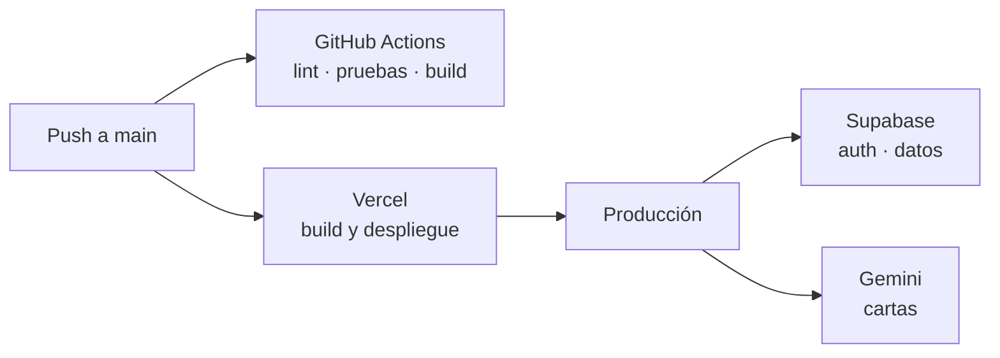

# 05 · Despliegue y verificación

## 1. Preparación del entorno

### Servicios

| Servicio | Uso |
|----------|-----|
| **GitHub** ([Ju4mpizel/dev-idea](https://github.com/Ju4mpizel/dev-idea)) | Repositorio y GitHub Actions (CI) |
| **Vercel** ([dev-idea-eight.vercel.app](https://dev-idea-eight.vercel.app)) | Hosting de la aplicación Next.js, despliegue automático desde `main` |
| **Supabase** | Autenticación con Google, base de datos PostgreSQL con RLS y funciones SQL |
| **Google Cloud (Vertex AI)** | Modelos Gemini para generar las cartas |

### Variables de entorno (Vercel → Settings → Environment Variables)

| Variable | Ámbito | Descripción |
|----------|--------|-------------|
| `GEMINI_API_KEY` | Servidor | Clave de Google Cloud con acceso a Gemini |
| `GOOGLE_CLOUD_PROJECT` | Servidor | Proyecto de Google Cloud |
| `NEXT_PUBLIC_SUPABASE_URL` | Público | URL del proyecto de Supabase |
| `NEXT_PUBLIC_SUPABASE_ANON_KEY` | Público | Clave anónima de Supabase (protegida por RLS) |
| `DEV_TOOLS_EMAILS` | Servidor | Cuentas sin límite de ideas y con herramientas de desarrollo |
| `NEXT_PUBLIC_SITE_URL` | Público, opcional | Dominio propio; si no existe se usa el de Vercel |

### Base de datos (Supabase)

1. Ejecutar `supabase/schema.sql` en un proyecto nuevo, o las migraciones de `supabase/migrations/` en orden en uno existente (todas son idempotentes).
2. Activar el proveedor **Google** en *Authentication → Providers*.
3. En *Authentication → URL Configuration*, agregar la URL de producción de Vercel en **Site URL** y en **Redirect URLs**.

## 2. Despliegue de la aplicación web

1. El repositorio está conectado a Vercel: cada push a `main` genera un despliegue de producción y cada pull request, uno de vista previa.
2. En paralelo, GitHub Actions corre lint, las 125 pruebas con cobertura y el build. Si algo falla, el commit queda marcado en rojo en GitHub.
3. Vercel compila con `next build` (Next.js 16) y publica las rutas estáticas y las funciones de la API.

## 3. Verificación del sistema desplegado

| # | Verificación | Cómo | Resultado esperado | Estado |
|---|--------------|------|--------------------|:------:|
| V-01 | El sitio responde | Abrir la URL de producción | Landing en menos de 3 s | ✅ Aprobado |
| V-02 | HTTPS activo | Revisar el candado del navegador | Certificado válido de Vercel | ✅ Aprobado |
| V-03 | Login con Google | Iniciar sesión | Vuelve al sitio con la sesión iniciada | ✅ Aprobado |
| V-04 | Generación con IA | Comenzar una idea y llegar a Requisitos | Cartas generadas sin error | ✅ Aprobado |
| V-05 | Guardado en la nube | Recargar a mitad del recorrido | El mapa se conserva | ✅ Aprobado |
| V-06 | API protegida | Abrir `/api/projects` sin sesión | 401 No autorizado | ✅ Aprobado |
| V-07 | 404 propia | Abrir una ruta inexistente | Página "Esta estación no existe" | ✅ Aprobado |
| V-08 | Metadatos para compartir | Pegar la URL en WhatsApp o en [opengraph.xyz](https://www.opengraph.xyz) | Título, descripción e imagen de Dev.Idea | ✅ Aprobado |
| V-09 | `robots.txt` y `sitemap.xml` | Abrir `/robots.txt` y `/sitemap.xml` | Responden con el dominio de producción | ✅ Aprobado |
| V-10 | Lighthouse | DevTools → Lighthouse | Rendimiento 91 · Accesibilidad 91 · Buenas prácticas 100 · SEO 100 | ✅ Aprobado |

**Resultado: 10 de 10 verificaciones aprobadas en producción.**
